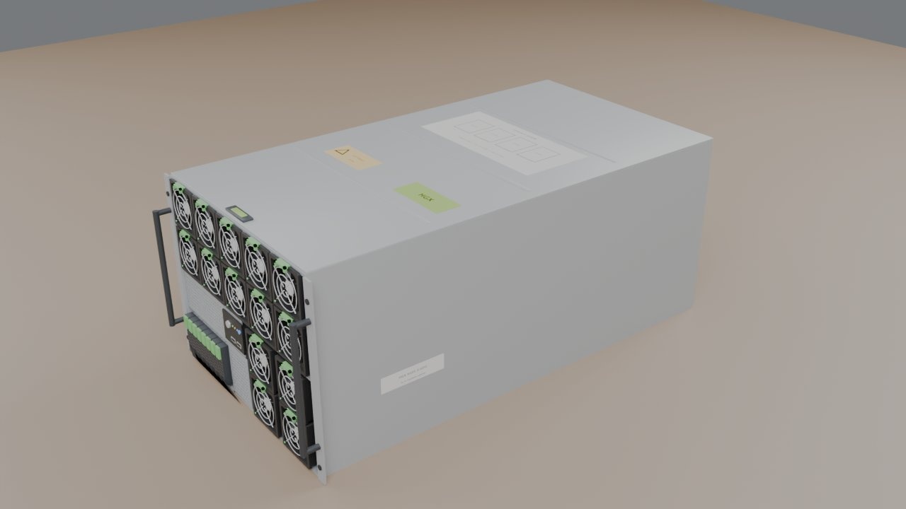
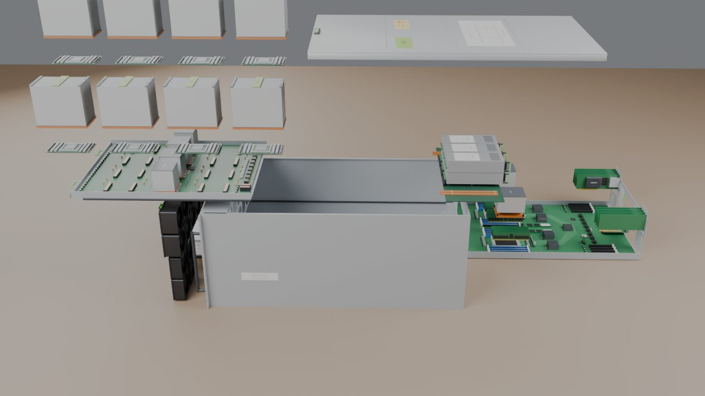
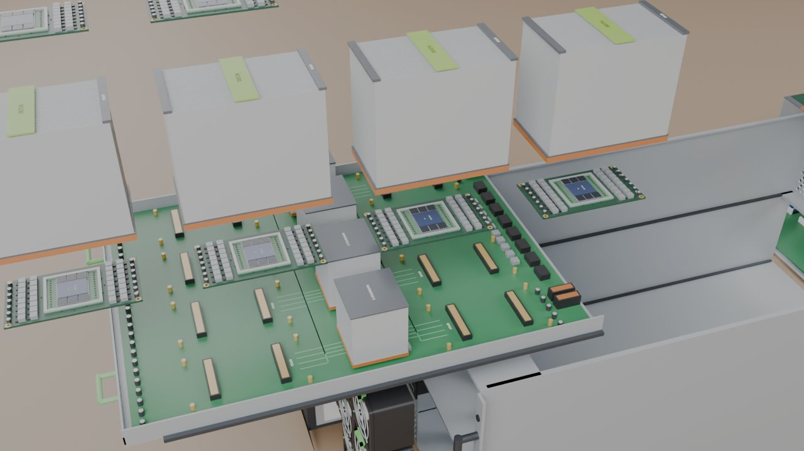
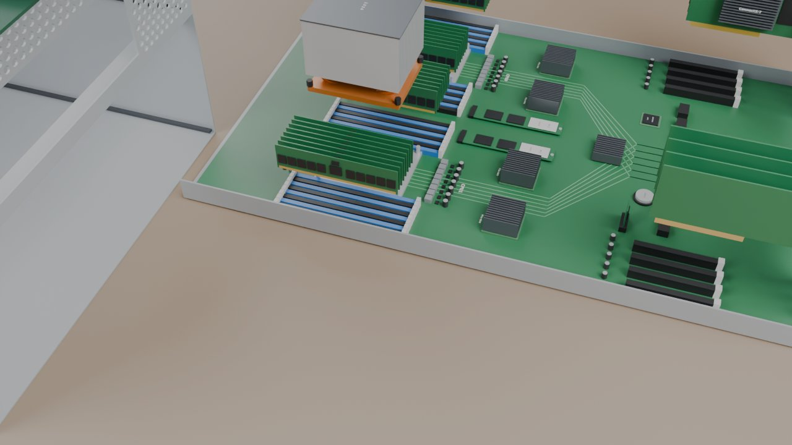

# AI 服务器爆炸图（Blender 脚本建模 + 原理爆炸图）

一台 8U 风冷 AI 训练服务器：8 块 SXM5 GPU（H100 级）+ 4 颗 NVSwitch 装在上层 GPU 托盘里，双路 CPU + 32 根 DDR5 + 8 张 400G 网卡装在下层主板托盘里，前面是风扇墙和 NVMe 硬盘，后上方是 6 个 3000 W 电源。用 `build_ai_server.py` 在 Blender 里全部用代码生成。建模时拆得很细（芯片、HBM、供电、散热器……共 180 个零件），导出前按"一块 GPU"这一级合并成 **32 个部件**：每块 GPU 是一个、它的散热器另算一个，CPU 连散热器是一个，内存一排 8 根是一个……
没有图纸，整体布局参考 NVIDIA DGX H100 / HGX H100 8-GPU 这一类服务器的公开图片（GPU 托盘从前面抽、主板托盘从后面抽），尺寸按 19 英寸机架、8U 高估的，内部细节是简化示意。
每个零件的信息牌写的是**它在整台机器里干什么**（为什么要 HBM、NVSwitch 干什么、网卡为什么每块 GPU 配一张……）。同一份模型导进了虚幻工程 MyVRToyBox，在 VR 里可以拆开、一个个部件拿起来看。

| 装配 | 爆炸 |
|---|---|
|  |  |
|  |  |

## 用法

双击 `启动.bat`，它会依次：

1. `git pull --ff-only origin main` 检查更新（没网或没装 git 就跳过）
2. 找 Blender（`blender_path.txt` → PATH → `Program Files\Blender Foundation\Blender*` → Steam）
3. 后台运行 `build_ai_server.py`，十几秒生成 `output\ai_server.blend` 和 `output\ai_server.glb`
4. 让你选：**[1]** 用 Blender 打开（按空格播放爆炸动画）/ **[2]** 用 Cycles 渲染 4 张预览图 / **[3]** 退出

找不到 Blender 时，把 `blender.exe` 的完整路径写进同目录的 `blender_path.txt`（这个文件不会提交到 git）。支持 Blender 4.2 ~ 5.x（在 5.2 上跑过）。

| 输出（`output\`） | 用途 |
|---|---|
| `ai_server.blend` | Blender 工程。第 1~120 帧按拆机顺序拆开，第 150~270 帧反顺序装回 |
| `ai_server.glb` | glTF 模型，单位米，每个部件一个节点（`P11_GPU_3` …），extras 里有零件号、中文名、材料、作用、爆炸路线。MyVRToyBox 的 `导入AI服务器模型.bat` 用它 |
| `parts.json` | 部件表（32 个部件） |

## 部件（32 个）

| 部件 | 个数 | 合并了哪些细零件 |
|---|---|---|
| 机箱（基座，不动） | 1 | 机箱、前控制面板 |
| 顶盖 | 1 | |
| GPU 区风扇墙 | 1 | 10 个 80 mm 对旋风扇 |
| CPU 区风扇 | 1 | 4 个 80 mm 风扇 |
| NVMe 硬盘组 | 1 | 8 块 U.2 硬盘 + 背板 |
| 电源组 | 1 | 6 个 3000 W 电源 + 配电板（含铜排） |
| GPU 托盘 | 1 | 托盘、HGX 基板、4 颗 NVSwitch + 散热器 |
| **GPU 模组** | **8** | 每块：SXM5 载板、GPU 芯片（含硅中介层）、6 颗 HBM3、供电模块 |
| GPU 散热器 | 8 | 铜底均热板 + 热管 + 鳍片，每块 GPU 一个 |
| 主板托盘 | 1 | 托盘、主板、4 颗 PCIe 交换芯片、PCH、BMC、TPM、CMOS 电池、OCP 网卡、2 块 M.2 |
| CPU（连散热器） | 2 | CPU + 热管散热器 |
| DDR5 内存（一排 8 根） | 4 | 32 根 |
| 400G 网卡（4 张一组） | 2 | 8 张 ConnectX-7 |

细零件的几何都还在（GPU 上的芯片、HBM 和供电都看得到），只是不再单独拆开。想拆得更细，把 `merge_units()` 那一行注释掉就回到 180 个零件。

## 拆机顺序和爆炸后的摆法

服务器平放，前面板朝左（在虚幻里也是这样摆：前面朝左手边、后面朝右手边、侧面朝着玩家）。顺序和真机维修差不多：

| 顺序 | 动作 | 爆炸后在哪 |
|---|---|---|
| 1 | 掀顶盖 | 往上再往后，停在电源组上方 |
| 2 | 拔前面的风扇墙、CPU 区风扇、硬盘组 | 往前（左）拔出一截 |
| 3 | 电源组从后面拔出，再往上抬 | 机箱后上方 |
| 4 | GPU 托盘先抬高、再整个往前抽出；8 块 GPU 再往上提、排成"两层看台"，每块的散热器浮在自己的 GPU 上方 8 cm | 桌子左边、托盘上方；每层 4 块从左到右一字排开（间隔约 5 cm），靠你那层低、后面那层高 24 cm，站着从散热器下面的缝里能看到 8 颗芯片和 HBM |
| 5 | 主板托盘从后面整个抽出，再往远处让 32 cm | 桌子右边；2 个 CPU、4 排内存、2 组网卡往上浮 |

主板托盘抽出来以后"往远处让"，是为了不碰到虚幻工作室右手边的触屏。

8 块 GPU 原本在基板上是 4 × 2 排的，4 块那一排正好顺着玩家视线方向，第一版只是把它们往上提再拉开，结果从玩家的位置看过去 4 块前后重叠，还是像两大块。现在改成横过来的两层：先往上提（近层一整摞 = GPU 10 mm + 散热器浮起 80 mm + 散热器 144 mm，远层的底比它再高 10 mm），再沿服务器长度方向分成 4 列（列距 205 mm，比散热器长 158 mm 多），最后归到前后两层。三段错开走，路上互不穿插（按虚幻里同样的缓动逐帧算过，路上没有部件相撞）。顶盖往后多让 5 cm，给远层的散热器让位。

## 原理速记

- **GPU 负责算，CPU 负责打杂**：神经网络训练 90% 以上的计算是矩阵乘法，交给 GPU 里的 Tensor Core；CPU 负责读数据、预处理、调度、管网络。
- **HBM 为什么贴在芯片旁边**：大模型训练经常卡在"数据搬不过来"。HBM 把 8 层 DRAM 叠起来用硅通孔打通，放在硅中介层上紧挨着 GPU 芯片，每颗位宽 1024 位，合计带宽 3.35 TB/s。
- **NVLink + NVSwitch**：8 块 GPU 每块拉 18 条 NVLink 到 4 颗 NVSwitch，任意两块之间 900 GB/s，8 块卡用起来像一块大 GPU（同步梯度靠它）。基板上浅绿色的线是按这个拓扑画的示意，不是真实布线。
- **一块 GPU 一张网卡**：几十上百台机器一起训练时，每一步都要交换梯度。网卡用 RDMA 直接读写对方 GPU 显存（GPUDirect RDMA），PCIe 交换芯片让网卡和 GPU 之间的数据不用绕到 CPU。
- **供电**：整机满载约 10 kW。6 个电源 4+2 冗余，经配电板和铜排送到 GPU 基板；每块 GPU 的供电模块再把 54 V / 12 V 降到 1 V 左右、700 A 以上。
- **散热**：每块 GPU 700 W。铜底均热板把热量摊开，热管送到鳍片，前面 10 个对旋风扇把风压过鳍片，后面网孔出风。顶盖必须盖着，不然风会从上面漏掉。
- **服务器特有的东西**：ECC 内存（自动纠正位翻转）、BMC（主机关机也能远程管理）、热插拔风扇 / 电源 / 硬盘（绿色把手，带电更换）、TPM（安全启动）。

## 建模说明

- 坐标：+Z 向上，-Y 是前面板（风扇、硬盘），+Y 是后面（电源、网卡口），X 左右；Z = 0 是机箱底面，顶盖上表面 Z = 355.6（8U）。零件直接按装配位置建模，物体原点都在世界原点。
- 爆炸公式和电机、车床、万用表一样：每个零件有几段位移，每段有一个出场时刻 s，在总进度 T 的 `[0.6s, 0.6s + 0.4]` 区间里缓动走完；装回时 T 倒着走。托盘上的零件路线 = 托盘的两段（抬高 / 抽出）+ 自己的一段。
- 合并：`merge_units()` 用 Blender 的 Join 把同一部件的细零件合成一个物体，每个部件一个节点、一条爆炸路线、一块信息牌（`UNIT_INFO`）。虚幻导入后 32 个抓取单元（机箱是基座，31 个能抓）。
- 材质金属度都压在 0.55 以下（虚幻工作室里没有反射探针，金属度高的会发黑）。
- 简化了的地方：芯片引脚、PCB 走线、电容位置都是示意；散热片鳍片比实物稀；线缆（MCIO、电源线）没画；风扇是两个 7 叶转子的示意。
- 在虚幻里按最长边缩放到 **55 cm**（实物约 91 cm 含把手，0.6 倍）。1:1 放不下：装配状态 91 × 48 × 36 cm 还能放上 160 × 70 cm 的桌子，但拆开后左右要摊开 2 米多、GPU 会升到桌面上方 80 多厘米。
- CPU 和内存条都是实物尺寸、同一个缩放：CPU 封装 77.5 × 56.5 mm（LGA4677），内存条 133.35 × 31.25 mm（JEDEC 标准），所以内存条本来就比 CPU 长 1.7 倍。
