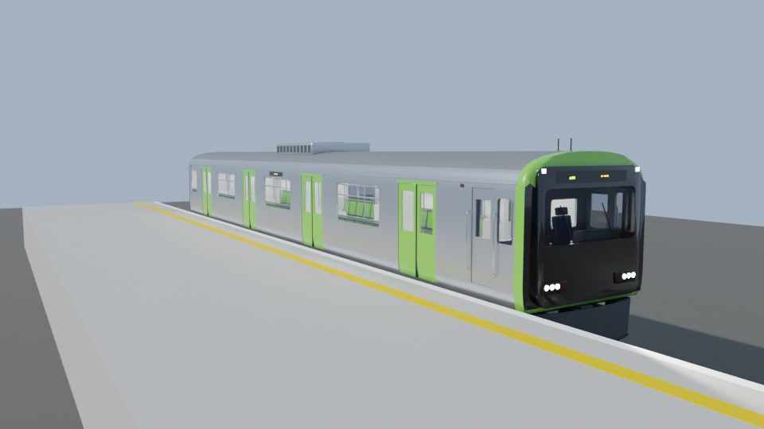
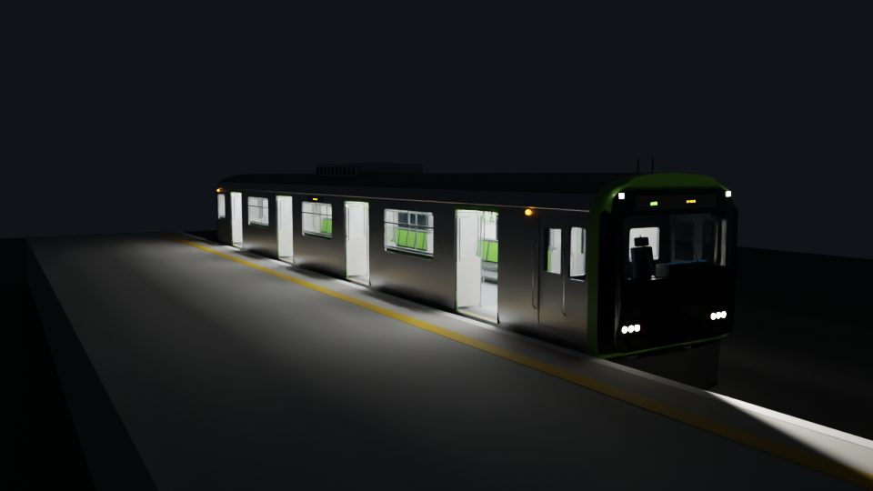
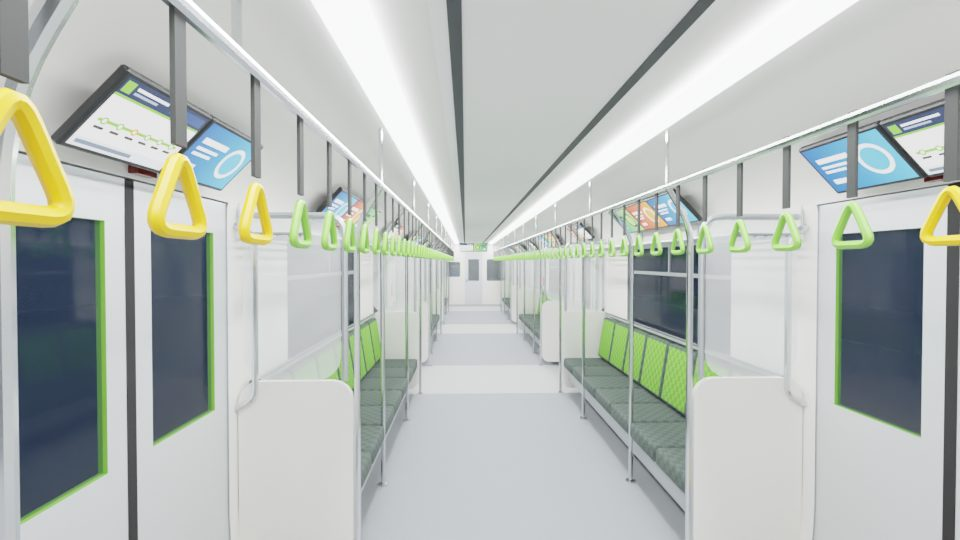
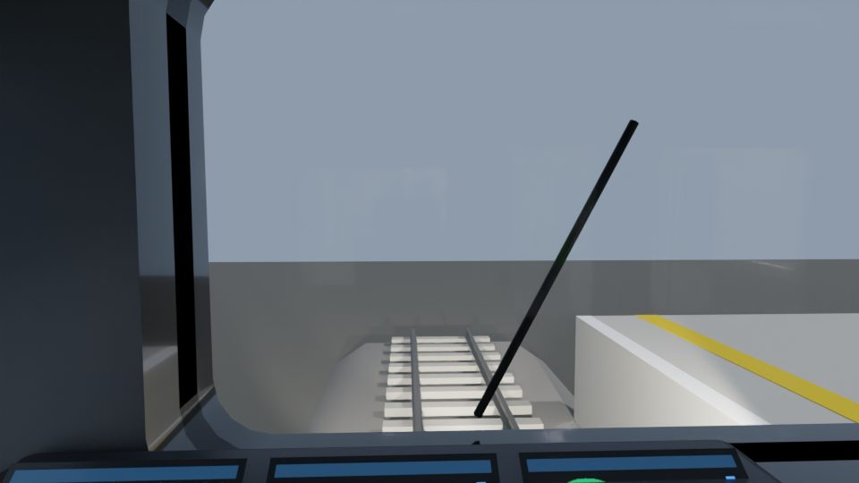
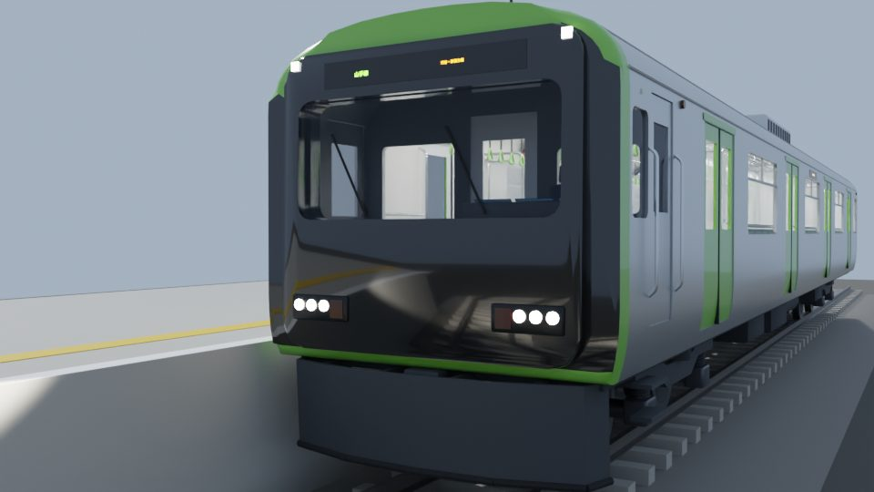
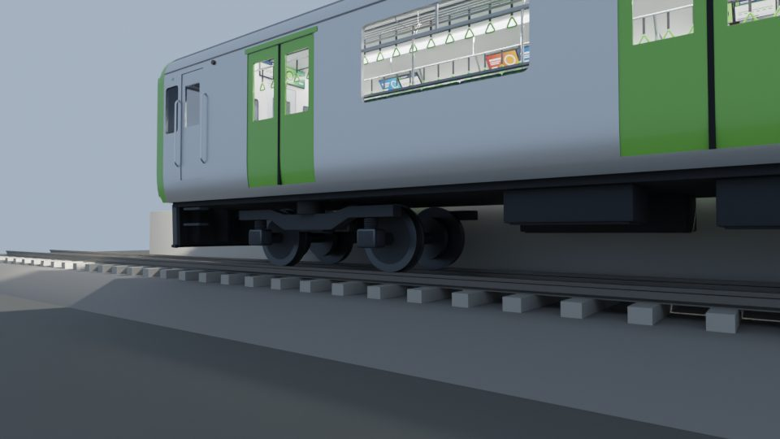

# E235 系电车模型（Blender 脚本建模）

山手线 E235 系的先头车 クハE235，按真车尺寸 1:1 用 `build_train.py` 在 Blender 里代码生成。
参考对象是孩子的 Plarail 山手线玩具，但做的是真车：车体是宽车体轮廓、门窗按真实间距开、车内按公开资料布置。

- **网页版（手机可看）**：<https://claude.ai/artifact/53Swfi4kQ8JQvTudHe9aWy>（默认只有自己能打开，要给别人看需在页面的 Share 里开启分享）
- **离线版**：运行一次 `启动.bat` 后，`output\` 里会有 `E235电车_离线版.html`，双击即可，不用联网

| 外观（白天） | 夜间开门 |
|---|---|
|  |  |
| **车内** | **驾驶室** |
|  |  |
| **车头** | **转向架** |
|  |  |

## 用法

双击 `启动.bat`，它会依次：

1. `git pull --ff-only origin main` 检查更新（没网或没装 git 就跳过）
2. 找 Blender（`blender_path.txt` → PATH → `Program Files\Blender Foundation\Blender*` → Steam）
3. 问要不要顺便用 Cycles 渲染预览图（默认 10 秒后选“不要”）
4. 后台运行 `build_train.py`，在 `output\` 生成文件（几秒钟）
5. 让你选：打开网页 / 打开 Blender / 都打开

找不到 Blender 时，把 `blender.exe` 的完整路径写进同目录的 `blender_path.txt`（这个文件不会提交到 git）。

### 输出文件（`output\`）

| 文件 | 用途 |
|---|---|
| `train.blend` | Blender 工程。用 bat 打开时会自动加载 `train_ui.py`，右侧 N 面板多一个「电车」页 |
| `train.glb` | glTF 模型，单位米。门扇单独命名（`Door_R1_a` …），extras 里带开门方向和行程 |
| `E235电车_离线版.html` | 离线网页，模型直接嵌在文件里（约 7 MB） |
| `render_*.png` | 只有选了渲染才会有 |

## Blender 里怎么操作

N 面板 →「电车」：

- **车门**：开门 / 关门（1.5 秒动画），或直接拖「开度」滑杆；选右侧（站台）/ 左侧 / 两侧
- **灯光**：车内灯、前照灯↔尾灯、白天↔夜晚
- **视角**：外观、侧面、车头、车内、驾驶室、转向架 6 台相机

视图默认是「渲染」着色（EEVEE），灯光效果直接能看到。想出高质量图就 F12（引擎可切 Cycles）。

不用面板也行：选中 `Train_Controls` 空物体，在「物体属性 → 自定义属性」里改 `door_open`、`lights`、`night` 等数值。

### 原理：为什么一个数值能同时开 16 扇门、亮一车灯

每扇门的 X 位置、每个发光材质的强度、每盏灯的功率上都挂了一个**驱动器**（driver），读的是 `Train_Controls` 上的同一组属性。例如右侧 3 号门靠车头那扇（驱动器里写成 `2.7200+0.6400*o*s`）：

```
x = 2.72 + 0.64 × door_open × door_right
```

改 `door_open` 一个数，所有门扇按各自的公式跟着动。驱动器只用了加减乘和 `min()` 这类“简单表达式”，Blender 会直接计算，**不需要开“允许自动运行 Python”**。

失效条件：驱动器不会导出到 glTF。所以 `train.glb` 里的门是关着的，网页和虚幻需要自己按 extras 里的 `base_x / open_dir / travel` 重新做动画（网页版就是这么做的）。

### 原理：门扇为什么不会穿模

E235 的客室门是**内藏式滑门**：门扇滑进车体侧墙的夹层（戸袋）里。模型里侧墙是 5 cm 厚的实体，门扇放在外皮往里 1.2~4.2 cm 的位置，正好在墙的夹层里。所以门开到底时门扇被墙“吃掉”看不见。也因此门旁边的窗户必须离门边至少 0.65 m（门扇的行程），否则开门时门扇会出现在窗玻璃后面——真车也是同样的约束。

## 网页的四个视角

- **外观**：拖动旋转、缩放；开门时站台上能看到门口洒出来的光（夜间更明显）
- **剖视**：把车顶切掉从上往下看，座位 2+3+2 的分隔立柱、吊环横杆、行李架都能看清
- **车内**：第一人称，WASD/方向键或左下摇杆走动；门开着时可以走出车门到站台上
- **驾驶室**：坐在司机座上看前方和驾驶台

门上方的液晶屏会跟着开关门变化：关着时显示「次は 渋谷」，开门显示「ただいま 渋谷」，关好门（=发车）后跳到下一站「原宿」。

## 模型里有什么、数据从哪来

| 部分 | 内容 | 依据 |
|---|---|---|
| 车体 | 宽车体轮廓（最宽 2.95 m，下部内收）、不锈钢、绿色车头包边 | 宽度是常规值；造型照着玩具和照片 |
| 车门 | 每侧 4 对，开口 1.30 m，门距 4.82 m | JR 东日本 20 m 车通用尺寸（**没找到 E235 专门的数字**） |
| 座椅 | 长条座椅，每人 46 cm；中间 7 人座、车尾 3 人优先座 | 46 cm（比 E231 宽 1 cm）是**公开资料** |
| 座椅花纹 | 靠背山手线绿格子花纹，吊环绿色 | **公开资料**（格子花纹、绿色靠背和吊环） |
| 吊环/行李架 | 比旧车低 5 cm | **公开资料** |
| 液晶屏 | 门间行李架上方每段 3 块 21.5 英寸；门上方 2 块；两端墙上方 | 3 块 21.5 英寸是**公开资料**，门上方数量是**推测** |
| 自由空间 | 车头侧门后面，靠背垫 + 扶手 | 每节车都有自由空间是**公开资料**，位置是**推测** |
| 优先座颜色 | 蓝色格子 | **推测** |
| 灯具 | 前照灯每侧 3 颗 LED + 尾灯条 + 上角标识灯；门上红色开闭灯；车侧橙色车侧灯 | 位置和形状是**推测** |
| 驾驶室 | 驾驶台、3 块显示屏、单手柄主控制器、司机座、隔墙门窗 | 大致布局；细节是**简化** |
| 转向架 | 拖车转向架：车轮 Φ860、轴距 2.1 m、车轴盘式制动、轴簧、空气弹簧 | 常规值 + **简化** |
| 场景 | 一段轨道（1067 mm 轨距）和右侧站台 | — |

公开资料来源：[旅行総合研究所タビリス：E235系の中吊り広告](https://tabiris.com/?p=8202)、[乗りものニュース：E235系1000番台](https://trafficnews.jp/post/128010)、[トレたび：E235系 山手線](https://www.toretabi.jp/railway_info/entry-4880.html)、[E235 series (Wikipedia)](https://en.wikipedia.org/wiki/E235_series)、[JR東日本 2018 年新闻稿（横須賀・総武快速線 E235）](https://www.jreast.co.jp/press/2018/20180902.pdf)。

## 和真车的差别（有意简化）

- 车长按先头车约 20.4 m 估计，转向架中心距、设备箱位置都是示意
- 车体是一整块挤出轮廓，没有做车体接缝、铆钉、车号、各种标识贴纸
- 门窗玻璃是平面，没有做窗帘
- 车内没做中吊广告。E235 最初的构想是用液晶屏取代中吊，但营业时决定中吊和液晶屏并用，所以真车上有中吊框
- 只做了一节车；没有受电弓（先头车 クハ 本来就没有）

## 改参数

尺寸都在 `build_train.py` 开头（单位 m）：地板高 `FLOOR`、门中心 `DOORS`、开口宽 `DOOR_W`、窗高 `WIN_Z0/WIN_Z1`、座位宽 `SEAT_W`、吊环高 `STRAP_Z`、车体轮廓 `OUT_HALF` 等。

## 导入虚幻 5

**文件 → 导入到关卡**，选 `train.glb`。单位是米，UE 会自动换成厘米。门扇是独立的 Actor，沿车长方向（UE 的 X 轴）平移 0.64 m（64 cm）就是开门；方向看 extras 里的 `open_dir`。

## 文件

| 文件 | 说明 |
|---|---|
| `启动.bat` | 一键启动（ASCII、CRLF） |
| `build_train.py` | Blender 建模脚本（bmesh 建模，开门窗用布尔在内存里应用） |
| `train_ui.py` | Blender 里的「电车」面板 |
| `viewer_src.html` | 网页源码（three.js 从 CDN 加载，用于发布网页版；改网页从这里改） |
| `viewer_template.html` | 离线网页模板（three.js r170 已打包在内，建模脚本把 glb 填进去） |
| `tools/make_template.mjs` | 把 `viewer_src.html` 打包成 `viewer_template.html`，只有改了网页才需要跑（要 Node） |

兼容：在 Blender 5.2 上测试通过；脚本对 4.x 写了兼容分支（材质接口名、平滑着色），但没有在这些版本上实测。
