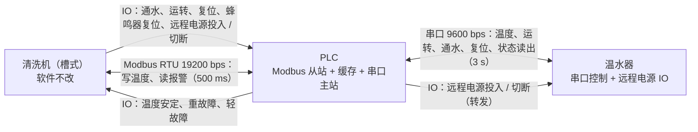
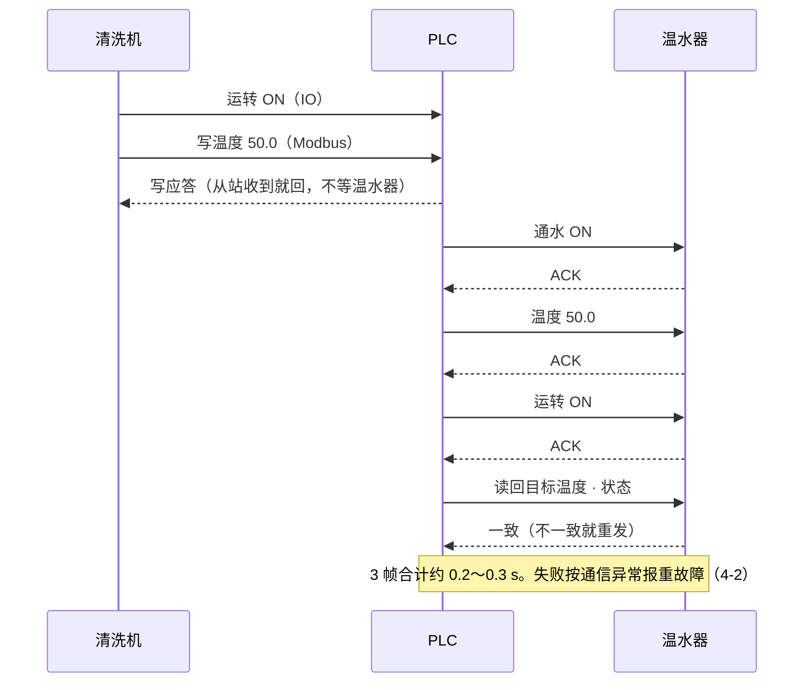
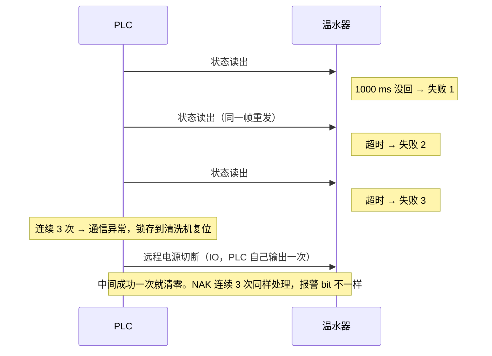

# 清洗机 ↔ PLC ↔ 温水器：信号时序图

槽式清洗机要接一台只用串口控制的温水器。清洗机软件一行不改，中间放 PLC：
对清洗机，PLC 装成原来那台「IO + Modbus」的温水器；对温水器，PLC 用厂家串口协议当主站。

清洗机、温水器、协议都是**假想的**：它们怎么动，是 Claude 按常见的工控 / 串口通信架构推理出来的，用户负责确认（点头）。

**图都在 [out/图一览.md](out/图一览.md)**，draw.io 版是 [out/时序图.drawio](out/时序图.drawio)（一张图一页），另有日语版 [out/时序图_ja.drawio](out/时序图_ja.drawio)、英语版 [out/时序图_en.drawio](out/时序图_en.drawio)。本页是分块、来源规则、帧级细节和待确认事项。

新对话接手先看第 0 节。

> 公开仓库：只有功能名和时序。型号、寄存器地址、命令码都是虚构的或者不写。

## 0. 交接（新对话从这里开始）

**这是什么**：槽式清洗机（软件不能改）要接一台只用串口控制的温水器。中间放一台三菱 PLC 当网关：
对清洗机装成原来那台「IO + Modbus」温水器（Modbus 从站），对温水器用厂家串口协议当主站。
这个文件夹是这套网关的信号时序图（9 张，分启动 / 供水 / 轮询 / 报警 4 块）和设计决定。

**现在的状态**（2026-11）：图和设计决定齐了，剩第 5 节「还没定的」几条。
第 5 节的「已经定下来的」是用户点过头的，改之前先问。

**内容从哪来**：清洗机和温水器怎么动，是 Claude 按常见做法推理的（槽式清洗机的 IO 习惯、温水器常见的串口协议、
Modbus RTU 的标准行为、三菱 PLC 的 Modbus 从站功能），用户看过点头。
数字（超时、重试次数、30 s、帧长度）都是假设值。

**怎么继续**：改 `charts.py` → 双击 `render_charts.bat`。出图时会自动检查时序对位（第 3 节最后），
出完 SVG、drawio（中 / 日 / 英）、`out/图一览.md` 一起更新。改了 `charts.py` 里的文字，要在 `i18n.py` 补日语和英语（出图时会列出「缺翻译」，见第 6 节）。`../v2/` 的模拟器还是旧逻辑，没跟这套图同步。

**网页版模拟器**：`../web/`（双击 `../run_web.bat`）按本页第 3～5 节的做法实际跑，时序图是跑出来的、参数可调。改了本页的设计决定，记得同步 `../web/core.js`。

## 1. 来源标记

每个信号的备考里都标了这一条是怎么来的：

| 标记 | 意思 | 范围 |
|---|---|---|
| 【推】 | Claude 按通用架构推理 | 清洗机、温水器怎么动；串口 / Modbus 的参数和时序 |
| 【IO】 | 假想的 IO 分配 | PLC 接哪些 IO、两个 485 口各接谁 |
| 【P】 | PLC 本方案 | PLC 怎么做（是提案） |
| 【未】 | 还没定 | 推测的做法，用户还没点头 |
| 【定】 | 用户已确认 | 原来是推测、后来用户点头的 |

## 2. 接线和信号

## 3. 分块和画法

| 部分 | 图 | 这张图回答 |
|---|---|---|
| 1 启动 / 结束 | 1-1 装置启动 → 等 30 s → 两边初始化 | 温水器上电 30 s 不能通信，清洗机的初始化怎么过；PLC 什么时候开始通信 |
| | 1-2 装置结束 | 温水器被直接断电时，PLC 怎么不把它当成断线 |
| 2 供水 | 2-1 手动 | 往温水器发什么、按什么顺序；安定 DO 什么时候变 |
| | 2-2 自动 | 清洗机等安定再投入，安定 DO 晚到会不会拖慢 |
| 3 轮询 | 3-1 两个轮询周期 | 清洗机 500 ms、PLC 3 s，中间怎么接；状态变了多久能看到 |
| 4 报警（两边断线都要复位） | 4-1 温水器报警 | 清洗机看到什么；复位的 5 s 里 PLC 要做完什么 |
| | 4-2 温水器侧断线 | 清洗机看到什么；PLC 怎么让温水器停；线修好以后怎么解除 |
| | 4-3 清洗机侧断线 | 谁让温水器停下来；线修好以后怎么解除 |
| | 4-4 PLC 自己断电 / 停止 | 清洗机和温水器各会怎样；PLC 重新起来以后怎么恢复 |

每张图都是表格风格：左边 区分 / 信号 / 备考，右边按阶段 ①②③… 分列。分区固定顺序：

清洗机内部（参考）→ **清洗机 → PLC** → 直连 → **PLC → 清洗机** → **PLC → 温水器** → **温水器 → PLC** → 温水器状态 → PLC 内部

- 和这张图无关的信号不画：轮询图不画报警，报警图不画每一次轮询
- 时序一样、只是原因不同的合成一张：4-1 里停止类和继续类报警，4-2 里超时和 NAK
- 色块：分区色 = 正常信号，红 = 报警 / 异常，绿 = 安定，斜线格 = 没应答，灰色虚线框 = 待确认
- 重故障 / 轻故障 DO 按逻辑画（红 = 报警）。实际是 **b 接点**：正常闭合、报警断开，PLC 断电时清洗机直接看到故障
- 阶段宽度不代表时间。请求和应答画在同一时刻（一问一答只要几十 ms，连发 3 帧合计 0.2～0.3 s）
- 没应答的请求：斜线格「无」紧跟在请求后面，表示等到超时；失败次数、判断、报警都画在这一刻（断线图 4-2、4-3、4-4）
- 「读回」= 目标温度 + 装置状态两帧，图上合成一格
- 出图时 `render.py` 自动检查对位，不过就在命令行列出来：
  - 串口（PLC↔温水器）、Modbus（清洗机↔PLC）各算一条线
  - 每个请求都要有同一时刻、同样宽的应答，或者紧跟在后面的「无」；每个应答都要找得到请求
  - 同一条线上的帧不能重叠（半双工，上一帧没完不能发下一帧）
  - 色块的起点（长条还有终点）要么压在阶段线上，要么离开 0.1 以上；差 0.03 这种「快压线又没压上」的一律报出来
  - drawio 写完以后再读回来，查色块位置和 `charts.py` 一致，再跑一遍上面的检查（日语版、英语版也一样查）
- 检查不了的是因果先后（比如 DO 要在读到状态那一刻变、温水器上电要在 PLC 转发那一刻），改图时自己对

## 4. 帧级细节（毫秒级）

### 供水时的 3 帧连发（2-1、2-2）

顺序已确认。停的时候：温度 25.0 → 运转 OFF → 通水 OFF。

### 超时 → 通信异常（4-2）

温水器串口（假设）【推】：

- 半双工、ASCII、加算校验和；出厂 9600 bps、8 位数据、无校验、1 位停止
- 温水器收到命令后 10 ms 以上才开始回；收到应答后要隔 50 ms 以上再发下一条；1 s 没应答算超时、重发
- 上电 30 s 以后才能通信
- ACK 只表示收到，执行结果要用确认命令读回核对

PLC 侧的设定【推】：超时 1000 ms、重试 3 次、帧间隔 50 ms、采样 3 s（常见的串口设定）。

清洗机侧 Modbus（PLC 要装成的那台温水器，假设）【推】【IO】：

- RTU（二进制）、CRC16；19200 bps、8 位数据、无校验、1 位停止
- 读保持寄存器 / 写单个 / 写多个 / 回环测试 4 种功能码。数据都是 16 位有符号，0.1 ℃ 单位
- 主站 1 s 收不到应答算超时、重发；温水器收到后 10 ms 以上才回；主站收到应答后隔 50 ms 以上再发
- 地址不对、写只读、超范围要回异常应答；站号不对、CRC 错不回
- 状态字和报警一览的内容和串口那边一样（同一套位、同一套报警编号），只是打包方式不同：串口按 4 bit 一组共 128 组，Modbus 按 16 bit 一个字共 32 个字
- PLC 用自带的 Modbus 从站功能：读写都直接对 PLC 内部寄存器，收到就回，不等温水器。所以读一律回缓存，写一律马上回、再由程序转发
- 设定温度的范围检查（25.0～85.0 ℃）从站功能不会做。已定不检查：清洗机只会写合法值

帧长度（9600 bps 下 1 字节约 1 ms）：写命令十来个字节，ACK 3 字节；装置状态读出的应答十几个字节；
报警详细读出的应答 130 多字节（约 0.15 s），所以只在状态里的错误位亮了才读。

## 5. 待确认

**推测了、还没定的**【未】：

1. 清洗机收到重故障后关运转 / 通水、写 25.0（4-1 4-2）
2. PLC 判清洗机断线的时间（暂定 5 s，4-3）

**本方案要定的**：

3. 复位的 5 s 窗口：PLC 收到复位要马上发复位 + 补一次状态读出，赶在复位 OFF 之前清掉 DO 和报警 bit（4-1～4-4）
4. 写完读回不一致：暂定重发，3 次还不对按通信异常处理（2-1）
5. PLC 和清洗机的上电顺序：故障 DO 是 b 接点，PLC 晚起来的话清洗机一开机就看到故障（1-1）
6. 轻故障温水器锁不锁存（4-1）

**早期草稿里改掉的做法**：

- 最早把每次 Modbus 读写都画成「收到 → 去问温水器 → 拿到再回」（透传）。PLC 自带的从站功能收到就回，做不了透传，所以按缓存做（现在的图就是这样）
- 报警一览的读出个数：串口那边 4 bit 一组共 128 组，Modbus 按字读是 32 个，不要混

**已经定下来的**：

- 复位走 IO。复位 → 错误复位 + 蜂鸣器复位；蜂鸣器复位 IO → 蜂鸣器复位
- 故障 DO 是 b 接点（逻辑 0 = 报警）；状态读出保持 3 s；没有急停
- 温水器上电 30 s 后才能通信。远程电源投入 / 切断经过 PLC 转发：PLC 转发投入时开始计 30 s，转发切断时当装置结束、停轮询（1-1 1-2）。通水和远程电源同时 ON / OFF
- 满 30 s 之前清洗机读报警回全 0；满 30 s 后读 3 次没应答才报通信异常
- 温水器不在串口模式 → 重故障
- 重故障 / 轻故障看温水器状态里的「停止错误 / 继续错误」位；报警 bit 按报警编号直接换算（两边编号相同）
- 「通水 ON + 运转 OFF」会流常温水，所以 3 帧按现在的顺序；运转中、停止中通水 OFF 无效【推】
- 自动模式等安定 ON 才投入；温水器侧 9600 bps，清洗机侧 19200 bps
- 清洗机写温度的应答由 PLC 从站马上回，不等温水器，所以清洗机的超时（1 s）不会被 3 帧拖到
- 温水器侧通信异常（超时 / NAK / 读回不一致各 3 次）：PLC 自己输出一次远程电源切断，温水器断电停下；等清洗机下次装置启动才重新上电（4-2）
- PLC 自己停：温水器停不下来，清洗机的远程电源切断也传不过去。写进风险评估（4-4）
- 清洗机写超范围温度：不检查，清洗机只会写合法值
- 漏液：PLC 不自己关，等清洗机看到重故障后自己停

## 6. 怎么改图

- 改 `charts.py`：每张图一个 dict，文件开头有写法说明（分区、色块、短帧、种类）
- 双击 `render_charts.bat`：先 `git pull` 检查更新，再出图到 `out/`，自动打开文件夹
- 要贴进 Excel / PPT：`render_charts.bat --png`
- 只出一张：`render_charts.bat 4-2`
- draw.io：打开 `out/时序图.drawio`。坐标和 SVG 相同，1 个阶段 = 100 px（0.01 阶段 = 1 px）。
  「表格」图层锁着，「信号」图层的色块可以拖；没应答画成红虚线框。drawio 是生成出来的，正式修改还是改 `charts.py`

### 日语版 / 英语版 drawio

- 每次出图都会一起生成 `out/时序图_ja.drawio`（日本語）和 `out/时序图_en.drawio`（English），色块位置和中文版完全一样，同样跑读回检查
- 文字全在 `i18n.py`：一行一条 `(中文原文, 日本語, English)`，中文原文要和 `charts.py` 里一字不差
- 改了 `charts.py` 的文字（标题、阶段、信号名、备考、色块字、注记），出图时命令行会列出「缺翻译」，
  同时写 `out/缺翻译.txt`（已经排好格式），填上日语和英语贴进 `i18n.py` 的 `ENTRIES` 再出一次图。补齐之前那几处先显示中文
- 版式：左边三列和行高按语言放宽（`export_drawio.py` 的 `LAYOUTS`），字号按格子自动缩；
  阶段名可以在翻译里用 `\n` 指定换行位置。字体：日语 Meiryo UI，英语 Segoe UI（Windows 自带）
- 来源标记：日语和中文一样【推】【IO】【P】【未】【定】；英语 [I] 推理 / [IO] / [P] 本方案 / [?] 还没定 / [OK] 用户已确认。
  英语里重故障 = Major fault、轻故障 = Minor fault、清洗机 = cleaner
