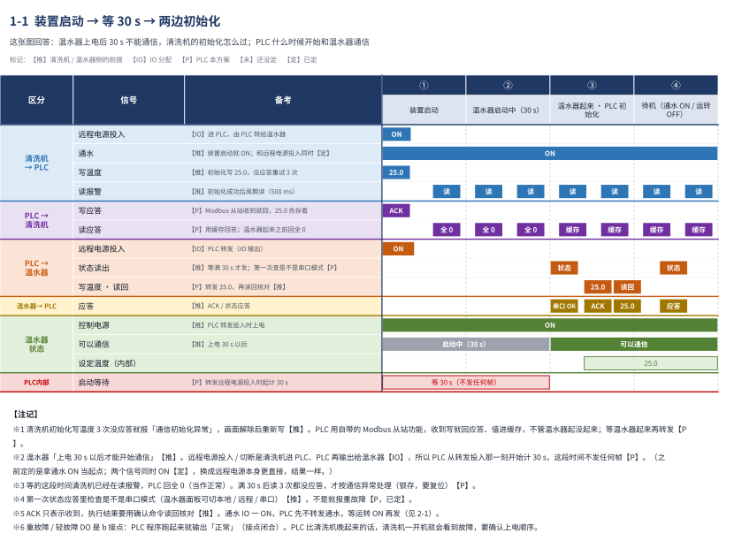
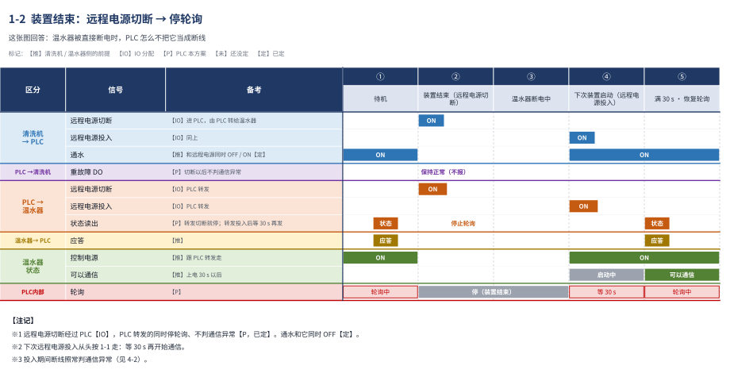
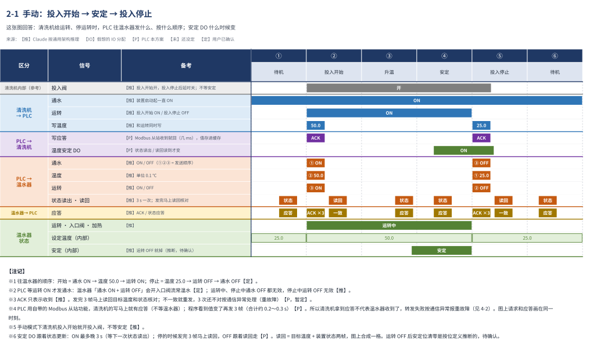
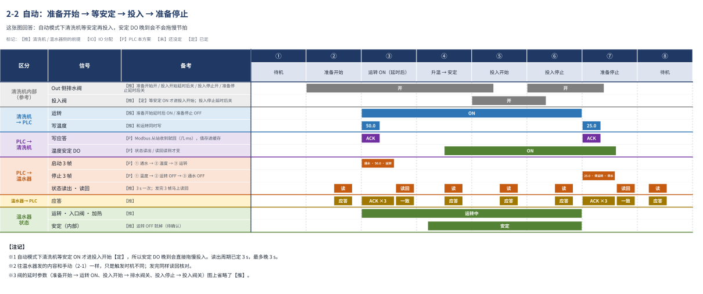
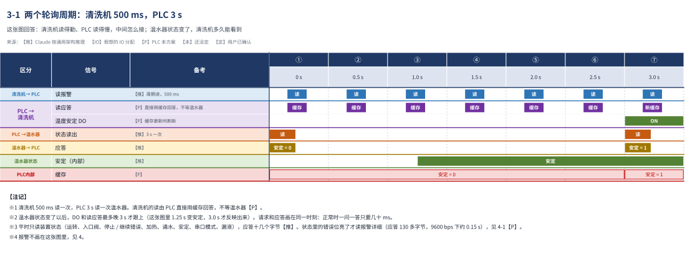
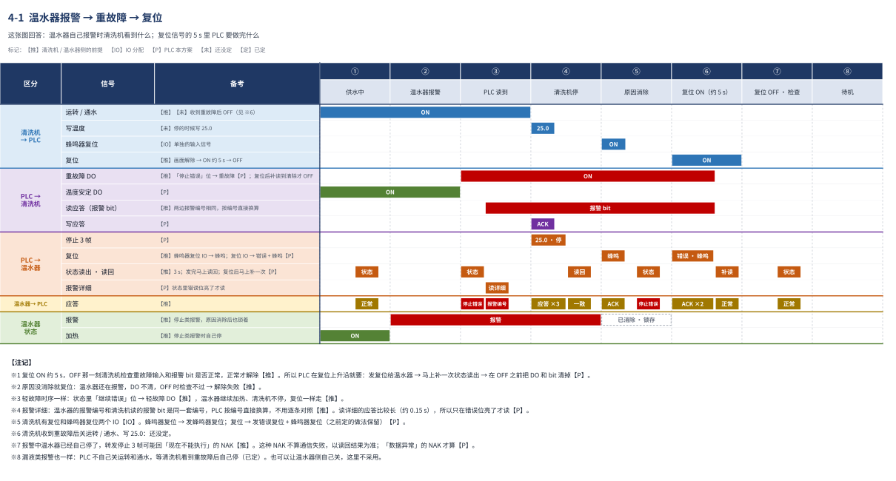
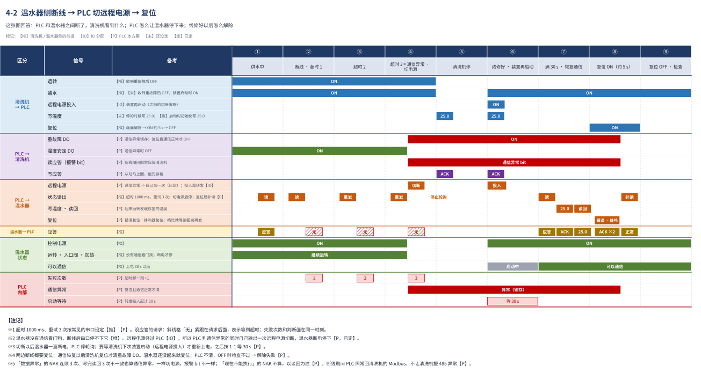
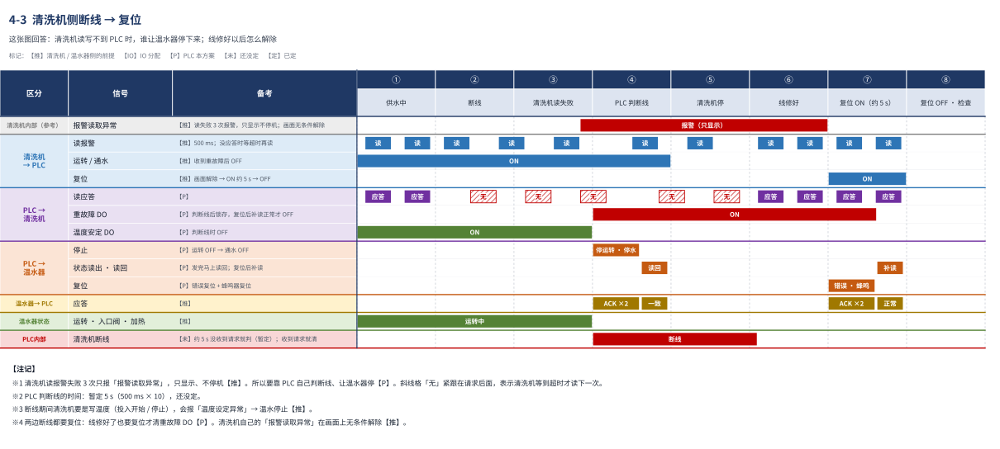
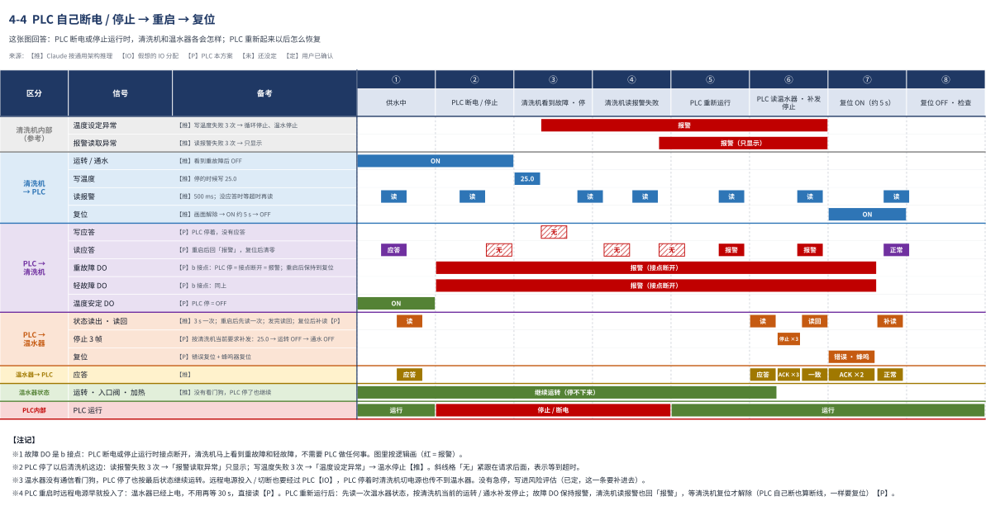

# 时序图一览

> 自动生成，别手改。改 `charts.py` 后双击 `render_charts.bat` 重新生成。

每张图左边是 区分 / 信号 / 备考，右边按阶段 ①②③… 分列。备考里的标记：【推】清洗机 / 温水器侧的前提、【IO】IO 分配、【P】PLC 本方案、【未】还没定、【定】已定。红色 = 报警 / 异常，斜线格 = 没应答，灰色虚线框 = 待确认。

请求和应答画在同一时刻（实际一问一答只要几十 ms）。没应答的请求：斜线格「无」紧跟在请求后面，表示等到超时（断线图 4-2、4-3、4-4）。出图时 `render.py` 会自动检查对位：串口、Modbus 各一条线，每个请求都要有同一时刻的应答或紧跟的「无」，同一条线上的帧不能重叠。

draw.io 版：[时序图.drawio](时序图.drawio)，一张图一页，坐标和 SVG 相同（1 阶段 = 100 px）。「表格」图层锁住，「信号」图层可以拖。drawio 里没应答画成红虚线框。

日语版 [时序图_ja.drawio](时序图_ja.drawio)、英语版 [时序图_en.drawio](时序图_en.drawio)：色块位置和中文版一样，文字查 `../i18n.py`，左边三列按语言放宽。

## 1 启动 / 结束

### 1-1 装置启动 → 等 30 s → 两边初始化

这张图回答：温水器上电后 30 s 不能通信，清洗机的初始化怎么过；PLC 什么时候开始和温水器通信

### 1-2 装置结束：远程电源切断 → 停轮询

这张图回答：温水器被直接断电时，PLC 怎么不把它当成断线

## 2 供水

### 2-1 手动：投入开始 → 安定 → 投入停止

这张图回答：清洗机给运转、停运转时，PLC 往温水器发什么、按什么顺序；安定 DO 什么时候变

### 2-2 自动：准备开始 → 等安定 → 投入 → 准备停止

这张图回答：自动模式下清洗机等安定再投入，安定 DO 晚到会不会拖慢节拍

## 3 轮询

### 3-1 两个轮询周期：清洗机 500 ms，PLC 3 s

这张图回答：清洗机读得勤、PLC 读得慢，中间怎么接；温水器状态变了，清洗机多久能看到

## 4 报警（两边断线都要复位）

### 4-1 温水器报警 → 重故障 → 复位

这张图回答：温水器自己报警时清洗机看到什么；复位信号的 5 s 里 PLC 要做完什么

### 4-2 温水器侧断线 → PLC 切远程电源 → 复位

这张图回答：PLC 和温水器之间断了，清洗机看到什么；PLC 怎么让温水器停下来；线修好以后怎么解除

### 4-3 清洗机侧断线 → 复位

这张图回答：清洗机读写不到 PLC 时，谁让温水器停下来；线修好以后怎么解除

### 4-4 PLC 自己断电 / 停止 → 重启 → 复位

这张图回答：PLC 断电或停止运行时，清洗机和温水器各会怎样；PLC 重新起来以后怎么恢复

## 信号 × 图

| 分区 · 信号 | 1-1 | 1-2 | 2-1 | 2-2 | 3-1 | 4-1 | 4-2 | 4-3 | 4-4 |
|---|:-:|:-:|:-:|:-:|:-:|:-:|:-:|:-:|:-:|
| 清洗机→ PLC · 远程电源投入 | ● | ● |  |  |  |  | ● |  |  |
| 清洗机→ PLC · 通水 | ● | ● | ● |  |  |  | ● |  |  |
| 清洗机→ PLC · 写温度 | ● |  | ● | ● |  | ● | ● |  | ● |
| 清洗机→ PLC · 读报警 | ● |  |  |  | ● |  |  | ● | ● |
| PLC →清洗机 · 写应答 | ● |  | ● | ● |  | ● | ● |  | ● |
| PLC →清洗机 · 读应答 | ● |  |  |  | ● |  |  | ● | ● |
| PLC →温水器 · 远程电源投入 | ● | ● |  |  |  |  |  |  |  |
| PLC →温水器 · 状态读出 | ● | ● |  |  | ● |  | ● |  |  |
| PLC →温水器 · 写温度 · 读回 | ● |  |  |  |  |  | ● |  |  |
| 温水器→ PLC · 应答 | ● | ● | ● | ● | ● | ● | ● | ● | ● |
| 温水器状态 · 控制电源 | ● | ● |  |  |  |  | ● |  |  |
| 温水器状态 · 可以通信 | ● | ● |  |  |  |  | ● |  |  |
| 温水器状态 · 设定温度（内部） | ● |  | ● |  |  |  |  |  |  |
| PLC内部 · 启动等待 | ● |  |  |  |  |  | ● |  |  |
| 清洗机→ PLC · 远程电源切断 |  | ● |  |  |  |  |  |  |  |
| PLC →清洗机 · 重故障 DO |  | ● |  |  |  | ● | ● | ● | ● |
| PLC →温水器 · 远程电源切断 |  | ● |  |  |  |  |  |  |  |
| PLC内部 · 轮询 |  | ● |  |  |  |  |  |  |  |
| 清洗机内部（参考） · 投入阀 |  |  | ● | ● |  |  |  |  |  |
| 清洗机→ PLC · 运转 |  |  | ● | ● |  |  | ● |  |  |
| PLC →清洗机 · 温度安定 DO |  |  | ● | ● | ● | ● | ● | ● | ● |
| PLC →温水器 · 通水 |  |  | ● |  |  |  |  |  |  |
| PLC →温水器 · 温度 |  |  | ● |  |  |  |  |  |  |
| PLC →温水器 · 运转 |  |  | ● |  |  |  |  |  |  |
| PLC →温水器 · 状态读出 · 读回 |  |  | ● | ● |  | ● |  | ● | ● |
| 温水器状态 · 运转 · 入口阀 · 加热 |  |  | ● | ● |  |  | ● | ● | ● |
| 温水器状态 · 安定（内部） |  |  | ● | ● | ● |  |  |  |  |
| 清洗机内部（参考） · Out 侧排水阀 |  |  |  | ● |  |  |  |  |  |
| PLC →温水器 · 启动 3 帧 |  |  |  | ● |  |  |  |  |  |
| PLC →温水器 · 停止 3 帧 |  |  |  | ● |  | ● |  |  | ● |
| PLC内部 · 缓存 |  |  |  |  | ● |  |  |  |  |
| 清洗机→ PLC · 运转 / 通水 |  |  |  |  |  | ● |  | ● | ● |
| 清洗机→ PLC · 蜂鸣器复位 |  |  |  |  |  | ● |  |  |  |
| 清洗机→ PLC · 复位 |  |  |  |  |  | ● | ● | ● | ● |
| PLC →清洗机 · 读应答（报警 bit） |  |  |  |  |  | ● | ● |  |  |
| PLC →温水器 · 复位 |  |  |  |  |  | ● | ● | ● | ● |
| PLC →温水器 · 报警详细 |  |  |  |  |  | ● |  |  |  |
| 温水器状态 · 报警 |  |  |  |  |  | ● |  |  |  |
| 温水器状态 · 加热 |  |  |  |  |  | ● |  |  |  |
| PLC →温水器 · 远程电源 |  |  |  |  |  |  | ● |  |  |
| PLC内部 · 失败次数 |  |  |  |  |  |  | ● |  |  |
| PLC内部 · 通信异常 |  |  |  |  |  |  | ● |  |  |
| 清洗机内部（参考） · 报警读取异常 |  |  |  |  |  |  |  | ● | ● |
| PLC →温水器 · 停止 |  |  |  |  |  |  |  | ● |  |
| PLC内部 · 清洗机断线 |  |  |  |  |  |  |  | ● |  |
| 清洗机内部（参考） · 温度设定异常 |  |  |  |  |  |  |  |  | ● |
| PLC →清洗机 · 轻故障 DO |  |  |  |  |  |  |  |  | ● |
| PLC内部 · PLC 运行 |  |  |  |  |  |  |  |  | ● |
