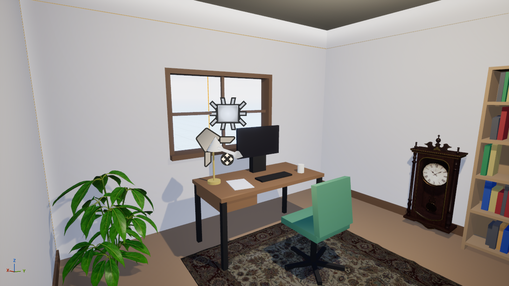

# UE 5.8 + MCP 接入 & VR 书房 (VRStudy)

通宵托管完成的实验：让 Claude 通过 **UE 5.8 官方 Unreal MCP 插件** 操作虚幻编辑器，并做一个小型 VR 书房场景（程序化建模 + Fab 素材软装）。



## 早上怎么看

1. 双击 `一键启动.bat`：git pull → 同步脚本到 `文档\UE-MCP-Tools` → 打开 VRStudy（默认关卡已改为 `L_Study` 书房）→ 等 MCP 就绪 → 在工程目录启动 `claude`。
2. 戴 Quest 3（Link / Air Link）→ UE 工具栏 ▶ 旁边的 ⋮ → **VR 预览**。手柄可以传送移动，书架旁的紫色积木可以抓起来。
3. 想重建场景：UE 底部控制台 (Cmd) 依次输入
   ```
   py "C:/Users/12192/Documents/UE-MCP-Tools/build_study.py"
   py "C:/Users/12192/Documents/UE-MCP-Tools/dress_fab.py"
   ```

## 文件

| 文件 | 作用 |
|---|---|
| `一键启动.bat` | 见上。已实测：检测 MCP 端口 → 在工程目录启动 Claude Code |
| `一键测试MCP.bat` + `test_mcp.ps1` | 不经过 AI，直接用 HTTP 测 MCP：initialize → tools/list → list_toolsets，写 `mcp_test_log.txt`。已实测 PASS |
| `prepare_level.py` | XR 模板关卡"另存为" `/Game/ClaudeVR/Maps/L_Study`，删模板演示几何体（保留 NavMesh / 出生点 / VR 观察者 / 天空） |
| `build_study.py` | 程序化建模：房间壳体 5×4×2.8m、东墙窗洞、书桌（显示器/键盘/台灯/杯子/纸）、转椅、书架 + 136 本书、落地灯、灯光、导航。可重复运行 |
| `dress_fab.py` | Fab 素材（OLD OFFICE Interior）软装：皮扶手椅、榕树、波斯地毯、落地座钟、地球仪、挂画（+ 补画布）。按包围盒自动贴地/贴墙 |
| `set_default_map.py` | 把编辑器/游戏默认关卡设为 L_Study |
| `shot.py` | 视口摆到预设机位 (eye/west/north/reading/desk/shelf) 并 HighResShot 截图，同时导出灯光参数 |
| `screenshots/` | 过程截图（编号即时间顺序） |
| `logs/` | MCP 接口测试日志、Claude Code 通过 MCP 做的 VR 尺度检查报告 |

## 架构：为什么这样连

```
云端 Claude (对话)  ──电脑控制(截图/点击/打字)──▶  UE 编辑器窗口
                                                  ├─ 底部控制台: py "xxx.py"  (建模脚本)
                                                  └─ 工具 > 终端 面板: 本机 claude (Claude Code)
                                                        └─ HTTP 127.0.0.1:8000/mcp ─▶ Unreal MCP 插件 ─▶ 编辑器 API
```

- Unreal MCP **只监听本机回环地址、没有鉴权**，云端连不上，所以 MCP 客户端必须是你电脑上的 Claude Code。
- 电脑控制对终端/资源管理器是"只能点不能打字"（安全限制），UE 窗口是完整权限，所以借 UE 自带的 Terminal 插件面板敲命令。
- **分工**：建模用 UE Python 脚本（确定性、可重放、可 diff）；MCP 用来读场景、做检查、按需修改。两者调用的是同一套编辑器对象 API —— MCP 本质上是把这些 API 包装成 AI 能发现、能调用的"工具"。

## 结果（证据等级）

- ✅ **实测**：MCP 握手成功；`tools/list` 只返回 3 个元工具 (`list_toolsets` / `describe_toolset` / `call_tool`)，`list_toolsets` 列出 52 个工具集 —— 这是"工具搜索"模式，避免一次塞几百个工具定义。
- ✅ **实测**：Claude Code 通过 MCP 读出关卡 Actor，并做了 6 项 VR 尺度检查，第一轮发现 2 个真问题（落地灯插进扶手椅、书架顶板 210cm 太高且顶层书穿模），改脚本重建后第二轮 6/6 PASS（`logs/vr_check.md`，这轮检查在 Fab 软装之前）。
- ✅ **实测**：PIE（编辑器内运行）玩家正常出生在 PlayerStart，无报错（`screenshots/09_PIE_player_view.jpg`）。
- ✅ **实测**：从零重跑 build_study + dress_fab，场景完整复现。
- ⚠️ **未验证**：头显里的实际观感和舒适度（没人戴 Quest 3），只在桌面视口检查过。
- ⚠️ **未验证**：VR 传送导航网格是否覆盖整个房间（NavMesh 已按房间缩放，但没在头显里实际传送）。

## 踩过的坑

1. `EditorAssetLibrary.duplicate_asset` 复制关卡后立刻 `load_level` → **编辑器致命崩溃**（"Old world not cleaned up by GC"）。改为 `EditorLoadingAndSavingUtils.save_map` 另存为，再在下一次运行时加载。另外我自己还因"上传新脚本和运行并行"让旧脚本又崩了一次 —— 之后每次上传都校验 md5。
2. 模板关闭了自动曝光、太阳只有 ~2 lux：灯光按常识给 1500 cd 会整片过曝。现在 3–8 cd。
3. 前向渲染下重叠的投影可移动光源最多 4 个 → 落地灯和窗口补光关掉投影。
4. 天空光"实时捕获"需要 SkyAtmosphere，模板用的是天空球 → 改回静态捕获。
5. Fab 的 OLD OFFICE 没标注支持 5.8：启动器"添加到工程"里勾"显示所有工程"，手选版本 5.8。素材里 `SM_Clock` 是 1.2m 落地钟、`SM_Picture_0x` 是空画框（自己补了画布）、`SM_Leather_Armchair` 的正面是本地 -Y。
6. UE 内置终端（ConPTY）里 cmd 不认中文文件名、也不搜当前目录 → 终端里要用 `.\xxx.bat`；资源管理器里双击不受影响。
7. PlayerStart 显示 "BADsize" 是编辑器的旧标记：脚本检查胶囊体周围无碰撞，PIE 也正常出生。

## 留在你电脑上的东西

- `文档\Unreal Projects\VRStudy\`（工程，含 834MB 的 Classic_Office 素材）
- `文档\UE-MCP-Tools\`（脚本、日志；`bat_test\` 是测 bat 用的副本，可删）
- `Config\DefaultEngine.ini.before_claude`：改默认关卡前的备份
- 编辑器偏好：Model Context Protocol → 自动开启服务器 = ✅
