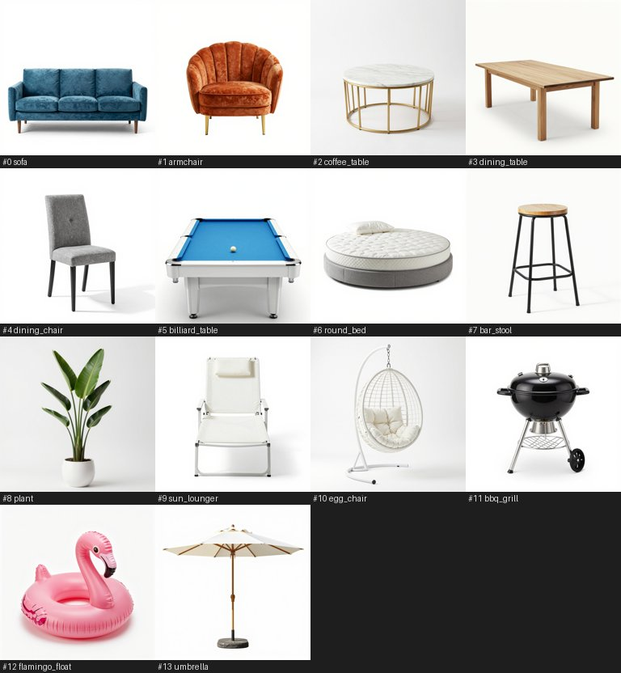
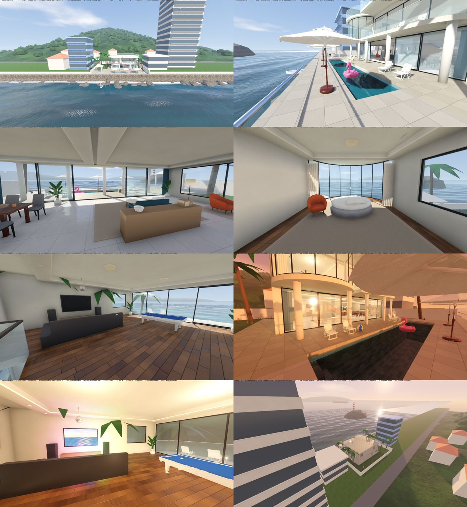
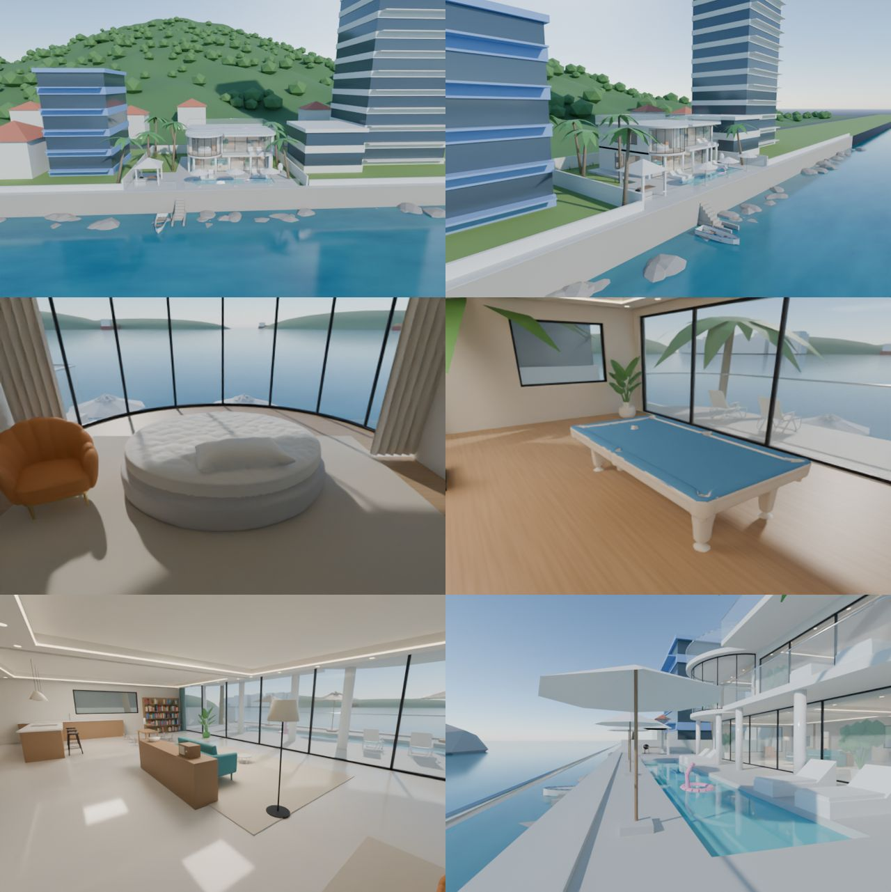

# VR 海边别墅（Blender 建模 → Quest 3）

照着头顿 BH19 海景别墅（石砌海堤、海水拍墙、弧形挑板、弧形玻璃卧室、长条泳池 + 玻璃栏杆步道）用脚本生成的二层别墅。
家具由本地 AI 生成（Z-Image 出图 → Hunyuan3D 2.1 出 3D 形状），其余全部是代码生成。有两种看法：

| | `启动_Godot版.bat`（推荐） | `启动.bat`（Blender 版） |
|---|---|---|
| 能做什么 | 走路、游泳、潜水，瞬移；推拉门、开关灯、冰箱、电视、KTV、收音机、吊扇、烧烤炉；坐下；抓起东西扔出去；四个时间段切换；有声音 | 只能看，在点位间瞬移 |
| 需要 | Blender（导出模型、生成贴图和声音）+ Godot（bat 第一次运行时自动下载，约 70MB） | Blender |

所有内容都由代码生成：模型、贴图、声音，没有任何外部素材。改尺寸只要改一处，两个版本都会跟着变。

> 计划中：语音指挥的机器人助理，见 [机器人助理方案.md](机器人助理方案.md)

---

## BH19 改造（2026-10）
| 照片里的 | 怎么做的 |
|---|---|
| 石砌海堤，海水直接拍墙，下面有抛石 | 海平面降到平台下 3m；海堤用 Voronoi 不规则毛石贴图；浪打到墙边起白沫（离墙 2m 内，跟着涌浪一涨一退）|
| 堤上的玻璃栏杆步道 + 遮阳伞，长条泳池平行于海 | 泳池 12×2.5m、深 2.4m；步道 1.6m 宽；栏杆在下水台阶处留口 |
| 下到海里的台阶 | 15 级、每级 30cm，一直伸到水面下 1.4m（游泳的人能踩着上来）|
| 二楼弧形挑板、西南圆角阳台、弧形玻璃卧室 | 任意多边形挤出 + 圆弧；屋顶轮廓 = 二楼轮廓外扩 25cm，层层挑出；屋顶一圈玻璃栏杆 |
| 一楼外廊的大理石柱 | 5 根，托住 2m 悬挑 |
| 亮面大砖地面、吊顶灯槽、筒灯 | 抛光地砖贴图 + 反射探针 + 屏幕空间反射；吊顶四周下沉 22cm，槽里暖光 LED 带（跟灯开关联动）|
| KTV 房 + 桌球室 | 二楼西侧娱乐室: 大电视（能开，放音乐、迪斯科球转、彩灯）、黑色 L 形皮沙发、台球桌 |
| 户外 BBQ 庭院 | 东侧白色凉亭 + 烧烤炉（能点火） |
| 背后长满树的山、两边的高楼和蓝楼、海平线上的货轮 | 高度场山坡 + 700 团树冠；邻居楼按层生成窗带；7 艘货轮 |

## AI 家具（`ai_furniture/`）

1. 双击 `ai_furniture/生成AI家具.bat`（第一次下载 Hunyuan3D 2.1 模型 7.4GB）→ 每件约 20 秒
2. 再运行 `启动_Godot版.bat`，Blender 会自动把 `ai_furniture/models/*.glb` 换进场景

**导入时自动做的清理**（`furniture_slots.py`）:
- **去底板**: 白底产品图里的地面阴影会被重建成一块薄板 → 找到底部顶点最密的那一层，从它上面切掉；再去掉残留的大薄片
- **去碎片**: 只留最大的连通块和贴着它的部分（椅腿等）
- **体素重建 + 减面**: Hunyuan 的网格有大量非流形边，直接减面减不动 → 先按 ≈1cm 体素重建成干净表面，再减到约 2.5 万面
- **朝向**: Hunyuan 出的模型正面朝 -Y，统一转 180°；宽深差别大的家具自动转 90° 对齐槽位
- **两种材质**: 按高度分（沙发腿、扶手椅的金色腿、花盆、台球桌台呢、伞面），见 `furniture.json` 的 `split`
- 结果缓存在 `models/_cache/`，第二次启动几乎不花时间

想换某件: `生成AI家具.bat --only sofa` 重新生成（每次随机种子不同）；或把你自己的图放进 `ai_furniture/my_images/sofa.png`。
朝向不对: 在 `furniture.json` 那件里加 `"yaw_fix": 180`。

**没做的**: 贴图。Hunyuan3D 的贴图生成要编译 CUDA 扩展，现成的预编译包是 CUDA 12.6 的，RTX 5090 需要 12.8 以上，所以颜色/质感由 `furniture.json` 指定。

## Godot 版

### 用法
1. Quest 3 打开 **Virtual Desktop** 连上电脑，VD Streamer 设置里把 **OpenXR Runtime** 设成 **VDXR**
2. **先连好头显**，再双击 `启动_Godot版.bat`。它会依次：`git pull` → Blender 导出模型 → 生成贴图和声音（第一次约 15 秒，之后会跳过）→ 找到或下载 Godot → 运行
3. 启动时会烘焙全局光照，需要等几秒；第一次运行还要编译着色器，也会多等一会
4. 没戴头显时会自动进入**桌面模式**，用键鼠操作

### 操作
| VR 手柄 | 桌面（键鼠） | 作用 |
|---|---|---|
| 左摇杆 | WASD / 方向键 | 走路；在水里朝视线方向游，低头推摇杆就是往下潜 |
| 左摇杆按下 | 按住 Shift | 跑（VR 里是切换开关） |
| 右摇杆左右 | 鼠标 | 转身（VR 里每次转 30°） |
| 食指搭在扳机上出现激光，按下扳机 | 准星 + 左键 | 指地面：**瞬移** 指门、开关、冰箱、电视、KTV、收音机、吊扇电机、烧烤炉：**操作** 指沙发、躺椅、吧凳、餐椅、圆床：**坐下**（推摇杆站起来） |
| 握把（中指） | E 或右键 | **抓**：手边 30cm 内的直接抓；激光指着远处的沙滩球、椰子、杯子时按握把，会把它吸到手里。松开就**扔**，按挥手的速度扔出去 |
| — | 拿着东西时按左键 | 扔 |
| A / X | T | 切换时间：清晨 → 下午 → 黄昏 → 夜晚（3 秒平滑过渡，黄昏起自动开灯，灯塔亮起） |
| B / Y | Tab，或 1~8 | 去下一个参观点位 |
| — | G | 开关全局光照（对比效果用） |

激光颜色：绿色 = 可以瞬移，黄色 = 可以操作或坐下，青色 = 可以抓。

### 场景里有什么
- **一楼**: 客厅（AI 沙发、茶几、落地灯、书架、收音机）、开放厨房（大理石岛台、AI 吧凳、吊灯、能开的冰箱）、AI 餐桌 + 6 把椅子、电视角（大理石背景墙 + 木格栅 + AI 扇贝扶手椅）、卫生间；吊顶灯槽 + 筒灯
- **二楼东**: 弧形玻璃卧室（180° 海景、AI 圆床、吊扇、窗帘）
- **二楼西**: 台球 + KTV 娱乐室（AI 台球桌、能开的 KTV、迪斯科球）→ 推拉门出去是圆角阳台
- **室外**: 外廊大理石柱 + AI 躺椅、吊篮椅；长条泳池（深 2.4m，东头有台阶）+ 充气火烈鸟；堤上步道 + AI 遮阳伞 + 玻璃栏杆；下水台阶 + 小船；东侧凉亭 + AI 烧烤炉；草坪、椰树、院墙
- **远处**: 背后的山林和山脚小房子、左边酒店高楼、右边蓝楼和红瓦房、海岬灯塔、对岸城市、海平线上的货轮、海鸥
- **声音**: 海浪声来自离你最近的那段海堤；进屋关门、潜水都会变闷；脚步分木地板/草坪/石材；烧烤炉噼啪、收音机和 KTV 放音乐

### 原理（为什么这样做）
| 部分 | 做法 | 依赖的假设 / 什么时候会失效 |
|---|---|---|
| 贴图 | `make_assets.py` 用"频域合成噪声"生成：白噪声做 FFT，按 1/f^β 衰减，再逆变换。FFT 天生是周期性的，所以贴图能无缝平铺 | 程序化贴图比不上真实照片贴图，近看时比较"干净"。可以把真实贴图放进 `godot/hd/` 来替换 |
| 声音 | 同样是算出来的：海浪 = 低通噪声 × 周期包络；脚步 = 短噪声冲击，按地面材质换滤波 | 比真实录音假一些，尤其是海鸥。可以把真实录音放进 `godot/hd/` 来替换 |
| 全局光照 | **VoxelGI**：启动时把房子切成 256 格的体素，记住"哪里有墙、是什么颜色"；光照本身每帧实时计算 | 所以换时间段、开关灯时，反弹光会跟着变，这就是能保留昼夜切换的原因。代价：墙太薄时可能漏光；只覆盖房子周围约 20m 的范围 |
| 海浪 | Gerstner 波：水面上的点做小圆周运动，所以浪峰尖、浪谷平。只在近岸 400×236m 范围内用细分网格，远处是平面 | 海浪公式在 `water_math.gd` 里只写一份：着色器用它画浪，CPU 用它算小船起伏和游泳浮力，两边保证一致 |
| 海堤白沫 | 不读深度缓冲，而是用"已知的海堤位置"直接算离墙距离，离墙 2m 内起沫，跟着涌浪一涨一退 | VR 双眼渲染下读深度贴图有兼容风险，这样做更稳。缺点是抛石周围不会单独起沫 |
| 风 | 只在顶点着色器里按正弦晃动顶点 | 几乎没有开销，但树干不会弯，只有叶冠在动 |
| 游泳 | 胸口没入水中时进入游泳模式：取消重力，朝视线方向游；不推摇杆时浮力把头托出水面 | 泳池台阶每级 32cm，能直接迈上去走出泳池 |

### 设置（`godot/settings.cfg`）
- `gi="voxel"`（默认）/ `"sdfgi"` / `"off"`：全局光照
- `ssao=true`：墙角、家具底下的阴影

**VR 里卡顿的话**：先把 `gi` 改成 `"off"`，再把 `ssao` 改成 `false`。Godot 官方文档对 VR 的说法是："Forward+ 渲染器支持 VR，但没有专门优化，推荐用 Mobile 渲染器"。可是只有 Forward+ 支持全局光照，所以这里选了画质。你的显卡性能足够，我推测问题不大，但没有实测。

### 换成真实素材
- `godot/hd/`：放同名的贴图或声音，会替换程序生成的版本（文件名见里面的 `说明.txt`）。比如从 Poly Haven、ambientCG 下载 CC0 贴图，改名后放进来
- `godot/art/`：放图片，会挂到墙上的三幅画框里。比如用本地 ComfyUI 生成几张海景画

### 已测 / 未测
- ✅ 在 Godot 4.7.2 上实际运行过（Linux，软件渲染），截图如上
- ✅ 自动测试 23 项全部通过（`godot --path godot -- --walktest`）：上楼梯、门挡人、开门出去、下草坪、迈回平台、泳池里浮起来、踩台阶出泳池、潜水、走下台阶进海、从海里爬上台阶、海里浮着、海边栏杆挡人、隔空抓球、扔出去、坐 AI 沙发、站起来、开冰箱、点烧烤炉、开电视、开收音机、开 KTV、夜晚灯塔、小船起伏
- ❌ **没在真头显上测过**：握把抓取的手感、扔的力度、手柄按键名、帧率、VoxelGI 和 SSAO 在 VR 双眼渲染下是否正常，都需要你戴上确认
- 推测：Godot 默认的 Oculus Touch 手柄映射在 Virtual Desktop 下能直接用

### 可能失效的地方
| 现象 | 处理 |
|---|---|
| 一启动就是桌面模式 | 头显没连上 VD，或者 OpenXR 运行时不是 VDXR。要先连好头显再运行 bat |
| 握把抓不起东西 | 用的是 `grip` 模拟量（按下超过 60% 算抓）。如果 VD 报告的手柄映射不同，告诉我是什么现象 |
| VR 里卡顿 | 按上面"设置"一节关掉全局光照和 SSAO |
| 屋里某处漏光 | VoxelGI 体素太粗。可以改成 `gi="sdfgi"` 试试 |
| 掉出世界 | 掉到 -15m 以下会自动回到第一个点位 |

---

## Blender 版（只看）

1. 同样先用 Virtual Desktop 连上电脑，运行时设为 VDXR
2. 双击 `启动.bat`
3. Blender 右侧边栏（按 `N`）→ **VR** 标签 → **Start VR Session**；在 Landmarks 列表里点选点位后点激活，就能瞬移

> ⚠ 每次运行 `启动.bat` 都会**重新生成并覆盖** `villa.blend`。手动改过的话请另存为其他文件名。

---

## 文件
| 文件 | 作用 |
|---|---|
| `build_villa.py` | 生成别墅主体（Blender），房子尺寸参数都在开头 |
| `scene_extras.py` | 室内陈设和室外扩展（KTV、灯塔、小船……）。**物体名就是交互接口**，约定写在文件开头 |
| `furniture_slots.py` | 家具槽位: 有 AI 模型就导入清理后摆上，没有就用占位 |
| `ai_furniture/` | AI 家具: 清单 `furniture.json`、生成脚本、一键 bat |
| `export_godot.py` | 加入交互部件，导出 glb 给 Godot |
| `make_assets.py` | 生成贴图和声音（只用 numpy） |
| `vr_setup.py` | Blender 版打开时启用 VR 插件 |
| `godot/main.gd` | 加载模型、材质、碰撞、交互、时间段、全局光照、声音布置 |
| `godot/player.gd` | 玩家：VR 和桌面模式、走、游、坐、抓、扔、激光 |
| `godot/world_fx.gd` | 海鸥、小船、灯塔、烧烤炉的火、泳池里漂的火烈鸟 |
| `godot/audio_fx.gd` | 声音加载、总线、水下和室内的闷音滤波 |
| `godot/water_math.gd` | 海浪公式（着色器和 CPU 共用的参数） |
| `godot/*.gdshader` | 水、天空、风、电视画面 |
| `godot/tests.gd` | 自动测试和截图 |
| `godot/settings.cfg` | 画质开关 |
