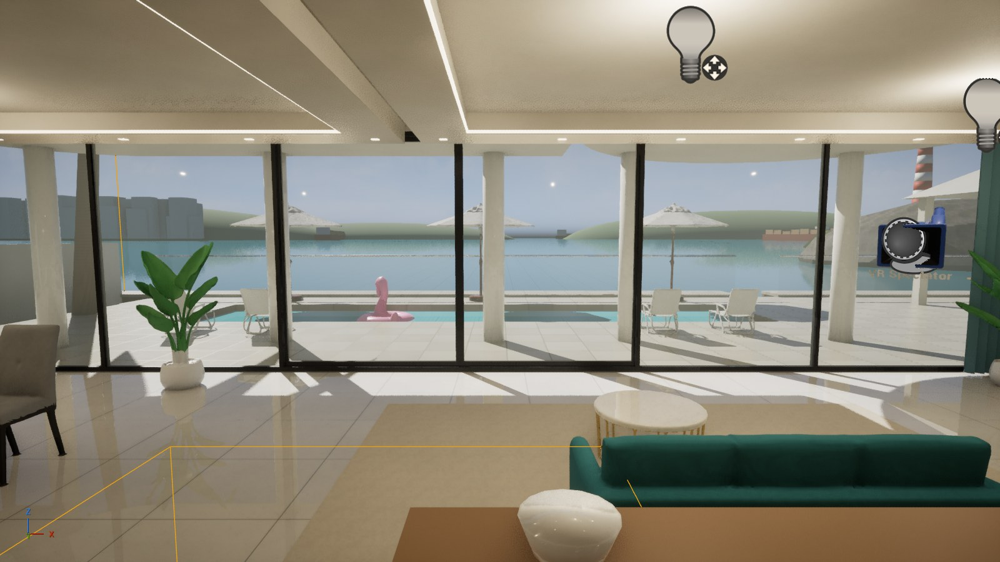
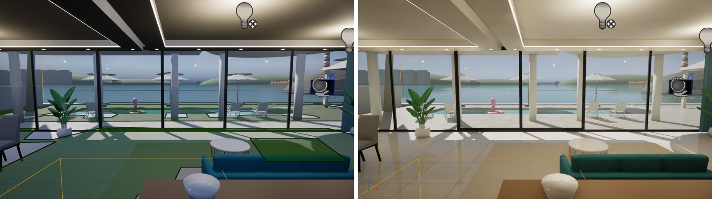
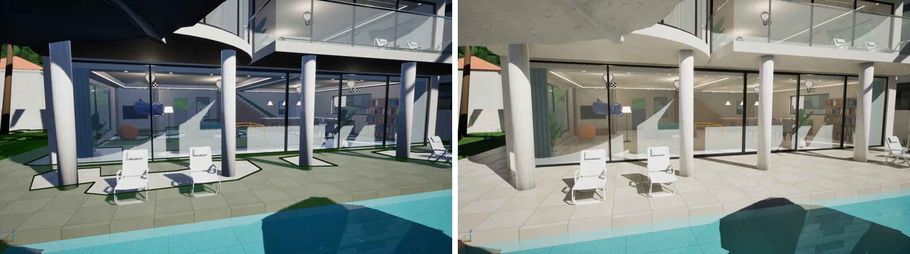
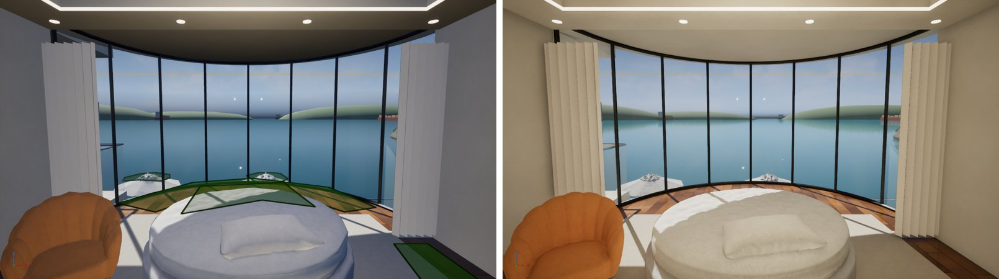

# 海边别墅 · UE 5.8 看房版（方案 C）

把 Blender 生成的 `godot/model/villa.glb`（含 AI 家具）导入 Unreal Engine 5.8 新工程 **VillaVR**，配 UE 材质、天空、灯光，用 VR 模板自带的瞬移在 Quest 3 里看房。**没有交互**（游泳、门、KTV 都没做）—— 目的只有一个：判断 UE 的画质和实时 GI 在 VR 里值不值得做完整版（方案 A）。

## 怎么看

1. 双击 `一键启动_UE看房版.bat`：git pull main → 同步脚本到 `文档\UE-MCP-Tools\villa` → **选渲染模式** → 打开 VillaVR（默认关卡已经是 `L_Villa`）。
2. 渲染模式（改的是 `Config\DefaultEngine.ini`，要**关掉 UE 再开**才生效；第一次切换要编译着色器，几分钟）：

   | 选项 | 内容 | 预期 |
   |---|---|---|
   | 1 forward | VR 模板默认：前向渲染 + MSAA，Lumen 不生效 | 便宜、清晰；室内只有直射光 + 天光，偏冷偏平 |
   | 2 lumen | 延迟渲染 + Lumen 实时 GI/反射 + TSR | 光会在墙、天花板之间反弹，暖、有层次；贵得多 |

   **现在工程停在 lumen 模式**（下面的对比图就是这么拍的）。
3. 戴 Quest 3（Virtual Desktop / Link）→ UE 工具栏 ▶ 旁边的 ⋮ → **VR 预览**。手柄推摇杆瞬移；出生在 "01 客厅看海"。
4. 头显里建议看：帧率是否稳（`stat unit` 看 GPU 时间，90Hz 需要 < 11.1ms）、TSR 在 VR 里有没有拖影、Lumen 有没有闪烁/漏光、两只眼睛是否一致。

## 对比（左 forward / 右 lumen，同一机位、同一套灯、固定曝光）

> 左图地面上的绿色是导航网格可视化（编辑器按 P 打开的），不是材质。

## 脚本（在 UE 底部控制台 Cmd 依次运行 `py "C:/Users/12192/Documents/UE-MCP-Tools/villa/<文件>"`）

| 文件 | 作用 |
|---|---|
| `prep_glb.py` | 云端/本机 Python：把 villa.glb 的中文物体名/材质名转拼音 ASCII → `villa_ue.glb` + 对照表 `names.json` + 标记点 `markers.json`。bat 在缺 glb 时自动跑（需要 `pip install pygltflib pypinyin`） |
| `v1_prepare_level.py` | 跑两次：第 1 次把 XR 模板关卡另存为 `/Game/Villa/Maps/L_Villa`；第 2 次删掉模板演示物体（保留出生点、导航、VR 观察者） |
| `v2_import.py` | Interchange "导入场景"：545 个物体保留名字和变换，网格在 `/Game/Villa/Import` |
| `v3_inspect.py` | 导出场景信息，用标记点反推坐标换算：UE(cm) = (100·x, 100·z, 100·y)，Godot 的 -Z（大海）= UE 的 -Y |
| `v4_collision_nav.py` | 527 个网格"复杂碰撞当简单碰撞"、隐藏碰撞坡道、出生点、NavMesh 边界 |
| `v5_materials.py` | 世界坐标三向投影母材质 + 40 个材质实例（墙、石材、木地板、草、沙、AI 家具…），玻璃/水/灯/画 |
| `v6_lighting.py` | 移除模板共享的灯光子关卡，自建太阳 + 天空球 + 天光 + 雾 + 9 盏室内灯 + 固定曝光 |
| `v7_check_nav.py` | 检查 8 个参观点能否落到 NavMesh（瞬移只能落在上面） |
| `v7b_reload_level.py` | 存盘 + 重载关卡，之后控制台输 `RebuildNavigation`（见踩坑 1） |
| `v8_finalize.py` | 保存关卡，默认关卡改成 L_Villa（备份 `DefaultEngine.ini.before_claude`） |
| `v9_nanite_usage.py` | 给自建材质打 Nanite 标记（见踩坑 2） |
| `shot_villa.py` | `py "shot_villa.py" 1 lumen` → 视口到第 1 个参观点（眼高 1.65m）截图 `villa_lumen_1.png` |
| `gi_mode.ps1` | `forward` / `lumen` / `status`，bat 调用它；第一次切换前备份 `DefaultEngine.ini.before_gi_switch` |

`v5_materials.py` 里贴图路径写死为 `C:/work/ITBasics/VR海边别墅/godot/model/tex`，仓库换位置要改这一行。

## 结果（证据等级）

- ✅ **实测**：8 个参观点 7 个在 NavMesh 上（`v7_check_nav.py`）。"06 下水台阶" 在水边台阶上，看房版没有游泳，没处理。
- ✅ **实测**：PIE 正常出生在客厅、面朝大海（`screenshots/PIE_出生点.jpg`）；重开编辑器默认进 L_Villa。
- ✅ **实测**：forward ↔ lumen 切换脚本可用，lumen 模式能正常编译、出图（上面的对比图）。
- 📏 **桌面参考，不代表 VR**：lumen 模式、编辑器视口内部分辨率 1526×862（TSR 50%）时 GPU 约 3.9ms（RTX 5090）。
- 🔮 **推测**：Quest 3 两只眼睛的像素大约是这个视口的 5–7 倍，Lumen 成本大致随像素涨，100% 分辨率可能超 11ms；降到 60–70% 再靠 TSR 放大也许能 90Hz。**一定要戴头显实测**，这正是看房版要回答的问题。
- ⚠️ **未验证**：Lumen + 实例化立体渲染（`vr.InstancedStereo=True`，模板默认）在头显里是否两眼一致。如果一只眼不对，在 `DefaultEngine.ini` 把它改成 False 再试。

## 踩过的坑

1. **NavMesh 一直 0 个 tile**：脚本挪/缩放 NavMeshBoundsVolume 后，不管 `on_navigation_bounds_updated` 还是 `RebuildNavigation` 都是 "build time 0.00s"。**存盘重载关卡**后导航系统才认新边界，再 Rebuild 就好了（0/8 → 7/8）。
2. **Nanite 标记**：Interchange 导入的 527 个网格默认全开 Nanite。forward 模式不支持 Nanite（用回退网格），所以看不出问题；切到 lumen（延迟渲染）后 Nanite 生效，自建材质缺 "用于 Nanite" 标记会被换成默认灰材质。`v9` 补上了。
3. **SkyAtmosphere 全黑**：物理大气在这个工程里出黑天（原因没查清），换成引擎天空球 `BP_Sky_Sphere`，并且必须把它的 "Directional light actor" 绑到太阳，否则一直是夕阳橙。
4. **模板灯光子关卡是共享的**：`L_XRTemplate_Lighting` 被模板关卡和 VRStudy 共用，直接改会连带改坏 → 从 L_Villa 移除引用，自建一套。
5. **模型几乎没有 UV**（539 个面组只有 5 个有）：材质只能用世界坐标三向投影（UE 的 `WorldAlignedTexture`），和 Godot 版同一思路。
6. `GameMapsSettings` 在 5.8 Python 里没有 `save_config()`，默认关卡改为直接编辑 ini。

## 看房版没做的

交互（门、开关、KTV、烧烤…）、游泳/潜水、海浪（海面是静止的光滑材质）、昼夜切换、法线贴图、挂画（画框是黑的，画的 UV 没对上）、声音。第 8 个参观点（台球 KTV 室）的机位朝向墙，需要对一下 Godot 版的朝向。

## 留在你电脑上的东西

- `文档\Unreal Projects\VillaVR\`（工程；`Config\DefaultEngine.ini.before_claude` / `.before_gi_switch` 是备份）
- `文档\UE-MCP-Tools\villa\`（运行副本、`villa_ue.glb`、各步骤报告 `*_report.txt`）
- VR 模板关卡 `L_XRTemplate` 和 VRStudy 工程都没动
