# 院落别墅（基克拉泽斯式）· UE 5.8 第一版

按画布"院落布局 v2"（[院落布局方案.md](../院落布局方案.md)）在 UE 工程 **VillaVR** 里新建的关卡 **L_Courtyard**。BH19 海边别墅（L_Villa）和它的脚本都没有动。

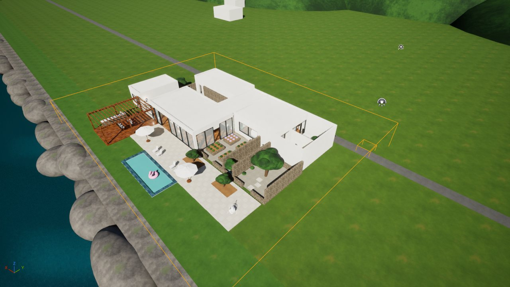

## 怎么看

1. 双击 `一键启动_院落别墅.bat`：git pull main → 同步脚本到 `文档\UE-MCP-Tools\court` → 选渲染模式（和看房版共用 `../ue/gi_mode.ps1`）→ 打开 VillaVR。**默认关卡已改成 L_Courtyard。**
2. 戴 Quest 3（Virtual Desktop / Link）→ UE 工具栏 ▶ 旁边的 ⋮ → **VR 预览**。出生在入口长巷东头，面朝门厅（"先收后放"：走进门厅才看到海）。
3. 工程现在是 **forward + 烘焙光照**（VR 约 90 帧）。bat 里选 2 可以切 Lumen 对比，但 Lumen 是延迟渲染、不用烘焙的光照贴图，VR 里不到 60 帧。

## 做了什么

| 区域 | 内容 |
|---|---|
| A 泳池平台 | 石材平台、8.2 × 2.7 m 泳池（池壁马赛克、压顶石、水面）、4 张躺椅、2 把伞、火烈鸟浮床、2 个橄榄种植池 |
| B 凉棚餐台 | 柚木平台 + 格栅凉棚、6 人餐桌、户外灶台、烧烤炉 |
| C 客厅 · 餐厨 | 北面、西面落地玻璃（北面中间 3 m 开口通平台），沙发 + 两把扶手椅 + 茶几 + 地毯，岛台 + 3 把吧椅，靠墙台面 |
| D 门厅 | 前门对入口长巷；西墙两扇门通主卧和次卧走廊；**楼梯井**（16 级，带玻璃栏杆）下地下室 |
| E/F 卧室翼 | 主卧（圆床、北窗对香草院、玻璃门通私院）、次卧（床）、卫浴、走廊 |
| ①②③ 小院 | 橄榄树院（大橄榄、石凳、汀步）、水渠窄院（浅水渠、壁泉、小无花果）、香草厨园（4 个种植池、石水槽 + 龙头） |
| ④⑤ 私院 | 主卧私院（柚木平台、泡池、九重葛墙、躺椅）、次卧私院（碎石、小树） |
| ⑥⑦⑧ G | 入口长巷（2.6 m 毛石墙、汀步、墙脚水渠、陶罐）、门院（无花果、石水钵、东门）、柠檬巷（3 盆柠檬、户外淋浴）、访客停车 |
| H 车库 | 两辆车（体块）、卷帘门洞、灯 |
| I 工作间 | 3 m 工作台 + 台钳、洞洞板工具墙（20 多件）、台钻、红色工具柜、油漆罐层架、后门通门院 |
| J 地下室 | −3 m，三排钢货架 + 纸箱、酒架、除湿机、4 盏灯 |
| K 电子工作室 | 东墙 6 m 防静电台（示波器屏幕上有方波、电源、万用表、烙铁台、显微镜、排烟器、逻辑分析仪、第三台显示器 + 键盘、面包板 + 跳线、开发板、舵机、台灯），台面上方三层零件盒，办公椅，西墙白板，北窗下写代码桌 + 双显示器（屏上有"代码行"），元件抽屉柜，3D 打印机 |
| 配景 | 草地、道路、岩石海岸、海面、两个海岬 + 灯塔、远岛、南边山丘、几栋邻居房子 |

## 脚本（UE 底部控制台 `py "C:/Users/12192/Documents/UE-MCP-Tools/court/<文件>"`）

| 文件 | 作用 |
|---|---|
| `c1_new_level.py save` / `load` | 从 L_Villa 另存 L_Courtyard（沿用太阳、天空、雾、固定曝光、VR 出生点、导航体积），下一次再加载（分两次，避免崩溃） |
| `c2_build.py` | **整栋房子**：约 1000 个引擎立方体/圆柱/球缩放拼出来，三向投影材质（世界坐标贴图，怎么缩放纹理密度都不变），AI 家具复用 L_Villa 那批。可重复运行：先删掉上次生成的再重建 |
| `c3_nav_check.py` | 12 个参观点能否落到 NavMesh |
| `court_shot.py` | `court_shot.py 3` 到第 3 个参观点截图；`top` / `top2` 俯瞰 |
| `cam.py` | 任意机位截图 + 列出家具旋转（调试用） |
| `court_points.json` | 12 个参观点（平面图米制坐标） |
| `ai_furniture_cache.json` | AI 家具用的网格和材质（第一次运行时从 L_Villa 的 AI_* 记下来，之后重跑靠它） |

**改完 `c2_build.py` 重跑后，NavMesh 要这样刷新**：`c1_new_level.py load` 重新加载 → 控制台 `RebuildNavigation` → `c3_nav_check.py`。

## 结果（证据等级）

- ✅ **实测**：12/12 参观点在 NavMesh 上，包括地下室（−2.8 m）。
- ✅ **实测**：PIE 正常出生在入口长巷（`screenshots/01_PIE出生点_入口长巷.jpg`）。
- 📏 **桌面参考**：Lumen 模式、编辑器内部分辨率 1526×862 时 GPU 3.3 ms、374 次绘制、48 万三角形（RTX 5090）。不代表 VR。
- ⚠️ **未验证**：头显里的尺度感、地下室楼梯能不能顺畅瞬移下去（导航上是连通的，但楼梯井窄，瞬移弧线可能难瞄准）。

## 踩过的坑

1. **导入的 AI_* Actor 改旋转不生效**（位置能改，旋转改不了，`set_actor_rotation` 和改根组件都不行）→ 改成读它的网格和材质，重新生成普通 StaticMeshActor。
2. **AI 家具正面不统一**：大多数 yaw 0 朝海，沙发相反（俯视截图确认）。新加家具要先俯视看一眼。
3. **地面盒子会堵住楼梯井**：整块地面要在地下室上方挖空。
4. **种植池间距 0.7 m 时那里没有 NavMesh**：VR 模板的代理半径 0.35 m，走道至少要 > 0.7 m，改成 1.1 m。
5. 参观点不能放在家具或种植池上（P6 第一次就放在种植池里）。

## 第二轮（30 分钟快速提升）：声音、能抓的东西、黄昏

| 脚本 | 内容 |
|---|---|
| `c4_ambience.py` | 11 个环境音源：海边 3 处海浪、海上海鸥、全场微风（不定位）、水渠壁泉 / 入口长巷水渠 / 门院石水钵的流水、厨房收音机（小声）、电子工作室设备嗡嗡声、地下室除湿机。带距离衰减和空间化，走近才听得清 |
| `c5_mood.py dusk` / `day` | 黄昏：太阳压到 7°、暖橙色、曝光 +1.3、室内灯调亮；`day` 还原白天 |
| `c6_grabbables.py` | 20 件能抓起来扔的东西（复用 VR 模板的 `BP_Grabbable_SmallCube`，只换外形）：岛台上 3 个杯子 + 酒瓶、餐台柠檬、泳池边沙滩球、香草院罗勒和薰衣草、工作台锤子扳手螺丝刀、写代码桌上开发板 / 舵机 / 焊锡卷 / 万用表、地下室小纸箱、长巷小陶罐 |
| `gulls_loop.wav` 等 3 个 | 海鸥（由 Godot 版的 gull 音效拼成 40 s 循环）、流水、设备嗡嗡声（程序生成） |

- ✅ 实测：模拟运行（物理开启）时工作室桌上的物件稳稳停在桌面上，没有穿透或弹飞。
- ⚠️ 未验证：头显里用手柄抓的手感、声音的远近效果（要戴耳机/头显听）。
- 现在关卡是**黄昏**状态。想回白天：控制台 `py "C:/Users/12192/Documents/UE-MCP-Tools/court/c5_mood.py" day`。

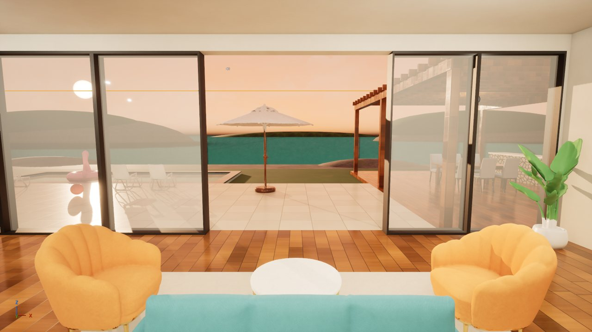

6. **墙脚闪烁（Z-fighting）**：地板盒子的侧面和外墙外表面正好在同一个平面上，两种材质抢同一批像素，头一动就闪。改成地面层的板子四边各缩 1.5 cm、屋面板缩 2 cm，侧面藏进墙里。
7. **Lumen 在 VR 里不到 60 帧，切 forward 后约 90 帧**（从 VR 预览期间的日志帧号算出来的）。现在工程停在 forward。

## 第三轮：往"能卖的场景"靠（倒角 + PBR、程序化植物、烘焙光照）

| 脚本 | 在哪跑 | 内容 |
|---|---|---|
| `c2x_export_geom.py` | 云端 / 任何有 Python 的地方（`pip install trimesh numpy`） | 用假的 `unreal` 模块跑一遍 `c2_build.py`，把 1000 多个立方体变成**带 1.2 cm 倒角**的网格，按（区域, 材质）合并成 122 个 → `court_geom.glb`（4.9 万三角形） |
| `c2_build.py` | UE | 发现 `court_geom.glb` 就导入合并网格，不再一个个生成立方体；发现 `court_plants.glb` 就调用 `c8_trees.py` 摆植物 |
| `c2f_fixcol.py` | UE | 删掉合并网格自动生成的凸包碰撞（见踩坑 8） |
| `c7_pbr.py` | UE | 从 ambientCG（CC0）下载 2K 贴图（颜色 / 法线 / 粗糙度），建母材质 `M_CourtPBR`（三向投影 + 大尺度颜色变化防重复），按材质替换。`c7q_search.py` / `c7t_thumbs.py` 是挑贴图时搜索和出缩略图用的 |
| `c8x_trees.py` | 云端（只要 numpy） | **程序化植物**：递归分枝 → 锥形树皮管（沿枝条展 UV）+ 枝头叶片卡 → `court_plants.glb`；再跑一遍 `c2_build` 的布局，导出 58 处植物位置 `court_plants.json`。`c8p_preview.py` 是不进 UE 就能看效果的小光栅器 |
| `c8_trees.py` | UE | 导入叶片/树皮贴图和植物网格，建 `M_Foliage`（遮罩 + 双面植被着色 + 风）和 `M_Bark`，删旧的球形树，按位置摆放。改了 glb 以后：先 `c8_trees.py reimport`，等几秒再 `c8_trees.py` |
| `c9_bake.py prep` / `build` / `save` / `revert` | UE | 烘焙光照（见下） |
| `tex/*.png` | — | 叶片卡和树皮：**本地 Z-Image（GenImgs）生成**，云端抠图（按背景色距离 + 饱和度出 alpha，边缘颜色向外填充防白边），树皮做成无缝 |

**植物**：橄榄（大树 1 棵 + 平台 2 棵小的 + 停车位 1 棵）、无花果 3、盆栽柠檬 3、橄榄球形灌木 17、薰衣草 9、迷迭香 18 + 3 盆、九重葛整面墙（花 + 绿叶两层）。

叶片卡的两个关键做法：
1. **几何做成正反两层、法线相同，材质用单面。** 如果用双面材质，背面法线会被翻转，树冠一半发黑。
2. **法线用"树冠球面法线"**（从树冠中心指向外，和面片自身法线 75 : 25 混合）。一堆面片在光照下像一个有体积的柔和树冠，而不是一片片硬纸板，商业植被资产基本都这么做。

**烘焙光照**（`c9_bake.py`）：
- 太阳、天光改为 **Stationary**：直射光仍然实时（植物、能抓的东西有实时阴影），间接光（墙面反弹、室内暗部）烘进光照贴图。
- 21 盏点光源改为 **Static + 投影**：阴影烘进去，运行时零开销，而且不会再透过墙照到隔壁。
- 合并网格自动生成第二套 UV，按包围盒面积给光照贴图分辨率（64–512）。
- 植物、AI 家具、能抓的东西设为 **Movable**，靠体积光照贴图取间接光。
- 房子周围放了 Lightmass Importance Volume（不然 5 km 的海面会把光子摊薄）。
- 中等质量，44 秒烘完；光照贴图 28.8 MB，阴影贴图 5.1 MB。
- **注意**：烘的是**黄昏**。`c5_mood.py day` 切回白天以后，间接光还是黄昏的颜色，要重新 `c9_bake.py build`。回到全动态：`c9_bake.py revert`。

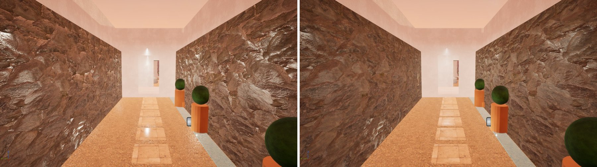
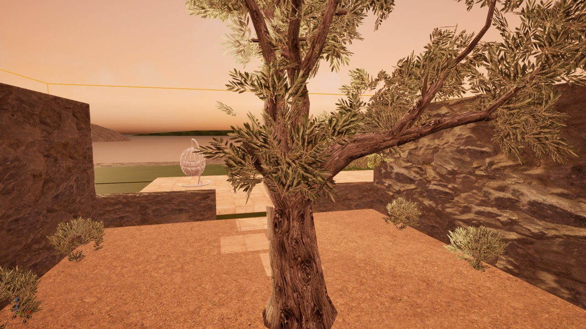
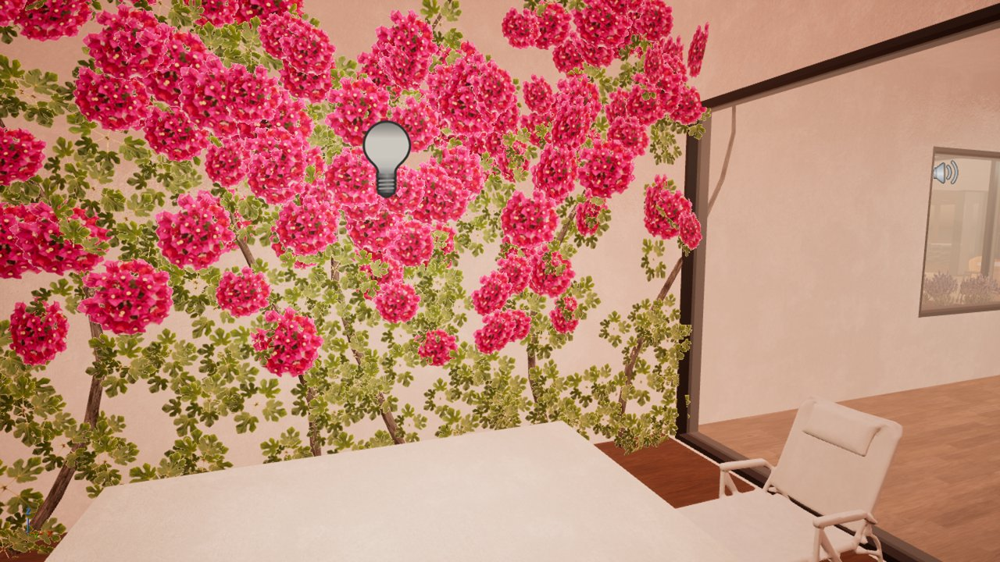
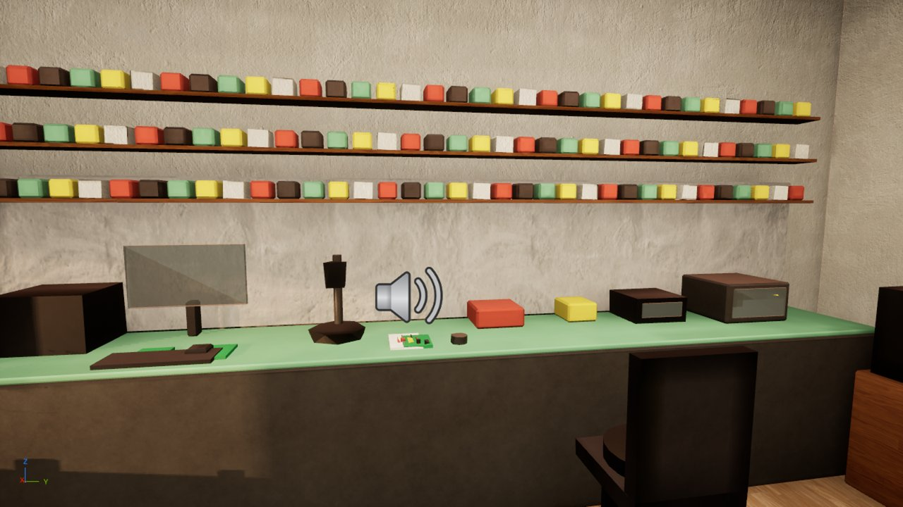

结果（证据等级）：
- ✅ 实测：合并网格 + 植物 + 烘焙之后，12/12 参观点仍在 NavMesh 上。
- ✅ 实测：烘焙成功（Lightmass 日志）；只有 9 条小警告（几个不碰撞网格的 UV 越界，海面和门厅光照贴图 UV 重叠 1.7–2.5%）。
- ⚠️ 未验证：VR 里的帧数（预期不比之前差：静态灯运行时更便宜，但多了植物的遮罩材质和风，叶片卡有一定过度绘制）、植物近看的效果、风的幅度合不合适（`MI_leaf_*` 的 `WindAmp` 参数，默认 3 cm）。

8. **合并网格导入时自动生成了凸包碰撞**：导航按简单碰撞算，一个区域的墙和天花板合成一个凸包，整间屋子就成了实心块。结果屋里没有 NavMesh（只有屋顶上有），能抓的东西也会撞上看不见的墙。删掉简单碰撞、只用"复杂碰撞当简单碰撞"以后恢复 12/12。
9. **粗糙度贴图按 sRGB 导入**：采样值约为原值的 2.2 次方，偏小，石墙看起来像湿的。在材质里开 1/2.2 次方还原（也可以把贴图的 sRGB 关掉，但采样器类型要跟着改）。
11. **九重葛第一版像恐怖片**：叶片贴图是"一整团花球"，260 张铺满墙 → 一堆一模一样的粉红球（密集恐惧）。改成本地 Z-Image 重新生成"带几簇苞片的垂枝"和"纯绿叶小枝"各 4 张，拼成 2×2 图集（`tex_cutout.py`），每张卡随机取一格；绿叶打底、花枝挂在上半部和墙顶往下垂，茎改成两个根扇形分出 6 根。
12. **楼梯走到底是一面墙 + 玻璃栏杆像瓷砖墙**：旧楼梯从门口往南下，最后一级正贴着地下室南墙；玻璃用的是看房版的 `M_VillaGlass`（带贴图），合并网格是米制 UV，每米一格，看起来像一面白瓷砖墙。现在楼梯从门厅南头平台往北下，下到底前面是地下室通道；玻璃换成不用 UV 的 `M_CourtGlass`。
13. **楼梯 NavMesh 断开**（以前也是断的，只是没测路径）：开敞楼梯两边是悬崖，宽 1.1 m 时两边各腐蚀 0.35 m 就断了；平台入口 0.85 m 也会被切断；货架离楼梯 0.7 m 也是死路。改成 1.45 m 宽、两侧有墙的楼梯井，平台入口 1.25 m，货架后移留 1.4 m 通道。`c3b_path.py` 现在检查"入口 → 地下室货架之间"整条路径不是部分路径。
14. 编辑器截图里楼梯井上方那层方格是**编辑器视口的网格**（世界 z=0 平面，开洞处露出来），VR 里不显示。
15. 远程操作小工具 `cq.py`：把要跑的脚本一行一行写进 `cq.txt`，UE 控制台只需反复执行同一条 `py …/cq.py`。

10. **Interchange 导入是异步的**：同一个脚本里刚导入就去找网格可能找不到；覆盖导入也不会刷新已经存在的网格。改成先删再导入，下一次运行再摆放。

## 第四轮：植物全部换成 Fab 免费素材

程序化植物（除了九重葛墙）全部删掉，改用 Fab 上的免费素材（挑选过程见 [植物布置方案.md](植物布置方案.md)）。素材装在本机的 VillaVR 工程里（`Content/PN_mediterraneanPlants_I|II`、`EuropeanHornbeam`、`Palms_Pack_02`、`Fab/Megascans/Plants`），**不在这个仓库里**：换电脑要在 UE 的 Fab 面板里重新"添加到项目"。

| 脚本 | 内容 |
|---|---|
| `c10_inv.py` | 列出工程里所有植物网格：尺寸、LOD 数、顶点数、是否 Nanite → `plants_inv.json` |
| `c10_lineup.py <路径前缀>` | 把一批网格排在海边草地上看效果；`clear` 删除 |
| `c10_plants.py` | **摆放**。可重复运行（先删上次的）；`seed=7` 换一种随机摆法；`clear` 只删除。`c2_build.py` 最后也会自动调用它 |
| `c10_shots.py [名字…]` | 用 SceneCapture 一次拍 13 张检查图 → `court/shots/plants_*.png`（不用一张张 HighResShot） |

摆放原则（为什么之前的植物显得别扭，见方案第二节）：3/5/7 株成团、缩放 0.8–1.2、随机朝向；树 → 灌木 → 地被三层；贴墙贴角种，踏步石和 12 个参观点留空。所有植物 Movable、无碰撞、不影响导航；小草和花不投影、25–30 m 外不画。

实际用了什么：

| 区域 | 植物 |
|---|---|
| ① 主树院 | 欧洲鹅耳枥 Field_04（原 12 m 孤植树，缩到 0.38 ≈ 4.5 m，冠形饱满）；东墙两团鼠尾草；树下干草；西墙、东墙常春藤 |
| ② 水渠窄院 | 尽头一对丝兰；渠边 Ribbon Grass |
| ③ 香草院 | 4 个池：鼠尾草 ×2、野花、Project Nature 灌木，每池 8–9 株 |
| ④ 主卧私院 | 九重葛墙（保留）+ 两盆绣球（只用 1.5–2 万顶点的 E/F 两个变体） |
| ⑤ 次卧私院 | 丝兰 + 龙舌兰 + 干草，一组干景 |
| ⑥ 入口长巷 | 三个陶罐种鼠尾草；南墙脚干草野花；南墙常春藤 |
| ⑦ 门院 | 仙人掌 + 龙舌兰围着石水钵；西北角一棵开花龙舌兰 |
| ⑧ 柠檬巷 | 三个陶盆种鹅耳枥树苗（代替柠檬树） |
| A 泳池平台 | 西池一棵小鹅耳枥 Forest_09 + 干草；东池龙舌兰干景 |
| 海边草地 / 停车位 | 加那利海枣 4 棵（客厅看海的视野中间不种）；停车位门洞两侧一对丝兰 |

一共 166 株（种子 3）。

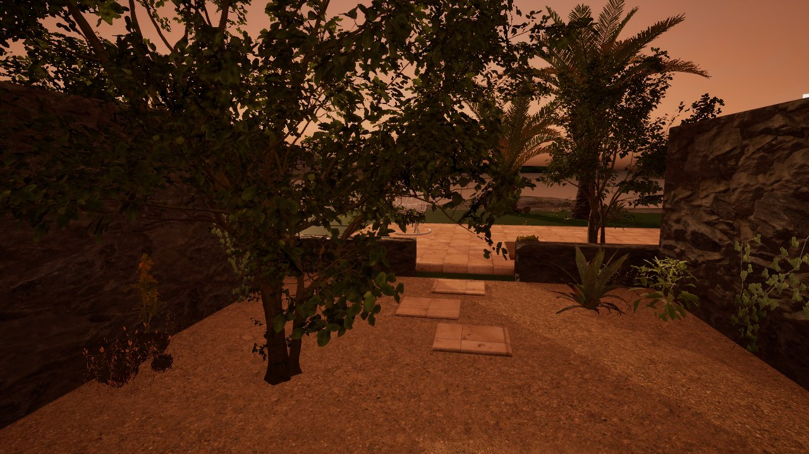
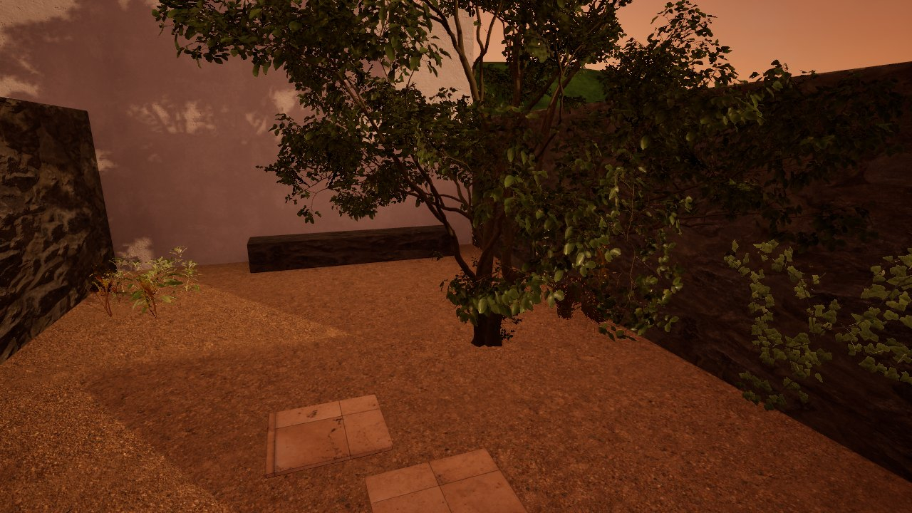
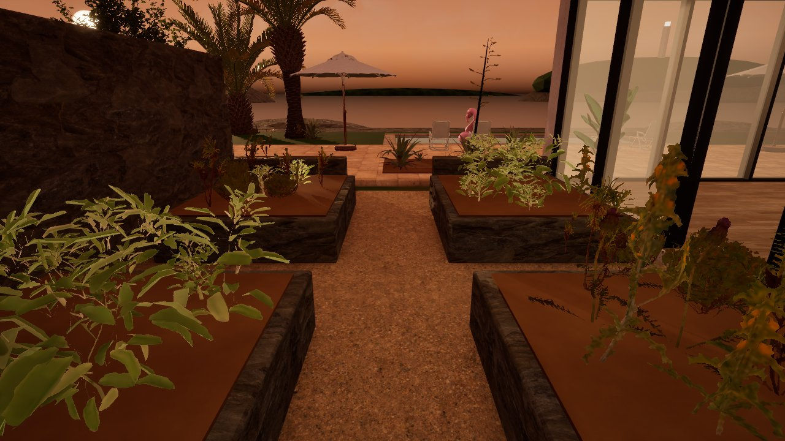
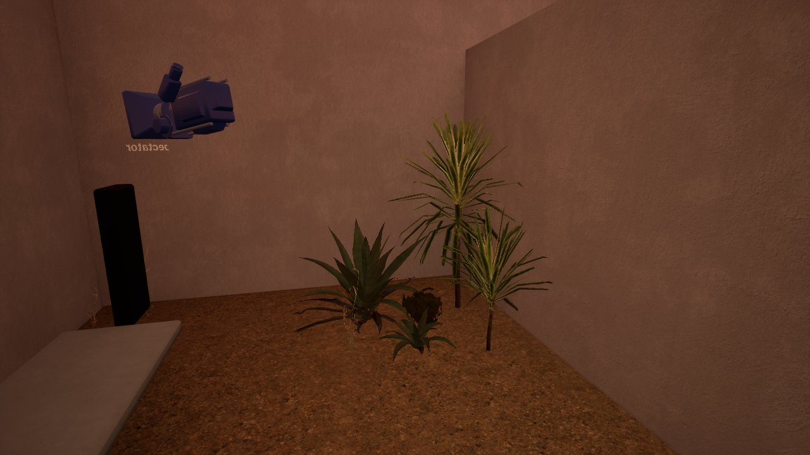
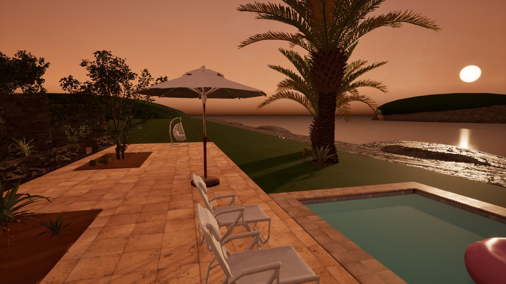
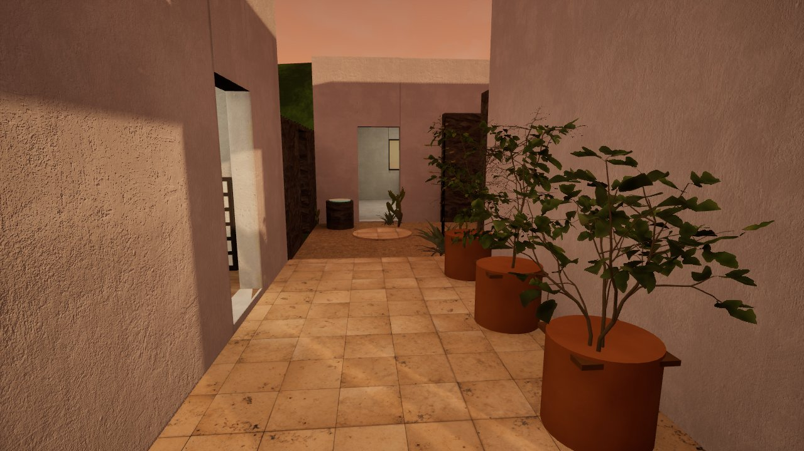
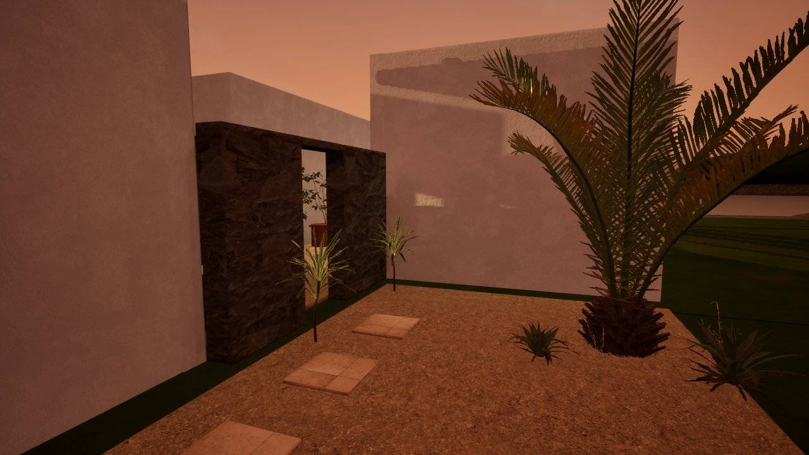

（截图是 SceneCapture 拍的黄昏光，比 VR 里暗一点、偏橙。）

结果（证据等级）：
- ✅ 实测：摆完以后 12/12 参观点在 NavMesh 上，"入口 → 地下室"整条路径通（27.8 m）。
- ✅ 实测：不用重新烘焙（植物和新加的花盆都是 Movable；"光照需要重建"提示已消失）。
- ⚠️ 未验证：VR 帧数。顶点数估计：鼠尾草每株 0.7–1.3 万、海枣每棵 2–2.5 万、主树 2.9 万（LOD0），全部加起来 LOD0 约 65 万顶点，远处会切到低 LOD。遮罩材质的过度绘制（叶子叠在一起）是 forward + MSAA 下最可能掉帧的地方。如果掉帧，先删 `c10_plants.py` 里香草池和海边草地的株数。
- ⚠️ 未验证：Project Nature 两个包官方只到 UE 5.4，在 5.8 里材质能正常显示（截图里看到了），但它们自带的风效果没检查。

16. **Fab 上的单个 FBX / glTF 模型导进来材质是坏的**：橄榄树的 Lambert 材质贴图全是默认白图、权重是 0（只显示纯色）；柏树和迷迭香的 glTF 材质是"不透明"，叶片卡的透明部分变成实心的块。手动连上贴图以后橄榄的叶子遮罩也不对（整片消失）。这三个都弃用了，只用 UE 原生包和 Megascans（材质是现成的 Masked + 双面植被）。`low_poly_terracotta_plant_pots` 是 4 个盆合成一个网格，也没用；花盆用引擎自带圆柱 + 院子的陶土材质。
17. **鹅耳枥默认开 Nanite**：VR 用 forward 渲染，Nanite 在这里不可靠，`c10_plants.py` 会把用到的几个网格的 Nanite 关掉，改用它自带的 4–7 级 LOD。
18. **"Forest"系列的鹅耳枥是林子里长的**：树干细高、叶子少，单独种在院子里像一根杆子。孤植要用 "Field" 系列（空地上长的，冠形圆满），缩小到院子的尺度。
19. **九重葛墙重新生成时变回了 Static**：烘焙后再跑 `c8_trees.py` 会出现"光照需要重建（1 个对象）"。现在 `c8_trees.py` 生成时就设成 Movable。

## 第五轮：手部菜单"调整时间" + 瞬间转向

**怎么用（VR 里）**
- 按菜单键（左手 Y / ☰，右手 B）打开手上的菜单，最上面多了两个按钮：
  - **时间：黄昏** → 每按一次切换：黄昏 → 上午 → 正午 → 下午 → 黄昏。按钮上的字会跟着变。
  - **转向：45°** → 在 45° 和 30° 之间切换。
- **瞬间转向**：左摇杆或右摇杆往左/右拨一下 = 转 45°（或 30°）。右摇杆往前推还是瞬移。
- 菜单里的 **Restart** 以前会去打开模板的 `VRTemplateMap`（工程里没有这个关卡），现在改成重新加载当前关卡。

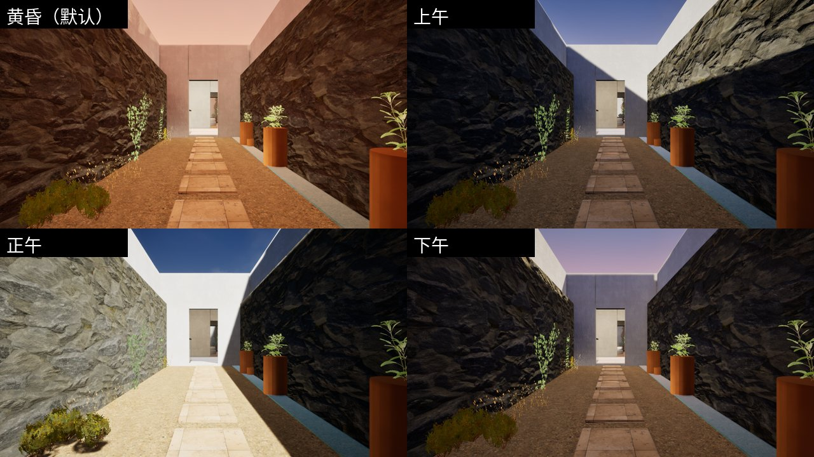

**改了哪些东西（都在 VillaVR 工程里，二进制资产，改前的原件在 `Saved/BeforeClaude_menu/`）**

| 资产 | 改动 |
|---|---|
| `XRFramework/Blueprints/BP_XRPawn` | 新变量 `CourtTimeIndex`；新函数 `CourtSetSun`（太阳角度/亮度/颜色，运行时把太阳从 Stationary 改成 Movable 才能转动）、`CourtSky`（天空球、天光重新捕捉、曝光）、`CourtApplyTime`、`CourtCycleTime`、`CourtTimeLabel`、`CourtCycleTurn`、`CourtTurnLabel`；相机组件加了曝光覆盖（偏移 0，默认权重 0，白天权重 1） |
| `XRFramework/Blueprints/WBP_Menu` | 加 `TimeButton`、`TurnButton` 两个按钮（样式照抄原按钮）；函数 `CourtRefresh`（菜单打开时刷新按钮文字）、`CourtTimeClicked`、`CourtTurnClicked`；Restart 改用 `GetCurrentLevelName` |
| `XRFramework/Input/IMC_Default` | `IA_Turn` 加上右摇杆 X（Quest / PICO / Index）。模板原来只有左摇杆 |
| `VillaVR.uproject` | 启用 `ModelContextProtocol` + `AllToolsets` 插件（为了用 MCP 改蓝图），原件 `VillaVR.uproject.before_mcp`；工程根目录加了 `.mcp.json` |

四个时段的参数（`c11_menu/dsl/apply.lisp`）：

| 时段 | 太阳俯角 / 朝向 | 亮度 (lux) | 颜色 | 曝光 |
|---|---|---|---|---|
| 黄昏（进场默认） | −7° / 55° | 4 | 橙 | 关卡原来的 +1.3 |
| 上午 | −30° / 235° | 7 | 暖白 | 0 |
| 正午 | −62° / 145° | 9 | 白 | 0 |
| 下午 | −22° / 70° | 6 | 浅橙 | +0.5（混合 60%） |

**换电脑 / 资产被覆盖了怎么办**：把 `c11_menu/assets/` 里三个 `.uasset` 复制到工程对应的 `Content/XRFramework/...` 位置（先关 UE）。`c11_menu/dsl/*.lisp` 是蓝图逻辑的源码（UE 5.8 MCP 的蓝图 DSL），`c11_menu/helpers/` 是当时用的辅助脚本，留作记录。

**远程操作的两个小工具**（bat 会同步到 `court`）：
- `ue_watch.py`：UE 控制台跑一次 `py ".../court/ue_watch.py"`，之后往 `court/pyq/` 丢 `.py` 就会在编辑器里执行，输出写同名 `.out`。比 `cq.py` 省事：不用每次在控制台按回车。
- `mcp_thread.py`：在编辑器里开后台线程，把 `court/mcpq/*.json` 转发给本机 MCP 服务器（`ModelContextProtocol.StartServer` 之后）。

结果（证据等级）：
- ✅ 实测（桌面 PIE）：连续按四次"调整时间"，太阳角度、亮度、相机曝光权重都按表切换，标签依次是 黄昏→上午→正午→下午→黄昏；截图见上。
- ✅ 实测（PIE 里直接调用）：`SnapTurn` 向右 45°，切到 30° 后向右 30°、向左两次各 30°，角度都对。
- ✅ 实测：三个蓝图编译无错误、无警告，保存后没有其他脏资产。
- ⚠️ 未验证：头显里**右摇杆**拨动是否触发（键位已加，但我没法戴头显）；菜单打开时右摇杆会不会既移动菜单光标又转身（模板给菜单的输入映射优先级更高，按理会吃掉，但没测）；新按钮在 VR 菜单里的大小和点击手感。
- ⚠️ 已知局限：间接光（墙面反弹、室内暗部）是黄昏时烘焙的，切到白天后室内反弹光还是偏暖偏暗。想白天也准确，得再烘一套白天光照，用 UE 的 Lighting Scenario 在两套之间切换（下一轮可以做）。

20. **UE 5.8 的蓝图 DSL 在中文编辑器下会接错引脚**：它按显示名识别执行引脚，中文界面下 `then`/`execute` 被当成数据引脚，报 "Could not connect pin then to Object"。临时 `InternationalizationLibrary.set_current_language("en")` 写完再切回 `zh-Hans`。切换后节点名是中英混合的（`变量|Default|GetSnapTurnDegrees`、`工具|流程控制|Switch|SwitchonInt`），要用 `BlueprintGraphEditor.list_available_nodes` 查当前真实名字；DSL 自带的 `switch int`、`select`、`%` 别名都找不到节点。
21. **DSL 调用函数时，第一个位置参数会被塞进 `self` 引脚**：`(CourtSetSun -7 55 …)` 实际变成 Pitch=55。调用自定义函数一律用关键字参数 `:Pitch -7.0`。
22. **Stationary 的太阳运行时转不动**：要先 `SetMobility(Movable)`。代价：太阳的阴影从烘焙的距离场阴影变成实时级联阴影（VR 帧数影响未测）。
23. **`GetCurrentLevelName` 带执行引脚**：只连数据线会被编译器裁掉（"was pruned because its Exec pin is not connected"），要串进执行链。
24. **VillaVR.uproject 没有关联到 UE**：双击 .uproject 或在启动器里双击工程会报"没有与之关联的应用"。用启动器的"启动 5.8.3"再选工程，或者用 bat（直接调用 UnrealEditor.exe）。

## 第六轮：转 C++ 工程 + 可交互水龙头 + 场景清理（2026-10-18）

| 改动 | 文件 | 说明 |
|---|---|---|
| 转 C++ 工程 | `cpp/Source/` | 模块 `VillaVR`；编译器 MSVC 14.50.35739（VS 2026 + 14.50 LTSC 组件，配置 `UE58_VS2026.vsconfig`） |
| 抓取桥 | `VillaGrab.*` | 运行时用反射读模板 `BP_GrabComponent` 的 `bIsHeld` / `MotionControllerRef`，GrabType 设 Custom；不改任何蓝图 |
| 通用旋钮组件 | `RotaryHandleComponent.*` | 抓住后绕父组件 Z 轴转；手的位置投影到水平面算角度**增量**（转过头往回拧立即响应）；每 15° 手柄震一下 |
| 球阀龙头 | `VillaFaucet.*` + `c12_faucet.py` | 香草院石水槽上方（原金属板当底座）；红色握把横=关、顺水管=全开；水柱直径 ∝ √开度（流量∝开度∝截面积）；流水声音量/音调随开度；`GetFlowRate()`（全开 0.2 L/s）/ `GetOutletLocation()` 留给水壶 |
| 删除 | — | 模板的旁观者摄像机 `BP_VRSpectator`；次卧私院吊床（`c2_build.py` 里也删了） |
| 玻璃栏杆 | `M_RailGlass`（UE 内） | 只给 `G_D_Hall__glass`：淡绿色 + 菲涅尔不透明度（正视 0.15、掠射 0.65）+ 表面逐像素光照 |
| 顶灯黑圈 | `c9_bake.py` | 灯板网格改 Movable 不参与烘焙；屋顶光照贴图 512→2048；`build high` 约 1.5 分钟 |

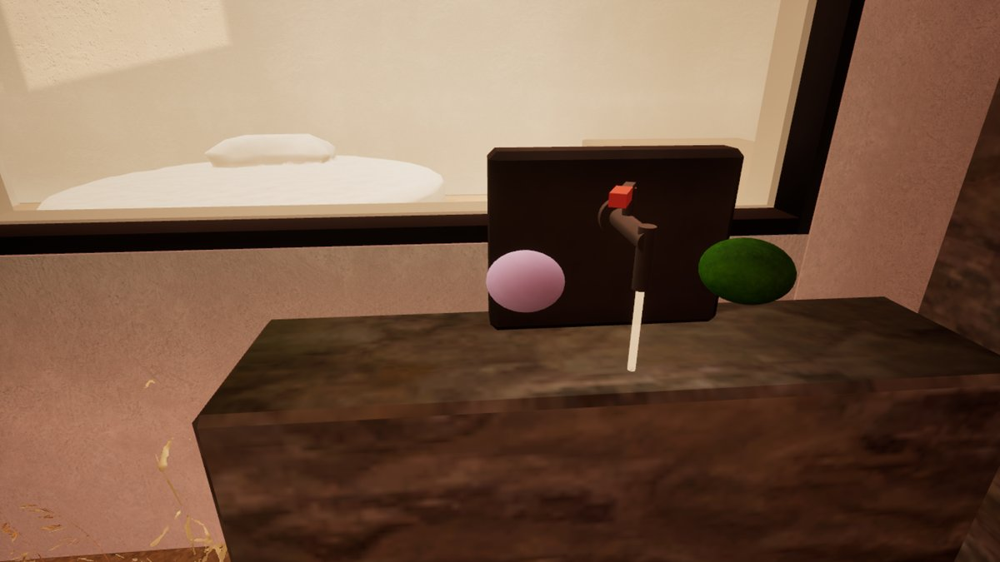
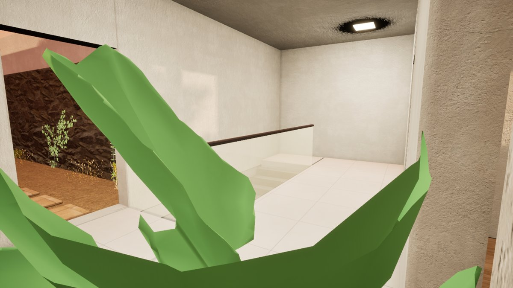

| 修之前 | 修之后 |
|---|---|
| 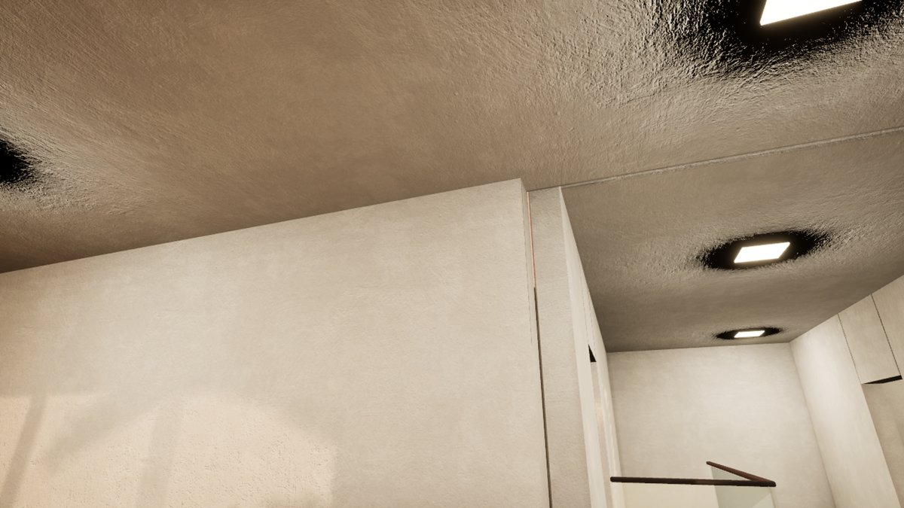 | 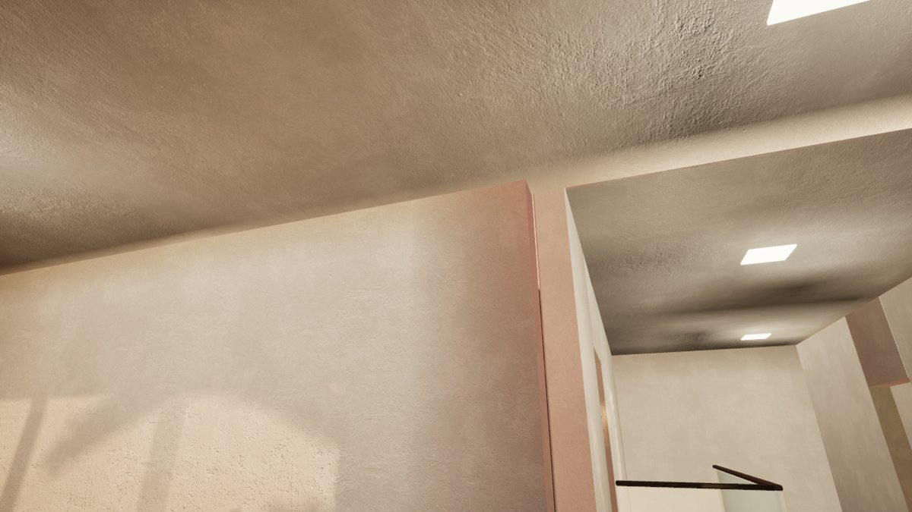 |

- ✅ 实测（PIE 里用脚本模拟手）：把右手控制器放到握把上调 `TryGrab` → 绕轴移动 10°…95°…回到 0°，手柄角度、开度、水柱显隐全部跟随；转到 95° 卡在 90°，再回转 45° 手柄立即回到 45°；松手正常。
- ✅ 实测：顶灯黑圈的原因是灯板本身（隐藏灯板后烘焙，黑圈消失），**关灯板投影没用**；灯板改 Movable 后高质量烘焙，黑圈消失。
- ⚠️ 未验证：头显里真手按握键能否抓到握把（碰撞类型按模板规则设为 PhysicsBody，理论上可以）、旋转手感、震动强度。
- ⚠️ 门厅（楼梯口）天花板上还有一小片偏暗的斑，位置在楼梯洞口上方，可能是下面是洞、地面反弹光少（物理上合理），也可能是别的伪影，没细查。

25. **顶灯外一圈黑（烘焙）**：灯板是贴在天花板上的 2 cm 薄盒，顶面和天花板底面重合。Lightmass 从天花板像素往外打采样光线时打到灯板背面，判成"在物体里面"置黑，再柔化成圆形黑晕。提高分辨率只会让黑圈更清晰；关投影也没用。发光小灯具设成 Movable、不进烘焙。
26. **UE 打开 C++ 工程时只检查 DLL 和引擎版本是否匹配，不比对源码新旧**：源码改了直接打开，加载的还是旧 DLL。可靠做法：把 `Binaries/Win64/UnrealEditor-VillaVR.dll` 改名（device_bash 的 `mv`，不需要删除权限）→ 从项目浏览器打开 VillaVR → 弹 "Missing VillaVR Modules… rebuild?" → Yes。
27. **从 UE 里 Popen 出去的"等 UE 退出再编译"脚本不可靠**：从项目浏览器打开的编辑器，退出后会回到项目浏览器（同一个进程）；子进程还可能随 UE 退出被一起结束（推测是作业对象）。`remote/rebuild_restart.py` 保留但不推荐，用坑 26 的方法。
28. **device_commit_files 同一个暂存文件名第二次提交不生效**（写回的是旧内容）：每次用新的暂存文件名（`xxx_v2.py`），提交后在 device_bash 里 grep 确认。
29. **computer use 的"打开应用 Unrealeditor"会新开一个 UE 进程**（项目浏览器），不是切到已有窗口。
30. **编辑器在后台时 HighResShot / take_high_res_screenshot 不出图**：视口不刷新，要等编辑器回到前台。

## 这一版还没做

- 带逻辑的交互：水龙头已做（第六轮）；开门、示波器开机、淋浴出水、灯绳、水壶、射击场还没做（方案见 [交互方案_水龙头水壶射击场.md](交互方案_水龙头水壶射击场.md)）
- 电子工作室、工作间的仪器和工具仍然是比例准确的体块，没有按钮旋钮。这是离"能卖"最远的一块：要么从 Fab 买（见 [Fab素材候选.md](Fab素材候选.md)），要么用本地 Hunyuan3D 出形状、再手工贴材质
- 门是空洞（没有门扇），卷帘门没做
- 草地还是偏绿
- 光照贴图分辨率是按面积粗估的（屋顶已单独给 2048），大面墙上的阴影边缘还偏软；想更细可以把 `c9_bake.py` 里的 `* 16` 调大，再用 `build high` 烘一次（现在高质量全场约 1.5 分钟）
