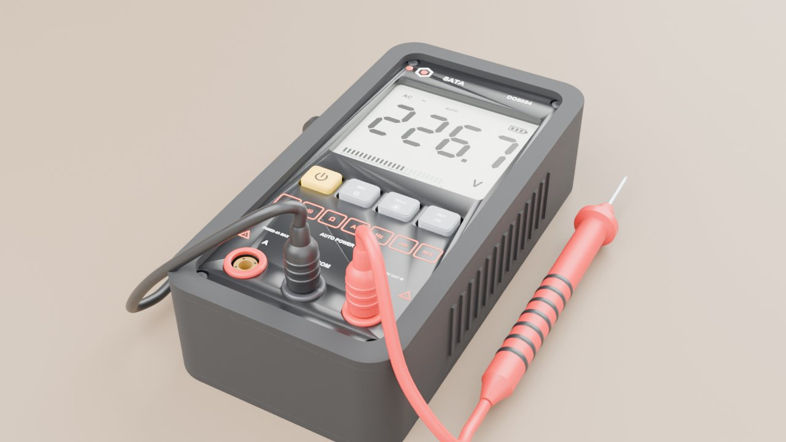
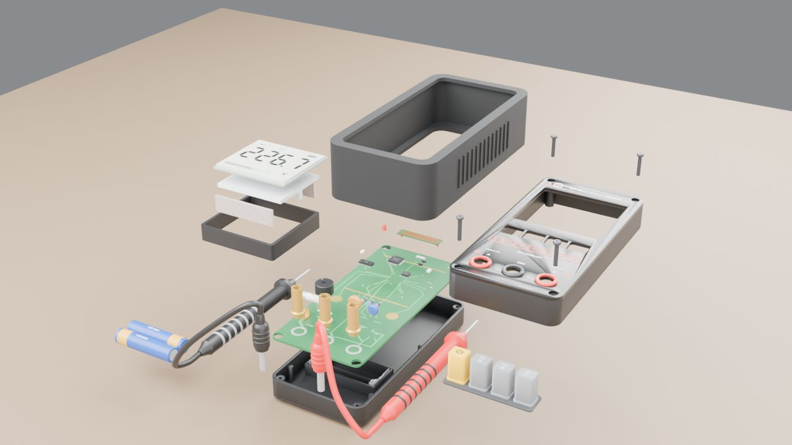

# 万用表爆炸图（Blender 脚本建模 + 原理爆炸图）

一台口袋式自动量程数字万用表，外观照 SATA 世达 DO5054 智能款的产品图（白底大屏、黄色电源键 + SEL / HOLD / NCV 三个灰键、橙色功能图标、A / COM / V 三个插孔、红黑表笔），用 `build_multimeter.py` 在 Blender 里全部用代码生成。
没有图纸，外形尺寸按比例估；内部看不到，按这类表的常见结构补的：主板、主控 SoC、自动量程模拟开关、分压电阻、PTC、压敏电阻、4A 保险丝、锰铜分流器、蜂鸣器、液晶屏 + 斑马条 + 背光导光板、硅胶导电按键、NCV 感应线圈、两节 AAA 电池。
每个零件的信息牌写的是**它在电路里干什么**，所以叫"原理爆炸图"。同一份模型导进了虚幻工程 MyVRToyBox，在 VR 里可以拆开、一个个零件拿起来看。

| 装配 | 爆炸 |
|---|---|
|  |  |

## 用法

双击 `启动.bat`，它会依次：

1. `git pull --ff-only origin main` 检查更新（没网或没装 git 就跳过）
2. 找 Blender（`blender_path.txt` → PATH → `Program Files\Blender Foundation\Blender*` → Steam）
3. 后台运行 `build_multimeter.py`，几秒钟生成 `output\multimeter.blend` 和 `output\multimeter.glb`
4. 让你选：**[1]** 用 Blender 打开（按空格播放爆炸动画）/ **[2]** 用 Cycles 渲染装配、爆炸两张预览图 / **[3]** 退出

找不到 Blender 时，把 `blender.exe` 的完整路径写进同目录的 `blender_path.txt`（这个文件不会提交到 git）。支持 Blender 4.2 ~ 5.x。

| 输出（`output\`） | 用途 |
|---|---|
| `multimeter.blend` | Blender 工程。第 1~120 帧按拆机顺序拆开，第 150~270 帧反顺序装回 |
| `multimeter.glb` | glTF 模型，单位米，每个零件一个节点（`P12_SoC` …），extras 里有零件号、中文名、材料、作用、爆炸路线。MyVRToyBox 的 `导入万用表模型.bat` 用它 |
| `parts.json` | 零件表（38 个零件，32 种） |

## 拆机顺序和爆炸后的摆法

表面朝上平放在桌上拆，顺序和真拆一块表差不多。爆炸后不是简单地往上摞（那样人从前面往下看，上面的层会挡住主板），而是分三列摆开：

- **中间**：底壳不动；主板抬起 3 cm，主板上的元件再各自往上"浮"1.4 cm，停在自己焊盘的正上方，一个接一个冒出来；保险丝浮在保险丝座上方。
- **左边**：屏幕叠层从下往上摞——LCD 支架、两根斑马条、背光导光板、液晶屏；电池放在它前面。
- **右边**：面壳（正面朝上，看得到面板印刷）和上面四颗螺丝；硅胶按键在面壳前下方。
- 护套往上往后（空心框，挡不住什么）；表笔拔出来往前挪，躺在两边。

| 顺序 | 零件 | 对象名 |
|---|---|---|
| 1 | 拔下红黑表笔 | `P31_ProbeRed`、`P32_ProbeBlack` |
| 2 | 剥下橡胶护套 | `P03_Holster` |
| 3 | 拧下面壳的 4 颗螺丝（藏在护套唇边下面） | `P05_Screw_*` |
| 4 | 掀起面壳 | `P04_FrontShell` |
| 5 | 拿下硅胶按键 | `P06_Keypad` |
| 6 | 拆屏幕叠层：液晶屏 → 斑马条 → 导光板 → 支架 | `P07`、`P08_Zebra_*`、`P09`、`P10` |
| 7 | 拔下保险丝 | `P21_Fuse` |
| 8 | 抬起主板，元件依次浮起 | `P11_PCB`，`P12`~`P20`、`P22`~`P29` |
| 9 | 取出两节电池 | `P30_Battery_*` |
| — | 底壳、电池弹片（含引线） | `P01`、`P02`（不动，基座） |

## 原理速记

- **一切都变成电压**：主控 SoC 里的 ADC 只会量一个很小的电压（几百毫伏），其他量都先变成电压：
  - 电压：10 MΩ 精密电阻串按 10 : 1 分压，600 V 进来到 ADC 只剩零点几伏；
  - 电流：流过约 0.05 Ω 的锰铜分流器，压降 U = I × R（4 A 时约 0.2 V）；
  - 电阻：送一个已知的小电流，量被测电阻上的压降，R = U / I；
  - 频率：晶振给的时间基准，数一秒钟里信号翻转几次。
- **自动量程 = 用模拟开关代替旋钮**：先在最大量程试测，读数太小就让模拟开关换到下一个分压抽头，直到读数落在最准的那一段。
- **自动识别**：先看 V 插孔上有没有交 / 直流电压，有就测电压，没有就送小电流测电阻 / 通断（< 约 50 Ω 蜂鸣器叫）。
- **错档防烧**：V 插孔后面串着 PTC 热敏电阻。万一在电阻 / 通断状态碰到 220 V，大电流让 PTC 发热、电阻几毫秒内涨到几十千欧，把电流卡住；压敏电阻再把雷击、浪涌这种尖峰泄放掉。A 插孔后面是 4 A 陶瓷保险丝。
- **NCV 非接触测电**：表顶端的铜箔线圈和带电导线之间有几皮法的电容，交流电场耦合过来一个极小的电流，放大后点亮指示灯、让蜂鸣器叫。
- **LIVE 零火线判断**：只接红表笔碰电线，人手通过表壳和人体的电容当"地"。火线对地 220 V，零线对地接近 0 V，所以只有火线会报警。
- **液晶屏 + 斑马条**：每一笔都是一块透明电极，主控加交流方波，那一笔变黑；液晶玻璃边上的引脚靠斑马条（导电层 / 绝缘层交替的硅胶条）压在主板焊盘上，上下导通、左右绝缘，不用焊接。
- **自动关机**：按黄键时电源 MOS 管导通，之后主控自己"拉住"它保持开机；15 分钟没操作，主控松手，整块表断电。

主板上浅绿色的走线是按信号走向画的示意（V 插孔 → PTC → 分压电阻 → 模拟开关 → 主控；A 插孔 → 保险丝 → 分流器 → COM），不是真实布线。

## 尺寸怎么估的

- **护套外形 150 × 76 × 38 mm**：产品图里高 : 宽 ≈ 2 : 1；这类口袋表一般 14~15 cm 长、3.5~4 cm 厚。表体（不含护套）142 × 68 × 32 mm。
- **屏幕占正面上方约 60%**：可视区 56 × 50 mm，读数 "226.7" 每个字高 20 mm；屏幕上方一条放 SATA 标志和型号。
- **插孔间距 20 mm**：常见的 4 mm 香蕉插座，表笔插头护套 Φ9.6。
- **电池 2 × AAA**：产品资料没看到，按同类自动量程口袋表的常见配置估的（3 V）。实物在背面有电池门；这里为了从正面一层层拆开看，电池放在底壳内侧的电池槽里。

在虚幻里模型按最长边缩放到 **40 cm**（其他模型是 50 cm），所以 VR 里看到的是 2.67 倍大的万用表。

## 建模说明

- 坐标：表面朝上平放，+Z 向上（屏幕朝上），+Y 指向表的顶端（屏幕、NCV 那头），+X 是右手边；Z = 0 是护套背面，面壳表面 Z = 35。所有零件直接按装配位置建模，物体原点都在世界原点。
- 面板印刷、液晶段码、PCB 丝印都是真的几何体（Blender 文字转网格 + 自己画的七段数码），用 Windows 自带的 Arial Bold；没有 Arial 时退回 Blender 自带字体。
- 爆炸公式和电机、车床一样：每个零件有几段位移，每段有一个出场时刻 s，在总进度 T 的 `[0.6s, 0.6s + 0.4]` 区间里缓动走完；装回时 T 倒着走，顺序自然反过来。主板上的元件出场时刻各错开一点点：既是依次冒出来的动画，也让每个元件的路线不一样（虚幻那边按路线分抓取单元，路线相同的会被合成一个）。
- 材质金属度都压在 0.55 以下（虚幻工作室里没有反射探针，金属度高的会发黑）。
- 简化了的地方：芯片引脚、电阻色环是示意；斑马条每 1 mm 画一层导电层（实物约 0.1 mm）；表笔线是固定形状，跟着表笔一起动。
