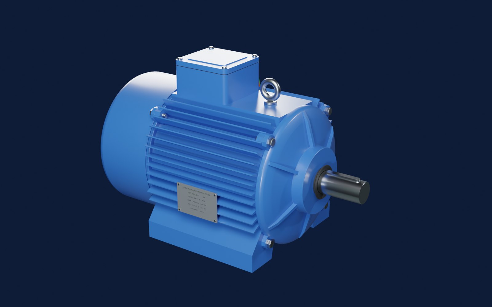
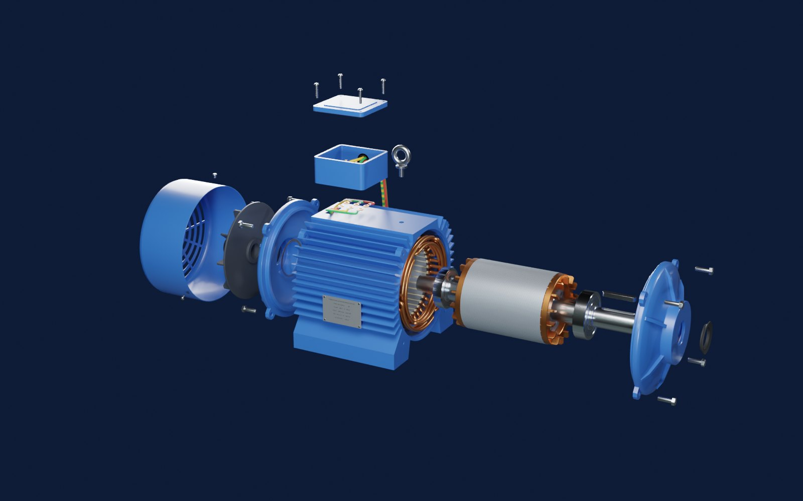

# 三相电机爆炸图（Blender 脚本建模）

三相鼠笼式异步电动机 **YE4-132M-4**（7.5 kW，380 V Δ，4 极，36 槽 / 28 斜导条，铸铜转子），全部零件由 `build_motor.py` 在 Blender 里用代码生成。
同一份模型有三种用法：Blender 里看/渲染、网页里看（手机也行）、导进虚幻 5。

- **网页版（手机可看）**：<https://claude.ai/artifact/7ih4MJPgZF1QqyxGHxaN5T>（默认只有自己能打开，要给别人看需在页面的 Share 里开启分享）
- **离线版**：运行一次 `启动.bat` 后，`output\` 里会有 `三相电机_离线版.html`，双击即可，不用联网

| 装配 | 爆炸 |
|---|---|
|  |  |

## 用法

双击 `启动.bat`，它会依次：

1. `git pull --ff-only origin main` 检查更新（没网或没装 git 就跳过）
2. 找 Blender（`blender_path.txt` → PATH → `Program Files\Blender Foundation\Blender*` → Steam）
3. 问要不要顺便用 Cycles 渲染预览图（默认 10 秒后选“不要”）
4. 后台运行 `build_motor.py`，在 `output\` 生成文件（约 20 秒）
5. 让你选：打开网页 / 打开 Blender / 都打开

找不到 Blender 时，把 `blender.exe` 的完整路径写进同目录的 `blender_path.txt`（这个文件不会提交到 git）。

### 输出文件（`output\`）

| 文件 | 用途 |
|---|---|
| `motor.blend` | Blender 工程。按空格播放 = 爆炸动画（第 1 帧装配，第 121 帧全拆开） |
| `motor.glb` | glTF 模型，单位米，零件独立命名（`P01_Frame` …），extras 里带中文名、日文名、材料、爆炸方向；名字以 `CAP` 开头的是剖切盖面，导入 UE 时可以删掉 |
| `三相电机_离线版.html` | 离线网页，模型直接嵌在文件里（约 10 MB） |
| `parts.json` | 零件表数据（27 种） |
| `render_*.png` | 只有选了渲染才会有 |

导入虚幻 5：**文件 → 导入到关卡**，选 `motor.glb`。单位是米，UE 会自动换成厘米。所有零件的原点都在电机轴心上，转子零件（轴、铁芯、鼠笼、风扇）绕电机轴线旋转就是转动。

## 网页的四种模式

- **结构**：爆炸滑杆 + 编号 + 零件表，点零件看材料和作用。“剖开”切掉前上方四分之一（切面是实心的），“鼠笼”把转子铁芯变透明，露出导条和端环。拆装顺序按真实维修顺序：接线盒盖 → 吊环 → 风罩 → 风扇 → 后端盖 → 前端盖 → 抽出转子 → 接线盒。
- **原理**：从轴伸端看的横剖面。36 个槽里的导体按 U/V/W 上色，⊙ = 电流朝你流出、⊗ = 流进去，越亮电流越大；白线是磁力线，N/S 标出磁极。右边是三相电流波形和合成磁场矢量。可以暂停、单步 30°、调换 V/W 两相看磁场反转。
- **电动**：转子比磁场慢一点（转差）。转子导条上的橙色 ⊙ / 蓝色 ⊗ 是感应电流方向，黄色弧线是电磁转矩。旁边有转矩–转速曲线、功率流向；可以重新启动、断电、拖负载到过载失速。
- **发电**：原动机拖着转子比同步转速还快（转差率为负），导条电流和转矩反向，电能回馈电网；关掉电网会看到磁场消失、转速失控。

运行模式都有“透视”按钮：铁芯变透明，看三相线圈和鼠笼导条在立体空间里怎么亮。

## 原理速记

- 三相电流时间上差 120°，三相绕组空间上差 120° 电角度 → 合成磁场大小不变（单相最大值的 1.5 倍）、匀速旋转。
- 4 极 = 2 对极：同步转速 ns = 60f / p = 60 × 50 / 2 = **1500 r/min**。电流变一个周期，磁场转半圈。
- 转子转速 n 必须比 ns 慢一点，导条才会切割磁力线、感应电流、受力：**转差率 s = (ns − n) / ns**，额定时约 2.7%（1460 r/min）。
- 0 < s < 1：电动机；s < 0（被拖得比 ns 还快）：发电机；s = 1：启动 / 堵转。
- 调换任意两根电源线 → 磁场反转 → 电机反转。
- 异步发电机自己建立不了磁场，要靠电网提供励磁（单独运行要并电容自励）。

## 网页里的计算（都是简化模型）

| 项目 | 做法 |
|---|---|
| 旋转磁场 | 用 36 个槽的实际电流（槽号 × 相 × 正负）求基波，N/S 位置是算出来的，不是画上去的 |
| 转矩–转速曲线 | T(s) = K·s·R(s) / (R(s)² + (sX)²)，R(s) = R0(1 + 3.5 s²) 模拟深槽效应；调成额定 1.0、启动 2.3 倍、最大 2.6 倍（s ≈ 13%） |
| 导条电流 | i ∝ s·B，按转子阻抗角 φ = arctan(sX/R) 滞后；启动时约为额定的 4.4 倍 |
| 启动 / 失速 | J·dn/dt = T(s) − 负载（发电时 + 原动机转矩），慢放显示 |
| 功率 | 电磁功率 = T·ωs（近似电网侧），机械功率 = T·ω，转子铜损 = s × 电磁功率；忽略定子损耗和铁损 |

简化之处：电动/发电模式里定子槽电流按励磁电流的相位画，没有画出负载电流带来的相位偏移；动画是慢放的（磁场约每秒 0.1 圈）。

## 和真实电机的差别

- 外形和主要尺寸参照 IEC 132M 机座（中心高 132、轴伸 Φ38×80、底脚孔距 216×178），不对应具体厂家图纸
- 叠片画成 2 mm 一片（真实 0.5 mm），每个线圈画成一根粗铜束，没画每一匝
- 转子画成铸铜（部分 IE4 高效电机采用），普通电机多为铸铝（银白色）
- 端部绕组按“双平面”整齐排列，真实的更乱一些，还有绑扎带和绝缘纸
- 螺纹没画螺旋；轴承画了钢球但没画保持架

## 改参数

尺寸都在 `build_motor.py` 开头（单位 mm）：定子内外径 `R_SI` / `R_SO`、铁芯半长 `LC`、导条斜槽 `SKEW`、叠片显示厚度 `LAM`、绕组排布 `GROUPS`、转向 `ROT`。爆炸路线在 `EX` 字典里，每条是 `(x, y, z, 出场时刻 0~1)`。

## 文件

| 文件 | 说明 |
|---|---|
| `启动.bat` | 一键启动（ASCII、CRLF） |
| `build_motor.py` | Blender 建模脚本（bmesh 建模，布尔 / 倒角用修改器在内存里应用，剖切盖面用布尔求交生成） |
| `viewer_template.html` | 离线网页模板（three.js r170 已打包在内，脚本把 glb 填进去） |
| `viewer_src.html` | 网页源码（three.js 从 CDN 加载，用于发布网页版；改网页从这里改，再打包成模板） |

兼容：在 Blender 5.2 上测试通过；脚本对 3.6 ~ 4.x 写了兼容分支，但没有在这些版本上实测。
