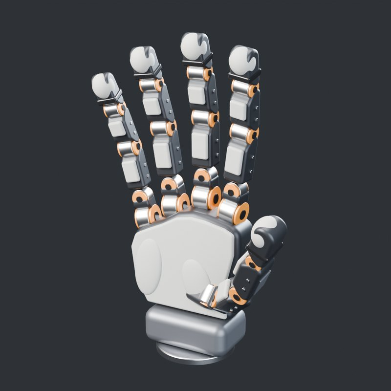
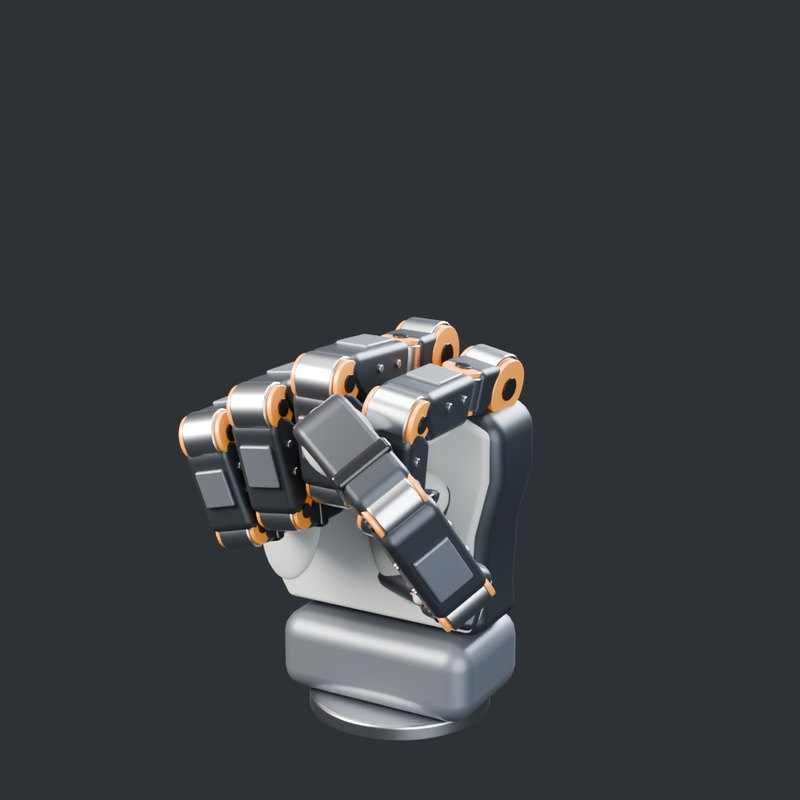
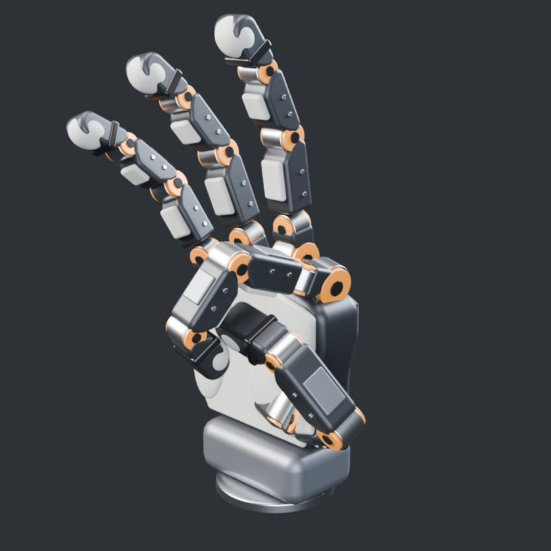
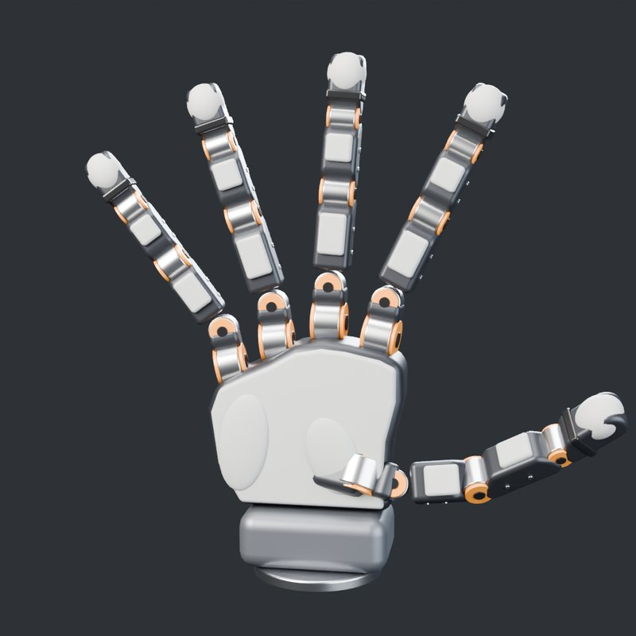
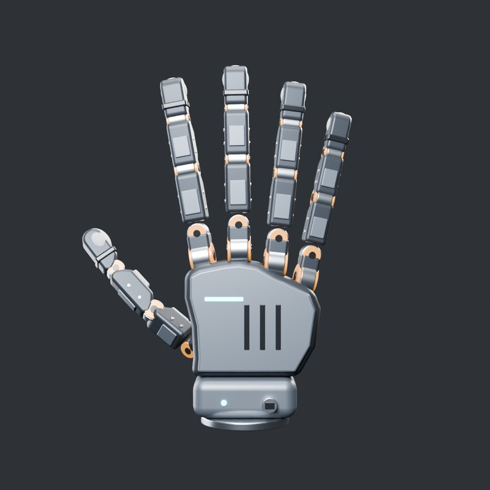
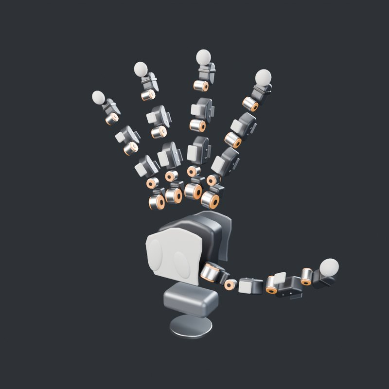
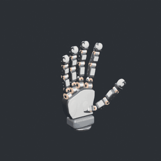

# 五指灵巧手（20 自由度直驱手：零件树 → 共享参数表 → 逐件建模）

一只右手机械灵巧手，5 根手指 × 4 个关节 = 20 个直驱关节电机，全部零件由 `build_hand.py` 在 Blender 里用代码生成。

- **关节布局参考** Wuji Hand 2（舞肌科技）公开的 URDF（[wuji-technology/wuji-description](https://github.com/wuji-technology/wuji-description)，MIT 许可，Hand 2.2 版）：每根手指根部的位置和朝向、指节长度、关节轴顺序和行程，都直接抄自 URDF。
- **外形是原创的**：骨架、电机模组、硅胶件的形状、颜色都是自己设计的，不对应真实产品的外观，也没有任何商标。

- **网页版（手机可看）**：<https://claude.ai/artifact/7EWvxwT7Smoy3WE9U9eKK1>（默认只有自己能打开，要给别人看需在页面的 Share 里开启分享）
- **离线版**：运行一次 `启动.bat` 后，`output\` 里有 `五指灵巧手_离线版.html`，双击即可，不用联网

| 放松 | 握拳 | 对指捏取 |
|---|---|---|
|  |  |  |
| **张指** | **背面** | **爆炸图** |
|  |  |  |



## 用法

双击 `启动.bat`，它会依次：

1. `git pull --ff-only origin main` 检查更新（没网或没装 git 就跳过）
2. 找 Blender（`blender_path.txt` → PATH → `Program Files\Blender Foundation\Blender*` → Steam）
3. 后台运行 `build_hand.py`，几秒钟生成 `output\hand.blend`、`hand.glb`、离线网页、零件树
4. 让你选：
   - **[1] 打开网页查看器**：切换手势、拖“拆开”看爆炸图、点零件看说明、看 20 个关节角
   - **[2] 用 Blender 打开**：按空格播放
   - **[3] 渲染 8 张预览图**：Cycles → `output\renders\`
   - **[4] 干涉检查**：在 5 个手势下检查零件有没有互相穿过去，报告存到 `output\check_report.txt`

找不到 Blender 时，把 `blender.exe` 的完整路径写进同目录的 `blender_path.txt`（这个文件不会提交到 git）。支持 Blender 4.2 ~ 5.x。

## 时间线（24 fps）

| 帧 | 内容 |
|---|---|
| 1 – 68 | 放松 → 握拳（28–44 停住）→ 张开 |
| 68 – 128 | 张开 → 对指捏取，拇指尖碰食指尖（92–108 停住）→ 张开 |
| 128 – 182 | 张开 → 张指，四指侧摆分开（148–162 停住）→ 放松 |
| 182 – 276 | 一边张指一边拆开（212–246 停住）→ 装回 |

## 文件

| 文件 | 作用 |
|---|---|
| `params.json` | **共享参数表**。所有尺寸、关节布局、行程、爆炸距离、材质颜色、各手势的关节角都在这里，零件只从这里读数 |
| `build_hand.py` | 逐件建模 + 装配 + 动画 + 导出网页。每类零件一个函数（`build_motor`、`build_finger`、`build_body`…），建模时把每个零件登记到零件树 |
| `check.py` | 干涉自查：每个手势下，把所有零件（含倒角）变成三角网格，用 BVH 找互相穿插的三角形 |
| `render.py` | 渲染静帧和动画帧 |
| `tools/solve_poses.py` | 重新求解各手势的关节角（避开穿模），写回 `params.json` 的 `poses`。改了尺寸后跑一次 |
| `viewer_src.html` / `viewer_template.html` | 网页查看器源码 / 内嵌 three.js 的离线模板（改了源码后用 `tools/make_template.mjs` 重新打包） |
| `output\part_tree.md`、`output\bom.csv` | 每次建模自动生成的零件树和零件清单（180 个网格零件） |

## 零件树

```
手（右手，20 自由度）
├─ 法兰（Ø52，接机械臂）
├─ 腕部模块（驱动板、IMU、以太网/电源接口、状态灯）
├─ 掌骨架
│  ├─ 背盖（散热槽 ×3、状态灯条）
│  └─ 掌心硅胶（软皮 + 大鱼际垫 + 小鱼际垫）
└─ 手指 ×5（同一个模板，参数不同）
   ├─ J1 根部屈伸电机 Ø18（定子在掌里；拇指多一个根座）
   ├─ 指根轭架（J1 转子 → J2 定子）
   ├─ J2 侧摆电机 Ø12
   ├─ 近节指骨（硅胶指节垫、指背盖板、螺钉）
   ├─ J3 中节屈伸电机 Ø13
   ├─ 中节指骨（同上）
   ├─ J4 远节屈伸电机 Ø11
   ├─ 远节指骨
   └─ 指尖力传感器 + 硅胶指尖套
```

每个电机模组 = 银色定子壳 + 两侧橙色输出环 + 黑色端盖。模组宽度等于所在指骨的宽度，所以相邻手指弯曲时不会互相顶住。

## 为什么要“先拆再建”

一次性写完整只手时，最容易错的不是单个零件，而是**零件之间的关系**：孔位对不上、相邻手指撞在一起、弯曲时穿模。这次的做法是：

1. **零件树先定**：哪些零件、谁装在谁上面、谁跟着哪个关节转。代码里的父子层级就是这棵树（`手指_base → J1 → F2 → J2 → F3 → J3 → F4 → J4`，F 是关节前的固定坐标系，电机定子挂在 F 上，不跟本关节转）。
2. **共享参数表**：接口尺寸只写一次。比如 J3 电机的外径同时决定了近节指骨末端的斜切、中节指骨起点的让位，改一个数，三个零件一起变。
3. **逐件建模**：每个零件在自己的局部坐标系里建，关节中心就是原点，所以装配时只需要把它挂到对的父节点上。
4. **渲染 + 干涉自查**：建完渲图看比例，再用 `check.py` 算穿模。这一步真的抓到过问题，见下面第 4 条。

这条规律（分层规划减少长链路出错）在代码生成里是比较公认的经验；具体到 CAD 能提升多少，没有严格数据，是推断。

## 设计要点和背后的原理

### 1. 直驱、可反向驱动（公认原理；“靠电流感知力”是厂家说法）

每个关节的电机转子直接带动下一节，没有减速器和连杆。好处是**可以反向驱动**：外力推手指，电机会跟着转，电流里就能估出受了多大的力。Wuji 自己的宣传是“通过电流感知力矩”，这是厂家说法，没有第三方测试数据。代价是电机要直接扛关节力矩，所以根部 J1 最粗（URDF 里 J1 的力矩上限 2 N·m，J3/J4 只有 0.3 N·m）。

### 2. 先屈伸、后侧摆（来自 URDF）

四指的 J1 是屈伸（绕 X），J2 才是侧摆（绕 Y），J2 装在 J1 后面。所以手指弯下去以后，侧摆的方向也跟着转了。人手的掌指关节是一个关节同时能屈和摆，这里拆成了两个串联的单轴关节。

### 3. 手心侧的斜切（自己的设计推理）

每节指骨在靠近关节的手心一侧做了斜切。不切的话，弯到 90° 时下一节的手心侧边角会钻进上一节里。斜切的位置由两端电机半径算出来（`phalanx_profile`），换电机尺寸会自动跟着变。

### 4. 手势是求解出来的，不是手调的

握拳、捏取时拇指的 4 个关节角，是用“坐标下降 + BVH 穿模惩罚”算出来的：代价 = 离目标多远 + 相交三角形数 × 权重。先粗网格或随机撒点找起点，再局部细化。

- 第一次把四指按 URDF 的根部朝向装好后，握拳时相邻手指的电机输出环撞在一起（42 对相交）。原因是 URDF 的根部带一点偏转，手指弯下去会向掌心汇聚。把电机模组收窄到不超出指骨宽度后，握拳 0 相交。
- 捏取：一开始拿“两个指腹中心点的距离”当目标，求解器怎么都差 8 mm，因为两根远节的硬骨架先撞上了。改成**像顶针一样包住指尖的硅胶指尖套**、目标改成“两个指尖套之间的最小间隙”以后，两个指尖套能碰上，其他零件 0 相交。

局限：坐标下降只能找局部最优；相交三角形数是离散的，不是真正的穿透深度；指尖套之间允许重叠，代表硅胶被压缩。

### 5. 拇指（来自 URDF；对掌程度是实测结果）

拇指根部的位置、朝向，以及 J2、J3 前面的固定偏转，都抄自 URDF。按这套运动学，拇指在 0 位是向外横着伸出去的，J1 的轴接近竖直，转 J1 就是把拇指从手掌侧面扫到手掌前面。用本模型的外形去捏食指时，两个指腹法线的夹角约 100°，也就是指尖对指尖、带一点侧面的捏法，不是完全指腹贴指腹。可能的原因（推测）：真实产品的拇指外壳形状和指腹位置跟这里的原创外形不同。

## 和真实 Wuji Hand 2 的差别

- 一样的：20 个主动自由度、每指 4 关节、关节顺序和行程、手指根部的位置和朝向、指节长度（中指总长约 208 mm，和官方 185~201 mm 的长度量级一致）。
- 不一样的：外形、颜色、电机模组尺寸（自己估的）、硅胶件形状、腕部模块、重量（没有建模）。网页里显示的“长 × 宽 × 厚”是 0 位姿态的包围盒，拇指横着伸出去，所以宽度比官方数字大。

## 改参数

- 改尺寸：编辑 `params.json`，重新运行 `启动.bat`。
- 改了手指长度、电机直径这类会影响碰撞的参数：先跑 `blender -b --factory-startup --python tools/solve_poses.py` 重新求手势，再用菜单 [4] 做干涉检查。
- 改了网页源码 `viewer_src.html`：`cd tools && npm install --no-save esbuild@0.24.0 three@0.170.0 && node make_template.mjs` 重新打包离线模板。
