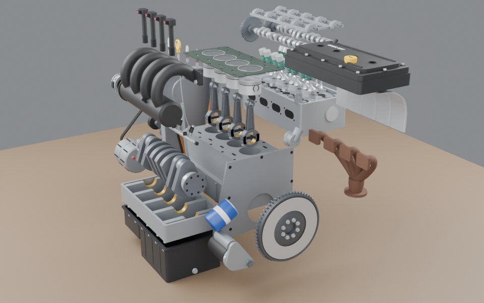
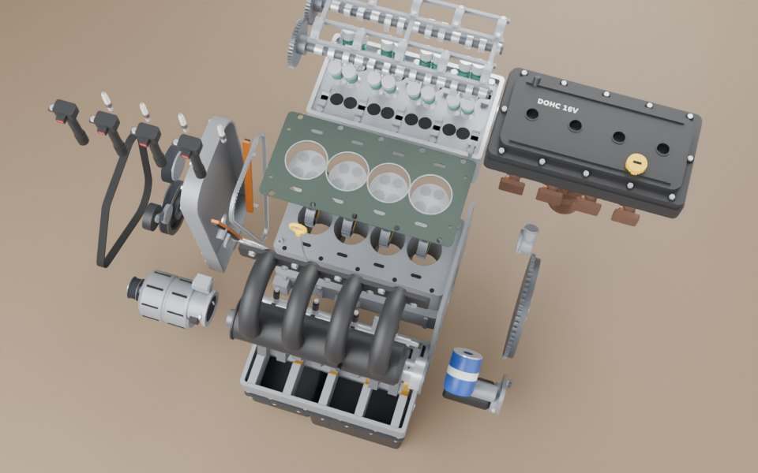

# 四缸发动机爆炸图（Blender 脚本建模 + 原理爆炸图）

一台通用的 2.0L 自然吸气直列四缸汽油机：DOHC 16 气门、正时链条、进气道喷射。不对应某一款车，尺寸按这个排量级常见的数值取（缸径 86 × 行程 86 = 1998 mL，缸心距 93 mm）。用 `build_engine.py` 在 Blender 里全部用代码生成，共 **49 个部件**：缸体是底座，另外 48 个都能单独拿起来。
每个部件的信息牌写的是**它在发动机里干什么**（为什么凸轮轴转速是曲轴的一半、连杆为什么是工字形、气缸垫冲了会怎样……）。同一份模型导进了虚幻工程 MyVRToyBox，在 VR 里可以拆开、一个个拿起来看。

零件树和接口参数表（建模前先和用户确认过的那份）在 Claude 文档《四缸发动机：零件树与接口参数表》里，这里只摘要。

| 装配 | 爆炸 |
|---|---|
|  |  |
|  |  |

## 用法

双击 `启动.bat`，它会依次：

1. `git pull --ff-only origin main` 检查更新（没网或没装 git 就跳过）
2. 找 Blender（`blender_path.txt` → PATH → `Program Files\Blender Foundation\Blender*` → Steam）
3. 后台运行 `build_engine.py`，几秒钟生成 `output\engine.blend` 和 `output\engine.glb`
4. 让你选：**[1]** 用 Blender 打开（按空格播放爆炸动画）/ **[2]** 用 Cycles 渲染 2 张预览图 / **[3]** 退出

找不到 Blender 时，把 `blender.exe` 的完整路径写进同目录的 `blender_path.txt`（这个文件不会提交到 git）。支持 Blender 4.2 ~ 5.x（在 5.2 上跑过）。

| 输出（`output\`） | 用途 |
|---|---|
| `engine.blend` | Blender 工程。第 1~120 帧按拆机顺序拆开，第 150~270 帧反顺序装回 |
| `engine.glb` | glTF 模型，单位米，每个部件一个节点（`E05_Crankshaft` …），extras 里有零件号、中文名、材料、作用、爆炸路线。MyVRToyBox 的 `导入发动机模型.bat` 用它 |
| `parts.json` | 部件表（49 个） |

## 部件（49 个，按系统分）

| 系统 | 部件 |
|---|---|
| 机体 | 缸体（底座，不动）、主轴承梁（下曲轴箱）、油底壳、气缸垫 |
| 曲柄连杆 | 曲轴、4 个活塞（连活塞环、活塞销）、4 根连杆（连杆盖、螺栓、轴瓦）、飞轮（连齿圈）、曲轴减振皮带轮 |
| 配气 | 缸盖、进气凸轮轴、排气凸轮轴（各连链轮）、凸轮轴承盖架、4 组气门（每组 = 4 个气门 + 弹簧 + 弹簧座 + 液压挺柱） |
| 正时 | 正时链条、链条张紧器与导轨、正时罩盖、气门室盖（连机油加注盖） |
| 点火 | 4 个笔式点火线圈、4 个火花塞 |
| 进气 / 燃油 | 进气歧管（稳压腔 + 4 根歧管）、节气门体、油轨与喷油器 |
| 排气 | 排气歧管、隔热罩 |
| 润滑 | 机油泵与集滤器、机油滤清器、机油尺 |
| 冷却 | 水泵（连皮带轮）、节温器壳 |
| 附件 | 发电机、起动机、多楔带、皮带张紧轮 |

粒度按"拿在手里能讲清楚作用的东西"来分，不拆到螺丝：气门、弹簧、挺柱都很小，一缸 4 个合成一组；连杆盖和连杆一起；喷油器跟着油轨。

## 主要接口尺寸（实物 mm）

| 参数 | 值 | 说明 |
|---|---|---|
| 缸径 × 行程 | 86 × 86 | 方形缸，排量 1998 mL |
| 缸心距 | 93 | 4 个缸中心 X = +139.5、+46.5、-46.5、-139.5，1 缸在正时端 |
| 主轴颈 / 连杆轴颈 | Φ55 / Φ48 | 5 道主轴颈，曲柄半径 43 |
| 连杆中心距 / 活塞压缩高度 | 139 / 30 | 缸体顶面高 212 = 43 + 139 + 30 |
| 凸轮轴中心 | Z 350，Y ±58 | 气门夹角 2 × 17.5°；进气门 Φ34、排气门 Φ29 |
| 正时链轮 | 曲轴 21 齿、凸轮轴 42 齿 | 2:1，曲轴两圈凸轮轴一圈 |
| 多楔带 | 6 楔 | 曲轴皮带轮 → 张紧轮 → 发电机 → 水泵 |
| 点火顺序 | 1-3-4-2 | 曲轴停在 1 缸压缩上止点（1、4 缸在顶，2、3 缸在底），凸轮按这个相位摆 |

## 拆机顺序和爆炸后的摆法

发动机曲轴沿桌子长边放，**进气侧朝玩家**（一眼看到进气歧管、油轨、节气门），正时端在左手边，飞轮在右手边（触屏在右前方，所以飞得最远的前端零件放左边）。顺序按真实拆机：

| 顺序 | 拆什么 | 爆炸后在哪 |
|---|---|---|
| 1 | 多楔带 → 张紧轮 → 发电机、水泵、曲轴皮带轮 | 左边一串，皮带最远 |
| 2 | 机油尺、机油滤清器、起动机 | 机油尺往上拔出一半（还插在导管里）；机滤、起动机在右边 |
| 3 | 点火线圈、火花塞 | 先往上拔，再排到左上方 |
| 4 | 节气门 → 进气歧管 → 油轨 | 往玩家这边、再往上 |
| 5 | 隔热罩、排气歧管、节温器 | 右边 |
| 6 | 正时罩盖 → 导轨 → 链条 | 左边，依次靠近缸体 |
| 7 | 气门室盖 → 凸轮轴承盖架 → 两根凸轮轴 | 先往上，再退到缸盖上方 |
| 8 | 飞轮 | 右边 |
| 9 | 缸盖（连气门）→ 缸垫 | 缸盖往后退 30 cm，气门再从缸盖里往上浮；缸垫浮在缸体正上方最高处 |
| 10 | 油底壳 → 活塞、连杆从缸孔往上推出 → 机油泵 → 主轴承梁 → 曲轴 | 连杆、活塞一缸一列浮在缸体上方；下半截像抽屉一样往玩家这边拉出 29 cm，从下到上按装配顺序叠着：油底壳、主轴承梁、曲轴 |

拆开后整个模型大约 133 × 84 × 91 cm（模型尺寸，VR 里乘 0.89），最高点在桌面上方约 81 cm。脚本按虚幻里同样的缓动逐帧检查过：拆开后的位置上没有部件互相穿插（只有机油尺故意留了一截在导管里，主轴承梁和缸体后端法兰有一个面贴着）。动画路上有几个部件会擦过别的部件，没有全部避开。

## 原理速记

- **四冲程**：进气 → 压缩 → 做功 → 排气，曲轴转两圈完成一次循环。四个缸轮流做功（1-3-4-2），每半圈有一个缸在做功，飞轮把转速抹平。
- **1、4 缸和 2、3 缸**：平面曲轴的 1、4 缸连杆轴颈在一边，2、3 缸在另一边（差 180°）。1、4 缸同时到顶，但一个是压缩上止点（马上点火），另一个是排气上止点（气门重叠）。
- **DOHC 16V**：每缸 2 进 2 排，进气、排气各一根凸轮轴。4 个气门比 2 个的总流通面积大，火花塞能放在正中间。
- **为什么凸轮轴半速**：每个气门每个循环（两圈曲轴）只开一次，所以链轮 42 齿 : 21 齿。
- **液压挺柱**：用机油压力自动消除气门间隙，不用定期调。
- **润滑**：机油泵从油底壳吸油 → 机滤 → 缸体主油道 → 曲轴主轴颈 → 曲轴里的油孔 → 连杆轴颈；另一路上缸盖润滑凸轮轴。
- **冷却**：水泵把冷却液推进缸体水套 → 缸盖 → 节温器；冷车时节温器关着，只在发动机里小循环。

## 建模说明

- 坐标：原点在曲轴中心线上、2 / 3 缸中间；+X = 正时端，+Z 向上，-Y = 进气侧。分型面高度：油底壳底 Z = -220（贴桌面）、主轴承梁 -70 ~ 0、缸体顶面 212、缸垫 212 ~ 215、缸盖 215 ~ 350（凸轮轴中心）、气门室盖顶 425。零件直接按装配位置建模，物体原点都在世界原点。
- **导出前整体左右镜像**（`MIRROR_X`，X 取反）：桌上进气侧朝玩家时，正时端才能落在玩家左手边。脚本里的尺寸、爆炸路线都按上面的坐标写，镜像只在 `finish()` 里做一次，气门室盖上的 "DOHC 16V" 提前反写了。镜像后的发动机相当于从正时端看曲轴逆时针转（老款本田就是这样），静态模型看不出区别。
- 爆炸公式和电机、车床、万用表一样：每个零件有几段位移，每段有一个出场时刻 s，在总进度 T 的 `[0.6s, 0.6s + 0.4]` 区间里缓动走完；装回时 T 倒着走。
- 在虚幻里按最长边缩放到 **60 cm**（实物装配后最长的一边是高度：油底壳底到点火线圈顶约 67 cm，所以缩放 0.89 倍）。活塞直径约 7.7 cm，捏得住；1:1 放上桌子拆开后会摊出 1.3 米多。
- 材质金属度都压在 0.55 以下（虚幻工作室里没有反射探针，金属度高的会发黑）。
- 简化了的地方：缸体里的水套、油道没有做（实心）；齿轮、链轮齿数为了好看取整，飞轮齿圈只做了 60 齿（实物 130 多齿）；线束、真空管、传感器没画；气缸垫画成 3 mm 厚（实物约 1 mm）。
