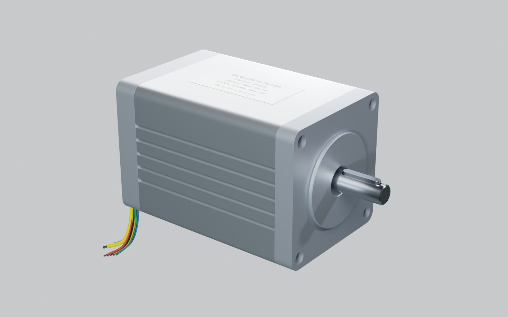
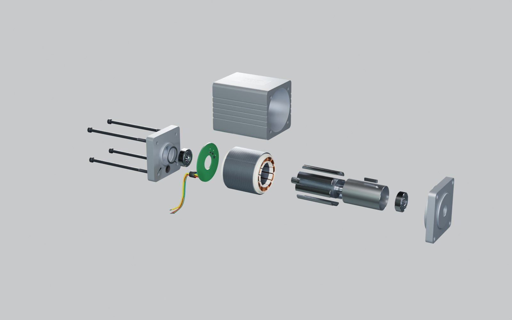

# 无刷电机爆炸图（Blender 脚本建模）

57 型内转子无刷直流电机（BLDC，3 相，8 极 12 槽，霍尔 120°），全部零件由 `build_motor.py` 在 Blender 里用代码生成。
同一份模型有三种用法：Blender 里看/渲染、网页里看（手机也行）、导进虚幻 5。

- **网页版（手机可看）**：<https://claude.ai/artifact/Jza5FNrQPK3M5vjD4rvut7>（默认只有自己能打开，要给别人看需在页面的 Share 里开启分享）
- **离线版**：运行一次 `启动.bat` 后，`output\` 里会有一个 `.html`，双击即可，不用联网

| 装配 | 爆炸 |
|---|---|
|  |  |

## 用法

双击 `启动.bat`，它会依次：

1. `git pull --ff-only origin main` 检查更新（没网或没装 git 就跳过）
2. 找 Blender（`blender_path.txt` → PATH → `Program Files\Blender Foundation\Blender*` → Steam）
3. 问要不要顺便用 Cycles 渲染预览图（默认 10 秒后选“不要”）
4. 后台运行 `build_motor.py`，在 `output\` 生成文件
5. 让你选：打开网页 / 打开 Blender / 都打开

找不到 Blender 时，把 `blender.exe` 的完整路径写进同目录的 `blender_path.txt`（这个文件不会提交到 git）。

### 输出文件（`output\`）

| 文件 | 用途 |
|---|---|
| `motor.blend` | Blender 工程。按空格播放 = 爆炸动画（第 1 帧装配，第 121 帧全部拆开） |
| `motor.glb` | glTF 模型，单位米，零件独立命名（`P01_Shaft` …），extras 里带中文名、日文名、材料、爆炸方向 |
| `无刷电机_离线版.html` | 离线网页，模型直接嵌在文件里（约 8 MB） |
| `parts.json` | 零件表数据 |
| `render_*.png` | 只有选了渲染才会有 |

导入虚幻 5：**文件 → 导入到关卡**，选 `motor.glb`。单位是米，UE 会自动换成厘米。所有零件的原点都在电机轴心上，转子零件（轴、铁芯、磁钢、护套、平键）绕电机轴线旋转就是转动，做 Sequencer 动画时不用再调轴心。

## 网页的三种模式

- **结构**：爆炸滑杆 + 编号气泡 + 零件表，点零件看材料和作用。拆装顺序按真实维修顺序：贯穿螺钉 → 后端盖 → 波形垫圈 → 后轴承 → 霍尔板 → 前端盖 → 前轴承 → 转子 → 机壳 → 磁钢护套 → 磁钢。
- **原理**：从前端看定子和转子，演示六步换相。线圈按通电相位上色，齿端色块是此刻的 N/S 极，转子磁钢红 = N、灰蓝 = S；右侧（手机在下方）实时显示霍尔码、三相状态和波形。可暂停、单步、调速度。
- **模型**：装配状态自由旋转；“剖切”沿轴线切开一半，能看到轴承、转子、定子和霍尔板的相对位置。

手机竖屏时，结构/模型模式会自动把电机轴转成竖直方向，爆炸图沿屏幕上下展开，更容易看清。

## 原理速记（网页“原理”模式演示的内容）

- 8 极 = 4 对极，所以 **电角度 = 4 × 机械角**。转子转 90°，电气上就走完一整圈 360°。
- 12 个齿按 U、V、W 循环绕线：相邻两个齿差 30° 机械角 = 120° 电角度，正好是三相的相位差。
- 3 个霍尔装在 15°、45°、75° 机械角（= 60°、180°、300° 电角度，彼此差 120°）。每 60° 电角度有一个霍尔翻转，一圈电角度出现 6 种码。
- 驱动器按霍尔码选择通电的两相，让定子 N 极落在转子 N 极后方约 90° 电角度（S 极在前方约 90°），转子就一直被往前拉。

| 步 | 霍尔 H1H2H3 | U | V | W |
|---|---|---|---|---|
| 1 | 100 | + | − | 悬空 |
| 2 | 110 | + | 悬空 | − |
| 3 | 010 | 悬空 | + | − |
| 4 | 011 | − | + | 悬空 |
| 5 | 001 | − | 悬空 | + |
| 6 | 101 | 悬空 | − | + |

注意：真实电机的霍尔码与步骤的对应关系取决于霍尔安装位置和相序定义，**不同厂家的表不一样**，以电机规格书为准；这张表只对本模型成立。

## 改参数

尺寸都在 `build_motor.py` 开头（单位 mm）：叠厚 `STACK`、定子外径 `R_STATOR`、齿宽 `TOOTH_W`、磁钢外径 `R_MAG`、霍尔角度 `HALL_ANG` 等。爆炸方向和顺序在 `EX` 字典里，每条是 `(x, y, z, 出场时刻 0~1)`。

## 和真实电机的差别（有意简化）

- 定子叠片画成 16 片 × 2.5 mm，真实是 0.5 mm 一片、约 80 片
- 每个线圈只画了约 12 匝（为了让手机也能流畅显示），真实通常几十到上百匝
- 螺钉螺纹画成一圈圈的环，不是真正的螺旋；轴承画了钢球但没画保持架
- 外形尺寸参照常见 57BL 系列，不对应任何具体厂家的图纸

## 文件

| 文件 | 说明 |
|---|---|
| `启动.bat` | 一键启动（ASCII、CRLF） |
| `build_motor.py` | Blender 建模脚本（bmesh 建模，布尔/倒角用修改器在内存里应用） |
| `viewer_template.html` | 离线网页模板（three.js r170 已打包在内，脚本把 glb 填进去） |
| `viewer_src.html` | 网页源码（three.js 从 CDN 加载，用于发布网页版；改网页从这里改，再打包成模板） |

兼容：在 Blender 5.2 上测试通过；脚本对 3.6 ~ 4.x 写了兼容分支（如 `auto_smooth`），但没有在这些版本上实测。
