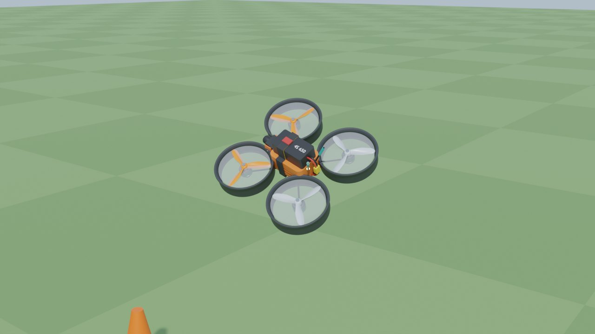
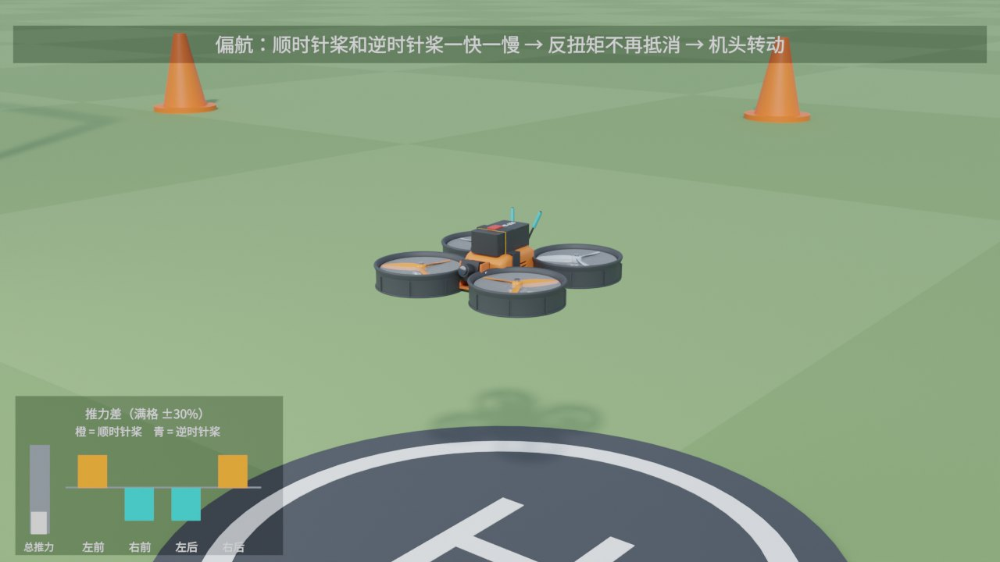
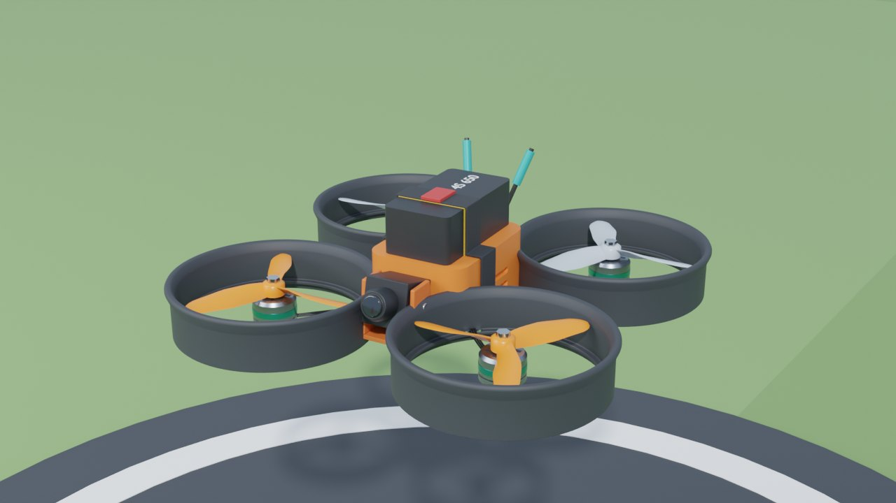
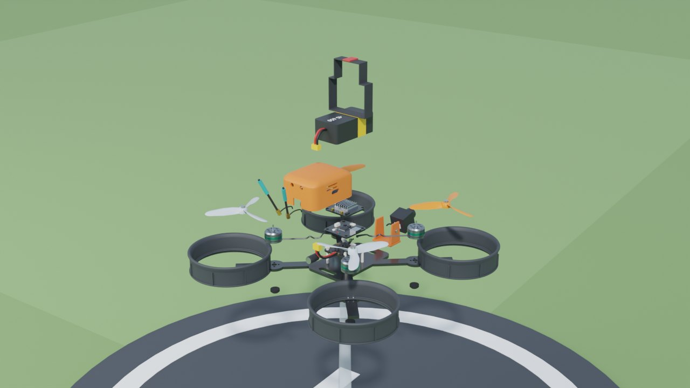

# 涵道无人机（Blender 脚本建模 + 飞行演示 + 差速原理 + 爆炸图）

一架**原创**的 3 寸涵道穿越机（cinewhoop），全部零件由 `build_drone.py` 在 Blender 里用代码生成，不对应任何厂家的产品。
同一个 `.blend` 里有三段动画：飞行演示、差速原理演示、爆炸图。

| 飞行（弯道里侧倾约 37°） | 差速原理（偏航：顺/逆时针桨一快一慢） |
|---|---|
|  |  |
| **装配（在展示台上）** | **爆炸** |
|  |  |

## 用法

双击 `启动.bat`，它会依次：

1. `git pull --ff-only origin main` 检查更新（没网或没装 git 就跳过）
2. 找 Blender（`blender_path.txt` → PATH → `Program Files\Blender Foundation\Blender*` → Steam）
3. 后台运行 `build_drone.py`，十几秒生成 `output\drone.blend`
4. 让你选：
   - **[1] 用 Blender 打开**：按空格播放。时间线上有标记，会自动切相机
   - **[2] 渲染 MP4 视频**：EEVEE，1280×720，1195 帧（约 40 秒），用显卡，几分钟 → `output\drone_demo.mp4`
   - **[3] 渲染 4 张预览图**：Cycles → `output\render_*.png`

找不到 Blender 时，把 `blender.exe` 的完整路径写进同目录的 `blender_path.txt`（这个文件不会提交到 git）。
支持 Blender 4.2 ~ 5.x。字幕用系统里的中文字体（微软雅黑 / 黑体 / 游ゴシック / Meiryo，按顺序找）；一个都找不到时自动换成英文字幕。

## 时间线（30 fps）

| 帧 | 内容 | 相机 |
|---|---|---|
| 1–449 | **飞行演示**：地面怠速 → 起飞 → 8 字航线左右各穿过一个竞速门 → 降落停桨 | 跟拍 `Cam_Chase` |
| 450–894 | **差速原理**：在起降垫上依次演示 油门 → 偏航 → 横滚 → 俯仰 → 降落 | 定点 `Cam_Demo` |
| 895–1195 | **爆炸图**：放到透明展示台上原地转圈，按拆机顺序拆开 → 停留 → 反顺序装回 | `Cam_Explode`（跟着拉远/推近） |

飞行段和差速段，画面左下角都有一组条形：

- **总推力**（灰色竖条）：四个电机加起来的推力，满格 = 推重比 4。
- **四个电机的推力差**：每个电机比四个的平均值多（向上）还是少（向下）。满格是 ±30%，橙色是顺时针桨，青色是逆时针桨。

上方的字幕说明当前这一步在干什么。

## 零件和拆机顺序

| 顺序 | 零件 | 对象名 | 爆炸方向 |
|---|---|---|---|
| 1 | 电池绑带 | `P14_Strap` | 上 |
| 2 | 4S 650mAh 电池（带 XT30 公头） | `P13_Battery` | 上 |
| 3 | 图传天线 ×2（带到图传的同轴线） | `P15_Antennas` | 后上 |
| 4 | 3 寸三叶桨 ×4（前橙后灰） | `P06_Prop_*` | 上 + 沿对角线向外 |
| 5 | TPU 机身罩（左侧 USB 口、两侧散热格栅、前后走线孔） | `P10_Canopy` | 后上（让出里面的飞控塔） |
| 6 | FPV 相机，上仰 15°（带到图传的相机线） | `P12_Camera` | 前 |
| 7 | TPU 相机支架 | `P11_CamMount` | 前 |
| 8 | 数字图传：屏蔽罩 + 铝散热片 + 2 个 MMCX 座（带到飞控的 6P 排线） | `P09_VTX` | 上 |
| 9 | 飞控：MCU、陀螺仪、气压计、Flash、晶振、USB-C、BOOT 键（带到电调的 8P 排线） | `P08_FC` | 上 |
| 10 | 四合一电调：24 颗 MOS 管、4 颗驱动 MCU、12 个电机焊盘（带电源线、低 ESR 电容、XT30 母头） | `P07_ESC` | 上（离开立柱一点） |
| 11 | 1404 外转子无刷电机 ×4（相线一直焊到电调焊盘） | `P05_Motor_*` | 上 |
| 12 | 涵道 ×4（外侧 8 条加强筋、底部加厚唇） | `P04_Duct_*` | 沿对角线向外 |
| 13 | 橡胶脚垫 ×4 | `P03_Foot_*` | 下 |
| — | 碳纤维机架、尼龙立柱 | `P01_Frame` `P02_Standoffs` | 不动 |

所有零件都挂在空物体 `Drone` 下：飞行和差速动画只动 `Drone`，爆炸动画只动零件相对 `Drone` 的位置，两者互不干扰。
桨的原点在电机轴心，只绕自己的局部 Z 轴转。
排线、相线这些线跟着它所属的零件一起移动，所以拆开时能看到线从另一头“拔出来”。

## 动画背后的原理

### 1. 姿态是从航线算出来的（公认结论）

四个桨都朝机身 +Z 方向推，推力方向改不了，只能把整个机身歪过去。
要获得加速度 **a**，推力必须等于 m(**a** + **g**)，所以机身 +Z 轴要对准 **a** + **g**。
脚本先算出每一帧的加速度，再让机身轴对准 **a** + **g**，机头转向速度方向。整段姿态不是手 K 的。

### 2. 每个电机该出多少力：混控器（公认结论，参数是估计值）

有了每一帧的姿态，脚本再往回推：

1. 用相邻帧的姿态差分出角速度 ω，再差分出角加速度 α。
2. 刚体需要的力矩是 τ = I·α + ω × (I·ω)。
3. 四个未知数（四个电机的推力）配四个方程，解出每个电机的推力：
   - 总推力 = 四个之和 = m·|**a** + **g**|
   - 绕机身 x、y 的力矩 = Σ 推力 × 力臂
   - 绕机身 z 的力矩 = Σ (−转向) × KQ × 推力。桨俯视逆时针转，机身就被往顺时针拧。

这就是飞控里“混控器（mixer）”做的事，只是飞控是反过来用的：先算出想要的力矩，再分配给四个电机。
代码在 `mixer_inverse()` 和 `compute_motion()`。

### 3. 从条形能看出的几件事

**偏航最费劲**（公认结论）
桨的反扭矩只有推力 × 1 cm 左右（`KQ = 0.012 m`），而横滚、俯仰的力臂是 5.2 cm。
所以同样是转动，偏航要的差速最大：演示里偏航约 ±22%，横滚和俯仰只有 ±9% 左右。
真机上也是偏航反应最“肉”。

**差速只在“开始转”和“停止转”的瞬间出现**（刚体力学的结论；忽略了空气阻力和桨的陀螺效应）
横滚演示里，机身先右倾再回正。条形是一阵一阵的：
- 开始倾斜时，左边快；
- 倾斜到位、要停住时，右边快；
- 保持倾斜不变时，四个几乎一样。

原因是力矩只和角**加速度**有关：保持一个固定的倾角不需要力矩。

**推力 ∝ 转速²，所以转速 ∝ √推力**（公认结论）
每个桨的转速都按它自己的推力算，所以转弯时四个桨转得不一样快。
但真实 3 寸桨每分钟两三万转，30 fps 下根本看不出快慢（车轮效应）。
所以动画里的转速是放慢的示意值，再叠一层半透明的桨盘虚影。真要看差别，请看条形。

### 4. 其他细节

- **对角两只桨同向、相邻两只反向**（公认结论）：反扭矩两两抵消，机身才不会原地打转。正桨和反桨的叶片是镜像的（`spin` 属性：+1 = 俯视逆时针，−1 = 顺时针），装错位置会直接翻机。
- **桨叶为什么是扭的**（公认结论）：每个截面的安装角 β = atan(螺距 / 2πr)。根部角度大、桨尖角度小，转一圈每个截面“前进”的距离都差不多等于螺距。
- **涵道**（有研究支持，但效果取决于设计）：首先是保护桨。另外，桨尖间隙很小时（这里单边 1 mm）能减少桨尖涡流，低速推力效率会好一点。代价是重量和前飞阻力。入口圆角是凭经验画的，没有做过气动验证。
- **为什么平移演示用九次多项式**（我的建模选择）：倾角 ∝ 加速度，所以倾斜的角加速度 ∝ 位置的 4 阶导数。如果用常见的五次平滑曲线，起步那一瞬间 4 阶导数会突变，算出来的差速方向会反直觉。换成九次（`S9`），起步时 3 阶、4 阶导数都是 0，条形才是“先左快、再右快”这种干净的形状。

## 改参数

尺寸都在 `build_drone.py` 开头（单位 mm）：

- `MOTOR_XY`：电机位置（决定轴距）
- `DUCT_R_IN` / `DUCT_R_OUT`：涵道内外径
- `PROP_PITCH`：螺距
- `CAM_TILT`：相机上仰角

飞行参数：
- `H`：巡航高度
- `LOOP_A` / `LOOP_B`：8 字大小
- `F_LOOP`：飞 8 字用的帧数。帧数越少飞得越快，倾角越大。

差速演示：
- `D_YAW` / `D_ROLL` / `D_PITCH`：各动作的起始帧
- `D_SHIFT`：平移用的帧数
- `DEMO_MOVE`：平移距离

动力学参数（都是估计值，不是实测）：
- `MASS`：整机质量
- `INERTIA`：转动惯量
- `KQ`：反扭矩系数
- `F_MAX`：单电机最大推力

改 `KQ` 能直接看到偏航差速跟着变。

爆炸方向和顺序在 `EX` 字典里，每条是 `(x, y, z, 出场时刻 0~1)`。

## 和三视图草稿的差别

- **电池往前挪了**：草稿里电池伸出机身后方 20 mm，会和天线撞上。现在电池和机身罩前后对齐，天线从机身罩后壁伸出。
- **高了一点**：电池顶到脚垫底约 55 mm，草稿是 53 mm；算上绑带搭扣约 57 mm。
- **机身罩改成圆角造型**：顶面四周 5 mm 圆角，前上沿斜切（给相机让视野），后上沿小倒角。

## 有意简化

- 板子上的元件是示意方块，尺寸参照常见封装，不对应具体型号
- 电机内部（定子、绕组、磁钢）没有建，只有外壳
- 混控器没有算空气阻力、桨的陀螺效应、电机响应延迟，也没有 PID：姿态是“理想跟随”的，差速是倒推出来的
- 螺丝只画了涵道法兰和相机转轴上的几颗

## 文件

| 文件 | 说明 |
|---|---|
| `启动.bat` | 一键启动（ASCII、CRLF） |
| `build_drone.py` | Blender 建模 + 动画脚本（bmesh 建模，布尔用 EXACT 求解器） |
| `preview/` | README 用的预览图 |
