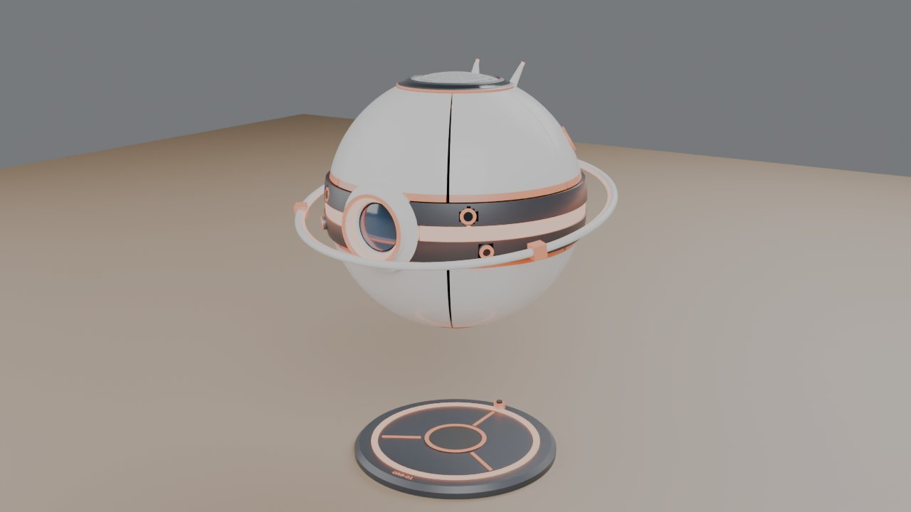
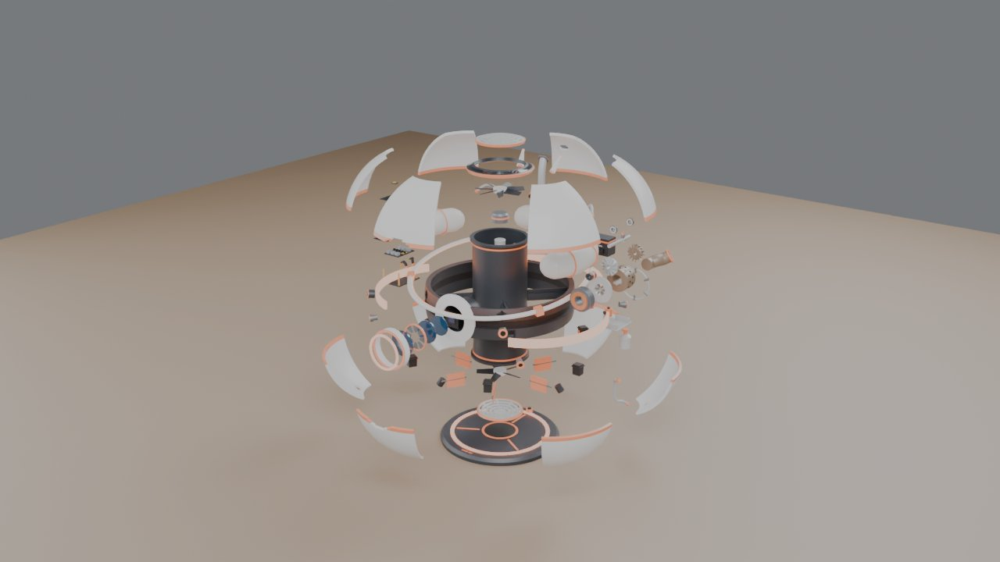
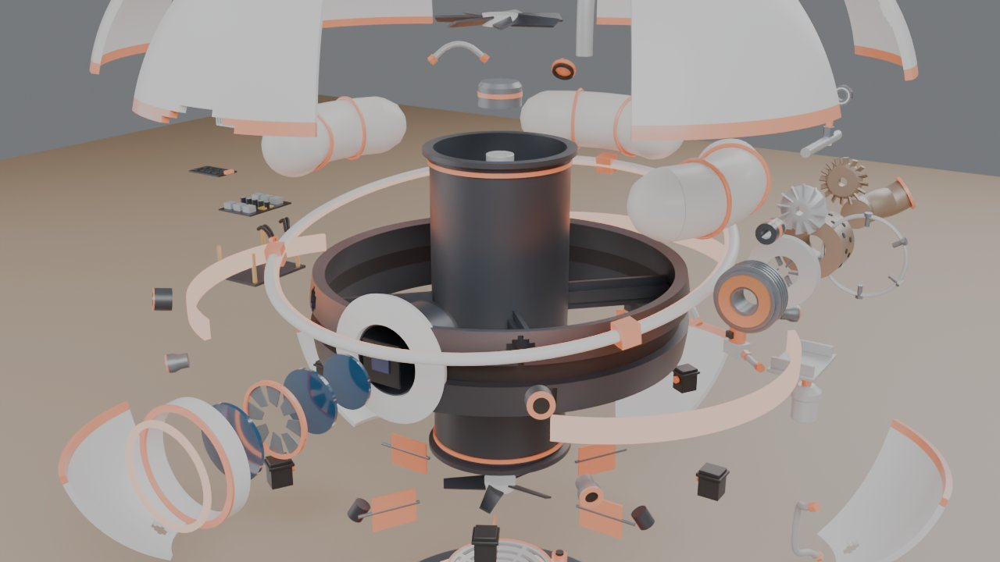

# 球形漂浮机器人爆炸图（ORB-1 · 科幻原创：Blender 脚本建模 + 原理爆炸图）

一台直径 36 cm 的白色球形浮游机器人，悬停在停机加注坪上方。用 `build_orb_bot.py` 在 Blender 里全部用代码生成，**58 种、96 个零件**。
同一份模型导进了虚幻工程 MyVRToyBox（触屏 **ROBOT** 按钮），在 VR 里可以拆开、一个个零件拿起来看。

设定是"真实骨架 + 科幻外皮"：液体燃料（航空煤油）→ 微型燃气涡轮发电机 → 电 → 球心竖直涵道里的**共轴反转风扇**往下吹气产生升力；涵道出口 6 片导流舵片控制俯仰 / 横滚，赤道 4 个小喷口管偏航。
每个零件的信息牌都标了 **【真实原理】** 或 **【科幻设定】**。

| 装配 | 爆炸 |
|---|---|
|  |  |

## 用法

双击 `启动.bat`，它会依次：

1. `git pull --ff-only origin main` 检查更新（没网或没装 git 就跳过）
2. 找 Blender（`blender_path.txt` → PATH → `Program Files\Blender Foundation\Blender*` → Steam）
3. 后台运行 `build_orb_bot.py`，几秒生成 `output\orb_bot.blend` 和 `output\orb_bot.glb`
4. 让你选：**[1]** 用 Blender 打开（按空格播放爆炸动画）/ **[2]** 用 Cycles 渲染 3 张预览图 / **[3]** 退出

找不到 Blender 时，把 `blender.exe` 的完整路径写进同目录的 `blender_path.txt`（这个文件不会提交到 git）。支持 Blender 4.2 ~ 5.x（在 pip 装的 bpy 5.2 上跑过）。

| 输出（`output\`） | 用途 |
|---|---|
| `orb_bot.blend` | Blender 工程。第 1~120 帧拆开，第 150~270 帧装回 |
| `orb_bot.glb` | glTF 模型，单位米，每个零件一个节点（`P34_UpperFan` …），extras 里有零件号、中文名、材料、作用、爆炸路线。MyVRToyBox 的 `导入漂浮机器人模型.bat` 用它 |
| `parts.json` | 零件表 |

## 零件

| 子系统 | 零件 | 数量 |
|---|---|---|
| 基座（不动） | 停机加注坪、赤道承力带（含 4 根辐条）、中央涵道、主眼镜筒 | 4 |
| 外壳 | 上装甲瓣 6、下装甲瓣 6、顶部进气格栅、底部出风格栅、激光雷达环、浮游光环、赤道灯带 3 | 19 |
| 燃料 | 环形燃料舱 3、加注管、加注口盖、液位传感器、滤清器、燃油泵、电磁截止阀、调压阀、油管 7 | 17 |
| 涡轮发电机 | 发电机定子 / 转子、进气口、压气机叶轮、环形燃烧室、喷油嘴组、点火器、涡轮转子、排气管、主轴、轴承 2、支架 | 13 |
| 电力与控制 | 缓冲电池包、电子舱支架、电源管理板、电调 2、散热片、飞控板、IMU、线束 | 9 |
| 推进 | 上风扇（7 叶）、上电机、电机支架、下电机、下风扇（5 叶）、导流舵片 6、舵机 6、偏航喷口 4 | 21 |
| 传感器 | 主眼（前镜片、光圈、中镜片、后镜片、图像传感器、遮光罩、眼圈光环）、立体相机 2、测高雷达 2、天线 2 | 13 |

## 拆机顺序和爆炸后的摆法

正面（主眼）是 -Y，在虚幻里朝着玩家；涡轮发电机在 +X（玩家右手边），电子舱在 -X（左手边），电池和加注口在背面。

| 顺序 | 动作 |
|---|---|
| 1 | 浮游光环往上浮；加注口盖、天线、立体相机、偏航喷口、三段灯带沿球面法线往外拔 |
| 2 | 顶部格栅、雷达环往上；底部格栅往下 |
| 3 | 12 片装甲瓣像花一样打开：上 6 瓣往斜上，下 6 瓣往外再往下 |
| 4 | 主眼的镜片、光圈、传感器、遮光罩沿视线往前一片片排开 |
| 5 | 下半球的油路（滤清器、泵、阀、油管）往外 |
| 6 | 电池往后；涡轮发电机往右后方整体拉出（避开虚幻工作室右手边的触屏），再沿轴线拆成一串；电子舱往左拉出，再一层层往上叠开 |
| 7 | 舵机往外，舵片往下再往外；上风扇、上电机、电机支架从涵道顶上抽出，下风扇、下电机从底下抽出 |
| 8 | 三段燃料舱（连着加注管、液位传感器、跨接油管）最后往上提 |

**为什么燃料舱最后才走、而且只能往上走**：它们和赤道承力带在同一高度，承力带是一整圈，往外拔会撞上；所以等上半球的涡轮、电子舱、电池都拿走以后，再从上面提出来。其他内部零件都放在承力带的上方或下方，从承力带上下的空当里往外拔。

## 原理速记（真实 vs 科幻）

- 【真实】**为什么不直接喷燃料悬停**：火箭比冲约 300 s，10 kg 的东西悬停每分钟要烧约 2 kg 推进剂。推空气比喷燃料省一个数量级，所以用"燃料发电 → 风扇推空气"这条路。
- 【真实】**布雷顿循环**：压气机压缩空气 → 燃烧室喷油燃烧 → 燃气推涡轮 → 涡轮带压气机和发电机（同一根轴）。
- 【真实】**共轴反转**：单个风扇会把机身往反方向拧，上下两个反转，扭矩抵消；下风扇还能把上风扇的旋转气流拉直。
- 【真实】**涵道**：管壁挡住桨尖涡，同功率推力大 20~30%，转着的桨叶也被包住。
- 【真实】**舵片偏流 + 飞控闭环**：悬停天生不稳定，靠 IMU + 飞控每秒几百次调舵片和转速。"重的放下面就稳"是错觉（钟摆谬误）。
- 【真实】**电池缓冲**：涡轮响应慢（秒级），风扇要毫秒级改推力，电池先顶上——油电混动的思路。
- 【科幻】36 cm 的球里塞进涡轮发电机还能长时间悬停（真机做不到这么小）；不连任何东西的浮游光环；发光灯带。

## 建模说明

- 坐标：+Z 向上，Z = 0 是停机坪底面，球心 Z = 380 mm，球壳外半径 177 mm（赤道承力带凸出到 182 mm）。零件直接按装配位置建模，物体原点都在世界原点。
- 球壳用经纬网格生成（`sph_grid`），开孔、开缝按格子挖掉，自动补侧壁。
- 爆炸公式和电机、车床、服务器一样：每个零件有几段位移，每段有一个出场时刻 s，在总进度 T 的 `[0.6s, 0.6s + 0.4]` 区间里缓动走完；装回时 T 倒着走。
- 虚幻那边按路线分抓取单元；基座（停机坪 + 承力带 + 涵道 + 镜筒）不能抓。
- 材质金属度都压在 0.55 以下（虚幻工作室里没有反射探针，金属度高的会发黑）。灯带、光环、眼圈用自发光材质。
- 在虚幻里按最长边（含停机坪的总高 56 cm）缩放到 **50 cm**，球体约 32 cm。
