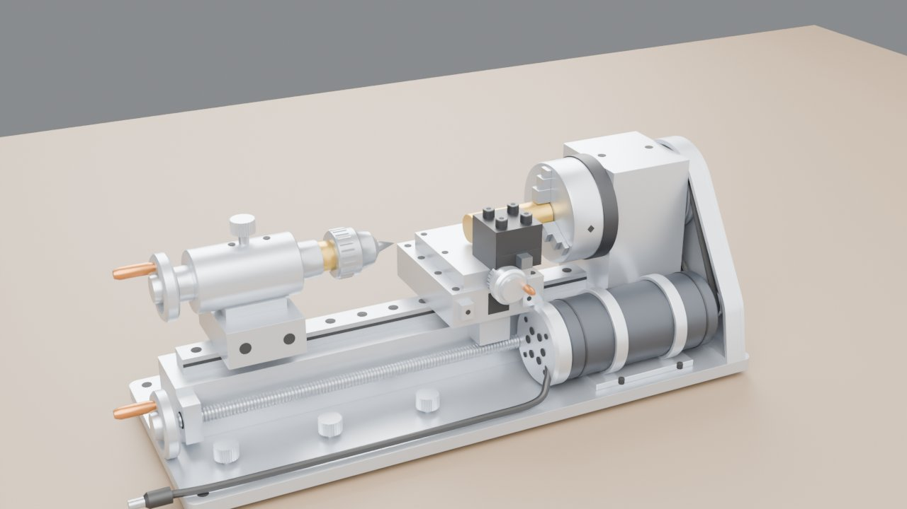
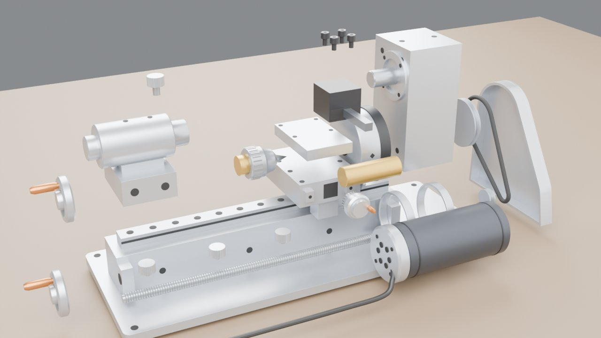

# 迷你车床爆炸图（Blender 脚本建模 + 爆炸图）

一台常见的 8 合 1 迷你桌面金属车床（铝合金底板 + 直线导轨床身，24 V 直流电机皮带传动），照着产品图用 `build_lathe.py` 在 Blender 里全部用代码生成。
没有图纸，尺寸都是按比例估的（见下面「尺寸怎么估的」）。同一份模型导进了虚幻工程 MyVRToyBox，在 VR 里可以拆开、一个个零件拿起来看。

| 装配 | 爆炸 |
|---|---|
|  |  |

## 用法

双击 `启动.bat`，它会依次：

1. `git pull --ff-only origin main` 检查更新（没网或没装 git 就跳过）
2. 找 Blender（`blender_path.txt` → PATH → `Program Files\Blender Foundation\Blender*` → Steam）
3. 后台运行 `build_lathe.py`，几秒钟生成 `output\lathe.blend` 和 `output\lathe.glb`
4. 让你选：**[1]** 用 Blender 打开（按空格播放爆炸动画）/ **[2]** 用 Cycles 渲染装配、爆炸两张预览图 / **[3]** 退出

找不到 Blender 时，把 `blender.exe` 的完整路径写进同目录的 `blender_path.txt`（这个文件不会提交到 git）。支持 Blender 4.2 ~ 5.x。

| 输出（`output\`） | 用途 |
|---|---|
| `lathe.blend` | Blender 工程。第 1~120 帧按拆机顺序拆开，第 150~270 帧反顺序装回 |
| `lathe.glb` | glTF 模型，单位米，每个零件一个节点（`P07_Headstock` …），extras 里有零件号、中文名、材料、作用、爆炸路线。MyVRToyBox 的 `导入车床模型.bat` 用它 |
| `parts.json` | 零件表（39 个零件，29 种） |

## 零件和拆机顺序

先拆刀具和小件，最后抬起主轴箱——和真去拆一台小车床的顺序差不多。

| 顺序 | 零件 | 对象名 | 爆炸方向 |
|---|---|---|---|
| 1 | 刀架压紧螺钉 ×4 | `P16_ToolScrew_*` | 上 |
| 2 | 纵向进给手轮（铜手柄） | `P06_HandwheelZ` | 左 |
| 3 | 四方刀架 + 车刀（车刀再往前抽出） | `P15_ToolPost`、`P17_ToolBit` | 上 |
| 4 | 横向刻度手轮 | `P14_CrossWheel` | 前 |
| 5 | 十字滑台（中拖板） | `P13_CrossSlide` | 上 |
| 6 | 工件（黄铜棒 Φ18） | `P11_Workpiece` | 前 |
| 7 | 大拖板 | `P12_Carriage` | 上 |
| 8 | 三个卡爪（先径向张开）、三爪卡盘 | `P10_Jaw_*`、`P09_Chuck` | 外 → 左 |
| 9 | 尾座锁紧螺钉、钻夹头（含顶尖）、尾座手轮、尾座 | `P21`、`P20`、`P19`、`P18` | 上 / 右 / 左 / 左上 |
| 10 | 皮带罩 → 皮带 → 两个皮带轮 | `P22`、`P23`、`P24`、`P25` | 右 |
| 11 | 直流电机（连电源线） | `P27_Motor`、`P28_PowerCord` | 前 |
| 12 | 丝杠、底板锁紧螺丝 ×3 | `P05_LeadScrew`、`P29_LockKnob_*` | 前 / 上 |
| 13 | 主轴箱（连主轴） | `P07_Headstock`、`P08_Spindle` | 上 |
| — | 底板、脚垫 ×4、床身、直线导轨、电机座 | `P01`~`P04`、`P26` | 不动（基座） |

## 尺寸怎么估的

产品图没给尺寸，只能靠零件之间的比例 + 这类小车床的常见规格：

- **整机长 ≈ 37 cm**：这类 8 合 1 迷你车床的底板一般 35~38 cm，加上左边两个手轮的把手、DC 插头，取 38.8 cm（模型包围盒 388 × 140 × 134 mm）。
- **长 ≈ 高的 2.5~2.9 倍**：图里整机长大约是高度的 2.5 倍，模型是 388 / 134 ≈ 2.9（含把手和插头；只量底板 360 / 134 ≈ 2.7）。
- **卡盘 Φ64**：小车床常配 Φ50~Φ65 的三爪卡盘；图里卡盘直径大约是主轴箱宽度的 1.1 倍。
- **手轮 Φ38**：图里手轮直径约为卡盘的 0.6 倍（38 / 64 ≈ 0.6）。
- **中心高 87 mm**（主轴轴线离底板顶面）：车刀刀尖要对准主轴中心，所以中心高 = 导轨 + 大拖板 + 十字滑台 + 刀架下半截的高度加起来，再留出卡盘半径到底板的余量。
- **电机 Φ48 × 116**：常见 775 直流电机外径约 Φ45~Φ50；皮带轮 Φ48 : Φ18 ≈ 2.7 : 1 减速。

在虚幻里模型按最长边缩放到 50 cm（和电机、球阀、无人机一样），所以 VR 里看到的是 **1.3 倍**的车床。

## 原理速记

- **车削**：工件跟着主轴转，车刀不转、只移动。车刀沿轴线走（纵向进给，摇左边手轮带丝杠）车出外圆；车刀往里进（横向进给，摇刻度手轮带十字滑台）决定车多深。
- **刻度手轮**：一格 0.02 mm。车刀往里进 0.1 mm，工件**直径**小 0.2 mm（两边都被车掉）。
- **皮带减速**：电机皮带轮 Φ18、主轴皮带轮 Φ48，主轴转速 = 电机转速 × 18 / 48 ≈ 0.37 倍，扭矩放大约 2.7 倍。
- **三爪自定心**：三个卡爪背面的螺纹啮合同一个平面螺纹盘，拧一下三个一起进退，所以工件自动对中。
- **刀尖对中心高**：高了刀具后面顶住工件、低了刀尖啃进去，端面中心都会留一个小凸台。

## 建模说明

- 坐标：+X 指向主轴箱（右），-X 指向尾座（左），-Y 是操作者站的正面，+Z 向上；Z = 0 是脚垫底面，主轴轴线在 (Y 0, Z 100)。所有零件直接按装配位置建模，物体原点都在世界原点。
- 爆炸公式和电机、无人机一样：每个零件有几段位移，每段有一个出场时刻 s，在总进度 T 的 `[0.6s, 0.6s + 0.4]` 区间里缓动走完；装回时 T 倒着走，顺序自然反过来。
- 材质金属度封顶 0.8、粗糙度至少 0.3：虚幻工作室里没有反射探针，金属度 1 的镜面铝会反射成黑块。
- 简化了的地方：主轴箱、拖板内部没建（轴承、燕尾导轨、螺母、平面螺纹盘都只体现在外观上）；丝杠的螺纹是一圈圈的环，不是真正的螺旋；皮带是一根圆带。
